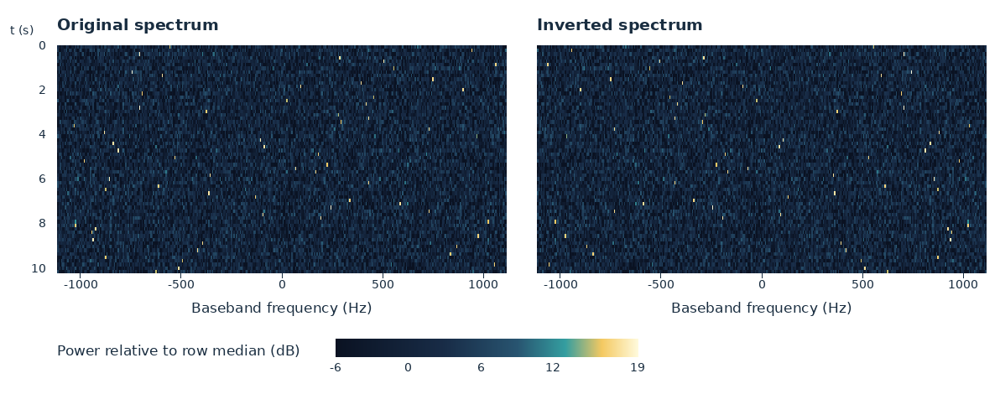

# Waterfall visibility and recovery of a ten-bit word

A complete sideband reversal left the 34 dB waterfall equally bright in both orientations. The original receiver missed every mirrored word in 64 draws. Searching both orientations recovered all 64. A separate fault moved the centre and compressed the spacing of the transmitted tones. A receiver fitting the strongest tone in each row still missed 42 of 48 words at 27 dB although all 48 records crossed the waterfall threshold. Using row pairs to propose a frequency map and checking the entire coded word against the measured spectrum recovered all 48 on a fresh 27 dB panel for each sign. When two damaged tones in each group of eight were much brighter than the rest, the strongest-row and runner-up proposals both failed. Testing every row pair recovered 32/32 at 27 dB on each of three frequency maps. Smaller successes, false admissions and the computational cost appear with their corresponding controls below.

## What the comparisons measure

Each record contains 64 contiguous 160 ms tones, a 10.24 s word at 3,200 complex samples/s. The configured calendar supplies the block ordinal and approximate boundaries. A trial selects one of eight schedule fixtures, a uniform word out of 1,024, a start error of −32 or +32 samples and a common random phase. The intended and other-schedule fixtures use keys `0xaa6218f2` and `0xd3d65011`. The physical synthesizer adds a single unit-gain path to circular complex Gaussian noise with mean sample power one. Each dB value is total received block energy over that noise density. Subtract 10.10 dB to convert it to mean C/N₀ in dB-Hz. Measurements use four-bit input and evidence codes with floating-point native FFTs and wider intermediates. [Waveform, scale estimates and scoring](README.md) · [Native implementation](block_reception.cpp)

The waterfall statistic averages the brightest FFT power divided by the median power in each nominal-time row. No key, word, true frequency, row-by-row path or actual start offset is supplied. It models one instrument's indication within the specified passband. Human visual thresholds and field propagation need their own measurements. All word scores include admission. Each active trial yields one correct word, a wrong word, or an absence. Any word admitted from noise, the other schedule or a carrier independent of the message is false. The waterfall and all applicable receivers see the same record. Variants reusing its word, noise and schedule are paired.

Each experiment fixed its cases, seeds, ranks, sample counts and stopping rule before taking its draws. Ranks below are one-based and require strict exceedance. With exchangeable quiet draws, rank 396 of 399 gives at most 4/400 marginal false admissions for a fresh block, averaged over training. The sum of marginal budgets bounds the union. The quiet holdout measures what happened with the resulting frozen thresholds. Strong occupied inputs have their own distributions. Small signal panels give pointwise evidence. For example, the two-sided 95% Wilson intervals for 64/64 and 0/64 are 94.3–100% and 0–5.7%. The corresponding interval for 48/48 is 92.6–100%.

## Spectral inversion

The transmitter uses signed FFT bins −176 through +175 on a 6.25 Hz grid. Complex conjugation of an entire record reflects both noise and signal about 0 Hz and reverses the keyed phase. At FFT index k the corrected coefficient is the conjugate of the coefficient at −k. This requires the reflected physical edge and guard bins. Reversing 352 array entries by index would reflect about −0.5 bin. Both orientations share all 192 native 512-point FFTs. Each orientation searches the same per-tone widths, alignments, residual carrier hypotheses and six coherent window lengths. Within each family the best standardized score across words and orientations competes. The per-tone decision has priority when both families cross. The oracle receives only the true orientation and uses the same single-orientation cutoffs as the original. [Search dimensions](README.md#coherent-branch-and-protected-per-tone-fallback) · [Paired experiment](orientation_trial.hpp)

The diagnostic training set has 399 quiet blocks. Each soft family gets rank 398 for a total nominal 1% budget. The waterfall uses rank 396 in the symmetric band −178 through +178. The measured cutoffs were 5.61244 and 13.203 for the original per-tone and coherent families, 5.81332 and 13.203 for the two-orientation maxima, and 10.0174 for the waterfall. Source seeds are consecutive from `0x53494401` through `0x53494409` for calibration, quiet, active, wrong schedule, carrier, calendar, parity/timing, independently reset active trials and their phase draws. Active blocks use alternately −0.25 and +0.25 carrier cycles per block, between the frequency hypotheses.

| Block energy | Waterfall visible, either orientation | Original correct, normal / inverted | Known orientation correct | Blind search correct, either orientation | Correct in blind search via per-tone / coherent fallback |
|---|---:|---:|---:|---:|---:|
| 15 dB | 0/64 | 61 / 0 | 61 | 61 | 5 / 56 |
| 18 dB | 0/64 | 64 / 0 | 64 | 64 | 48 / 16 |
| 24 dB | 36/64 | 64 / 0 | 64 | 64 | 64 / 0 |
| 34 dB | 64/64 | 64 / 0 | 64 | 64 | 64 / 0 |
| 44 dB | 64/64 | 64 / 0 | 64 | 64 | 64 / 0 |
| 24 dB, independent phase each tone | 34/64 | 64 / 0 | 64 | 64 | 64 / 0 |

Every active admission in this comparison carried the correct word. On 24, 34 and 44 dB mirrored records the original receiver missed all 36, 64 and 64 visible words respectively. The blind receiver recovered them all. At 18 dB it also recovered every word below the waterfall indication. The 18 and 44 dB observations are 26 dB apart on a fixed grid. They do not locate a continuous sensitivity threshold.

| Independent control | Trials | Visible | False words, original / blind |
|---|---:|---:|---:|
| Gaussian quiet | 400 | 4 | 5 / 4 |
| Other schedule, 44 dB | 64 | 64 | 2 / 2 |
| Unmodulated bin +29, 44 dB | 64 | 64 | 0 / 1 |

The native direct-IQ reference agreed with the shared-FFT scorer on winners and scores in its parity fixtures. A continuous mirrored sequence returned 113, absence, 889, absence, absence and closed at ordinal 4. The single interior absence became an erasure. A missing capture interrupted consecutive quiet. Sixteen timed scoring calls per route on an AMD Ryzen 5 PRO 5650U took 0.10865 s for the original and 0.19788 s for the blind search, about 6.79 and 12.37 ms per block. This measures the 1,024-word fixture after warm-up. It excludes signal generation, rendering, broad unscheduled acquisition and device qualification.



Both panels show word 946 in ordinal 0, active holdout index 0 at 34 dB, with a −32-sample start error. All 22,848 reflected cell powers agreed at the exported precision. Both records gave a waterfall statistic of 49.92. The common color scale clips the display at its endpoints.

## Variable spacing and centre frequency

The independent sample generator programs the signed frequency of each tone as a × x + b, where x is the scheduled signed bin. In the three fixtures (a, b) equals (1, 0), (+0.73, +17.375) or (−0.81, −13.625). Thus b is an offset in 6.25 Hz bins. Each tone keeps its commanded keyed phase. Negative a in this experiment represents a reversed frequency table. The earlier physical-IQ inversion reverses phase as well. The damaged fixture substitutes bin −205 every eighth tone. All cases keep the tone duration fixed. [Native generator, fit and oracle](affine_trial.hpp)

For each candidate word, the blind receiver fits signed slope magnitude 0.5 to 1.1 and an intercept in ±24 bins to the measured strongest bins in the fixed −230 through +230 band. Its score is the maximum of 1 − SSE/Syy on all 64 rows and the 32 rows with the strongest peak-to-median ratios. A sequence of equal peaks has zero frequency variance and supplies no fit. The known-map comparator receives (a, b) and sums capped, median-normalized row powers at each word's nearest predicted bins. It still searches all words and applies presence calibration. The original per-tone comparator searches its six nominal hypotheses. A hybrid gives per-tone priority and spends half its 1% budget on each of the original and blind-fit families.

There are 399 training and 400 holdout quiet blocks, 48 paired draws per signal row, and 48 each for a strong other schedule and an unmodulated line. Seeds `0xaff10001` through `0xaff10005` specify training, quiet, paired signals, wrong schedule and line. Each standalone family and the wider waterfall use rank 396, the hybrid branches rank 398. The known-map comparator gets a separate calibration for each specified map.

The measured standalone per-tone and fit cutoffs were 5.272892 and 0.4949449. The hybrid cuts were 5.822151 and 0.5099857. The waterfall cut was 10.31088. The known-map cuts were 4.793754, 4.882311 and 4.863568 respectively. On 400 quiet holdouts the per-tone, fit and hybrid receivers admitted 3, 6 and 4 false words. The waterfall flagged ten. The respective known-map comparators admitted 3, 6 and 2 false words.

Each receiver column gives correct / wrong admissions from the same 48 blocks. The remainder were missed. At 27 and 34 dB all 48 records in each row were visible.

| Map and energy | Visible | Per-tone | Blind fit | Known map | Hybrid | Hybrid gains / losses versus per-tone |
|---|---:|---:|---:|---:|---:|---:|
| Nominal, 18 dB | 2 | 33/0 | 0/1 | 38/0 | 30/0 | 0/3 |
| Nominal, 27 dB | 48 | 48/0 | 38/0 | 48/0 | 48/0 | 0/0 |
| Nominal, 34 dB | 48 | 48/0 | 48/0 | 48/0 | 48/0 | 0/0 |
| Compressed, 18 dB | 2 | 0/0 | 0/0 | 26/0 | 0/0 | 0/0 |
| Compressed, 27 dB | 48 | 0/0 | 6/0 | 48/0 | 6/0 | 6/0 |
| Compressed, 34 dB | 48 | 4/2 | 48/0 | 48/0 | 48/0 | 44/0 |
| Reversed and compressed, 18 dB | 2 | 0/0 | 0/0 | 29/0 | 0/0 | 0/0 |
| Reversed and compressed, 27 dB | 48 | 0/0 | 6/0 | 48/0 | 5/0 | 5/0 |
| Reversed and compressed, 34 dB | 48 | 0/2 | 48/0 | 48/0 | 48/0 | 48/0 |
| Compressed, 34 dB with eight substituted tones | 48 | 4/3 | 11/0 | 48/0 | 9/1 | 7/2 |

The 34 dB other schedule and unmodulated line each crossed the waterfall threshold on all 48 draws. The original per-tone and blind-fit receivers each admitted one false word from the other schedule. The known-map and hybrid rules admitted none, and all four rules rejected every unmodulated line.

As a noiseless check, centre each scheduled sequence at its first bin and divide all differences by their signed greatest common divisor. This yields a canonical signature under an arbitrary nonzero signed affine frequency change. All 1,024 words had different signatures on each of eight schedules using the first 64 rows or the first 32 rows. The first two rows yielded only one or two distinct signatures. Even within the bounded fit envelope, ordinal 0, word 0's first bins (165, −48) exactly match word 14's (173, −61) under slope 213/234 and intercept 165 − 173 × 213/234. These fixed row footprints differ from the 32 rows selected by noisy peak strengths. Exact real-frequency signatures also omit bin rounding and noise.

## Refinement using pairs of observed tones

The 27 dB misses motivated a separately frozen comparison on new records. The receiver uses up to 16 distinct rows to propose geometry. It takes the eight largest peak-to-median ratios over the block and the strongest row in each of eight consecutive groups. For each candidate word, two proposed rows at least 64 nominal bins apart determine a signed frequency scale and offset. The receiver tests every pair within the physical fit envelope, with at most 120 pairs per word. Every feasible map then scores all 64 rows using the measured 0–15 energy at the nearest predicted bin. This retains evidence from rows where the strongest bin is spurious. It can miss when every suitable proposal pair contains a spurious peak.

The standalone comparison trains 399 quiet maxima and freezes rank 396 for each family and the ±230-bin waterfall. It then evaluates 400 quiet records, 48 records per active cell and 64 each from a strong other schedule and unmodulated line. Seeds are `0xaff20001` through `0xaff20005` in that order. Active cells include the nominal map at 18/27 dB, both distorted maps at 18/24/27/34 dB, and positive compression with eight substitutions at 27/34 dB. The printed elapsed time per block covers IQ quantization, the central FFTs, evidence extraction and the fit with all of its proposals.

| Map and energy, 48 trials each | Visible | Least-squares correct / wrong | Refined correct / wrong | Known map correct | Visible yet missed or wrong, refined |
|---|---:|---:|---:|---:|---:|
| Nominal, 18 dB | 0 | 0/2 | 3/0 | 41 | 0 |
| Nominal, 27 dB | 48 | 25/1 | 48/0 | 48 | 0 |
| Compressed, 18 dB | 1 | 0/2 | 0/1 | 23 | 1 |
| Compressed, 24 dB | 17 | 0/0 | 38/0 | 48 | 1 |
| Compressed, 27 dB | 48 | 7/3 | 48/0 | 48 | 0 |
| Compressed, 34 dB | 48 | 48/0 | 48/0 | 48 | 0 |
| Reversed and compressed, 18 dB | 1 | 0/1 | 0/1 | 26 | 1 |
| Reversed and compressed, 24 dB | 18 | 1/0 | 37/0 | 48 | 2 |
| Reversed and compressed, 27 dB | 48 | 7/0 | 48/0 | 48 | 0 |
| Reversed and compressed, 34 dB | 48 | 48/0 | 48/0 | 48 | 0 |
| Compressed, 27 dB with eight substitutions | 48 | 3/0 | 48/0 | 48 | 0 |
| Compressed, 34 dB with eight substitutions | 48 | 19/0 | 48/0 | 48 | 0 |

The cuts were 0.4905372 for the least-squares fit, 290 for the refined score, 10.26171 for the waterfall and 4.754368 / 4.893102 / 4.787078 for the three known maps. At 27 dB the refined score gained 41 correct words and lost none relative to the least-squares fit on each of the two compressed maps. At 24 dB it still missed one of 17 visible positively compressed words and two of 18 visible reversed/compressed words. At 18 dB each distorted map admitted a wrong word and missed every intended word even though the known-map receiver recovered 23 and 26 respectively.

Three of the 400 independent quiet records were visible. The respective least-squares, refined and nominal-map rules admitted 6, 0 and 10 false words. The other two known-map rules admitted 3 and 5. The 34 dB other schedule and the independent line each yielded 64/64 visible records. The refined score admitted one false word from the other schedule and none from the line. On the local CPU the timed extraction and proposal search averaged 3.34 ms for a quiet control and 2.76–3.55 ms across the active and occupied-control strata. The mean counts of physically allowed proposals ranged from zero for the persistent line to 3,286 for the other schedule. These short measurements include concurrent local work.

## False words at the attended target

The three-family receiver gives priority to the per-tone maximum over both orientations, then the coherent maximum over both orientations, then the affine least-squares maximum. Every usable block gets all three searches. Each family freezes its greatest score on 39,999 independent training blocks. This assigns each at most 1/40,000 marginal false admissions under the quiet calibration law. Their union is bounded by 3/40,000, averaging over training. For the comparison, the original receiver gets the second-highest training score per single-orientation family, giving a marginal union bound of 1/10,000. The diagnostic waterfall uses its 39,600th score for 1% visibility in the ±178-bin band. [Training and integrated decision](fault_admission.hpp)

The distinct fixed-threshold endpoint is a one-sided exact 95% upper bound of 10⁻⁴ per quiet block on 30,000 independent holdouts. At this holdout size it requires zero false words. Training, quiet, paired active draws, wrong schedule, carrier and mixed-calendar seeds are `0xfcad1001` through `0xfcad1006`. The single-path cases use 64 matched trials at 15, 18 and 34 dB, both orientations. Both compressed maps are tested at 34 dB. The other schedule and independent carrier are tested at 34 and 44 dB. Active, occupied-control and quiet histograms retain their own denominators. Six local workers generate and score independent quiet draws. Their campaign elapsed time describes experiment turnaround.

**The three-family receiver missed the fixed-threshold endpoint.** It admitted one false word in 30,000 Gaussian quiet blocks, through the affine fit. The exact one-sided 95% upper bound was 1.58119 × 10⁻⁴. The original single-orientation receiver also admitted one quiet block. The diagnostic waterfall flagged 267. These rates apply to the frozen receiver and eight-schedule Gaussian mixture. The run took 285.56 s on the local CPU. The single-orientation per-tone/coherent cuts were 7.0448336393 / 16.1995798184. The two-orientation per-tone/coherent and affine cuts were 7.19071340422 / 17.9755089077 / 0.679820845044. The diagnostic waterfall cut was 9.9517550479.

| 64 paired active trials per row | Visible | Original correct | Known orientation correct | Three-family correct | Admitted through affine fit |
|---|---:|---:|---:|---:|---:|
| Original spectrum, 15 dB | 0 | 46 | 46 | 35 | 0 |
| Inverted spectrum, 15 dB | 0 | 0 | 46 | 35 | 0 |
| Original spectrum, 18 dB | 1 | 64 | 64 | 64 | 0 |
| Inverted spectrum, 18 dB | 1 | 0 | 64 | 64 | 0 |
| Original spectrum, 34 dB | 64 | 64 | 64 | 64 | 0 |
| Inverted spectrum, 34 dB | 64 | 0 | 64 | 64 | 0 |
| Compressed and shifted, 34 dB | 64 | 0 | — | 64 | 64 |
| Reversed, compressed and shifted, 34 dB | 64 | 0 | — | 64 | 62 |

All visible intended words in this panel were admitted correctly by the three-family receiver. The remaining intended decisions were absences. On the original 15 dB signal the tighter combined rule lost eleven correct admissions. The combined and original receivers admitted zero of the 64 independent other-schedule or carrier blocks at each of 34 and 44 dB. Each of the four occupied controls was visible on 64/64 trials. The mixed continuous stream delivered 319 with compressed spacing, then 715 under physical inversion, followed by two scored quiet periods. It closed only on the second quiet period.

## Allocating a fourth search at the attended target

Two alternatives each take the remaining 1/40,000 marginal budget. The gated alternative runs the pair-based refinement only after the three searches miss and the ±178-bin waterfall exceeds its largest training value. It then uses the independently frozen diagnostic score cutoff of 290. The direct alternative scores the pair-based refinement on every usable block and applies its own maximum over the 39,999 quiet training blocks as the cutoff. In both rules, a previously accepted word retains priority. The gated rule can miss recoverable weak signals that fall below the waterfall gate. The direct rule spends more computation on quiet and uses a stricter word threshold. The two alternatives are evaluated individually with the same first three searches.

The initial central-FFT replay used the original training and holdout seeds for a matched comparison with the measured quiet count. It recomputed full decisions on every holdout that could add an admission, verified the shared observer and checked the precision of the printed original cutoffs. The integrated command regenerates these statistics and fits the cutoffs directly. Results on these 30,000 quiet records are paired re-evaluations. The middle-strength follow-on uses fresh `0xfcad1008` draws, 64 words each on both distorted maps at 24 and 27 dB and on positive compression with eight substitutions at 27 dB. For local service timings, each policy processes the same 17 consecutive captured blocks per stratum, including an initial warm-up. It retains the oldest-to-newest order and records the 16 scored intervals after warm-up, with stream and transmit seeds `0xfcad1009` and `0xfcad1010`. The timed path includes input coding, searches, admission and calendar update. The first service implementation repeated the central FFT and evidence extraction for its fourth family. Supplying prepared IQ excludes source preparation and audio I/O. [Integrated calibration and service driver](fault_admission.hpp)

The maximum training waterfall was 10.431464751805. The maximum training pair-based word score was 314, above the diagnostic 290. Neither fourth-family rule added any Gaussian false words. Both complete decisions retained the earlier affine false admission, yielding 1/30,000 and an upper 95% bound of 1.58119 × 10⁻⁴ each. All 69,999 calibration and quiet holdout records had complete required central rows. In the 34/44 dB other-schedule tests, the gated receiver admitted 1/64 and 5/64 false words. The direct receiver admitted 1/64 at each level. Neither admitted an unrelated constant line in either 64-record control. These counts illustrate why trials with strong traffic belong alongside Gaussian quiet.

| Distortion, 64 paired trials each | Visible at the 1% observer cut | Original three families correct | Gated policy correct, all / visible | Direct policy correct, all / visible |
|---|---:|---:|---:|---:|
| Compressed, 24 dB | 25 | 0 | 1 / 1 | 56 / 25 |
| Reversed and compressed, 24 dB | 22 | 0 | 2 / 2 | 52 / 21 |
| Compressed, 27 dB | 64 | 1 | 63 / 63 | 64 / 64 |
| Reversed and compressed, 27 dB | 64 | 2 | 64 / 64 | 64 / 64 |
| Compressed, 27 dB with eight substitutions | 63 | 0 | 62 / 62 | 64 / 63 |

All active admissions in these rows were correct. Gating restricted the positive and negative 24 dB cases to one and two trials respectively. The direct search recovered 55 and 50 more words at the same block energies. It recovered all 25 visible positively compressed words and 21 of the 22 visible reversed/compressed words. Each policy preserved the original intended outcomes at 15 and 18 dB for an undistorted or fully conjugated transmitter and at 34 dB for all four corresponding ordinary or distorted cases. Across the intended cases monitored here, the least-squares route supplied no correct decision uniquely beyond the direct pair-based metric and the earlier soft families. A replacement chosen after examining these cases can keep the applicable frozen cutoffs. A fresh holdout would measure its false-admission risk independently of that choice.

| Initial implementation, 16 consecutive timed blocks | Gated median / max ms | Direct median / max ms | Extra scorer calls, gated / direct |
|---|---:|---:|---:|
| Gaussian quiet | 15.01 / 16.30 | 17.37 / 19.37 | 0 / 16 |
| Other schedule, 34 dB | 14.09 / 16.07 | 13.74 / 14.59 | 16 / 16 |
| Compressed intended word, 27 dB | 13.43 / 14.88 | 13.59 / 15.54 | 15 / 16 |

These are short local serial service measurements on the stated ten-bit fixture. All times were well within 10.24 s per block. Bright unrelated traffic invoked the gated scorer on every block and consumed its full recurring cost. Neither this panel nor the parallel calibration measures the much broader search in the FSK draft.

An early implementation gave an unobservable central row the same sentinel as a measured, zero-variance ridge. Two missing-row blocks could then end an active message. The corrected combined decision checks the availability of every required row independently of whether a fit wins. The regression removes all 512 samples of nominal row 23 from an otherwise valid quiet capture (seed `0xfcad1007`), verifies an unscored result, then requires two newly consecutive quiet blocks to close. A complete constant ridge may yield a scored absence. The replay passed the missing-row, calendar and shared-observer parity checks.

## When the strongest tones are damaged

On the positively compressed map, replace one tone in every group of eight by bin −205 at the ordinary tone power, then at 15 dB above that power. The other 56 tones retain their original power, time, frequency and phase. Increasing the power in eight substituted tones raises total energy by 6.8375 dB above the 27/34 dB intact-block reference, while the useful 56 tones have 56/64 of the original block energy. This tests whether high-energy damage monopolizes the rows that propose frequency maps. The ±230-bin observer includes the substituted frequency. Actual ±32-sample timing offsets allow leakage into adjacent nominal rows.

On the same samples, form a second set of eight proposal rows by choosing the **second** highest peak-to-median ratio within each consecutive group of eight. This adds at most 28 pairs per word and uses the same signed fit constraints and 64-row soft score. The expanded score takes the larger maximum over the old and new proposal sets, breaking ties in favour of the original. Fresh seeds `0xaff30001` through `0xaff30005` specify 399 calibration blocks, 400 quiet, 48 paired active draws in each of six cells, and 64 each of wrong-schedule and constant-carrier controls. The rank-396 cutoffs were 281 for the original and 289 for the expanded score. The fixed older score cutoff of 290, waterfall cutoff of 10.26171, least-squares cutoff of 0.4905372 and oracle cutoff of 4.893102 were also tested.

| Reference energy and replacements | Visible / 48 | Least-squares correct, strongest 32 / all 64 rows | Original proposals correct | Expanded proposals correct | Known map correct |
|---|---:|---:|---:|---:|---:|
| 27 dB, intact | 47 | 6 / 0 | 48 | 48 | 48 |
| 27 dB, eight at ordinary power | 48 | 1 / 0 | 48 | 48 | 48 |
| 27 dB, eight at +15 dB | 48 | 1 / 0 | 0 | 48 | 48 |
| 34 dB, intact | 48 | 48 / 48 | 48 | 48 | 48 |
| 34 dB, eight at ordinary power | 48 | 8 / 15 | 48 | 48 | 48 |
| 34 dB, eight at +15 dB | 48 | 5 / 14 | 0 | 48 | 48 |

The two high-power rows provided a direct explanation. In each 48-record stratum, all 384 selected original rows fell at substituted source positions. None of the 384 group-runner-up rows did. The expanded rule gained 48 correct words and lost none at each reference energy. Neither proposal-based rule admitted a wrong intended word at any tested level. The strongest-32 least-squares fit admitted one wrong intended word in the 27 dB high-power case.

Of 400 quiet blocks, six were visible and the original/expanded rules at their paired cutoffs admitted 6/3 false words. The original rule at 290 admitted two. All 64 high-power other-schedule controls were visible. The expanded search admitted two false words and the original search admitted zero. All 64 constant-carrier controls at the same total energy were visible, and both rules admitted none. This diagnostic has a separate 1% calibration. The original three- and four-family decisions above used the strongest-row proposal set. Several strong contaminants in the same eight-tone group can corrupt its second choice as well.

## Testing every pair of rows

The next experiment uses all 2,016 pairs of the 64 observed row maxima for every candidate word, retaining the same sign, spacing and centre constraints and the same 64-row soft score. There are at most 2,064,384 pair tests per record before geometry pruning. A pair needs at least 64 bins of nominal separation. The front end and public word set stay fixed. This removes the cap on how deeply to look down the list of rows. Each row still proposes only its strongest frequency, so a second strong line inside every row can deprive this search of the true geometry.

Two measured integer bin coordinates define a rational map. For nominal bins x₁ and x₂ and measured bins y₁ and y₂, let D = x₂ − x₁ and N(x) = y₁D + (y₂ − y₁)(x − x₁). Normalize the signs so D is positive. The intended bin is floor(N(x)/D + 1/2), including for negative frequencies. A floating-point evaluation of the map could round the exact half-bin −5.5 down to −6, and a second floating comparison could reject an exact intercept of −24 at the permitted boundary. The corrected implementation checks slope and intercept inclusively with integers and uses a bounded Q20 index that agrees with exact division on this lattice. It matched rational nearest-bin indices in 50,534,452 cases. At 44 dB the four endpoint slopes (±0.5, ±1.1) crossed with the two endpoint offsets (±24 bins) selected the correct word on all 16 IQ records (two seeded draws per corner). All eight corner configurations reached the maximum soft score of 960. This strong boundary check measures word selection before quiet calibration.

Use 399 independent quiet training blocks, 400 quiet holdouts, 32 new paired words per cell and 48 each of wrong-schedule and equal-total-energy carrier controls, with seeds `0xaff40001` through `0xaff40005`. The 18 signal cells cross the three maps, 24/27 dB intact reference and zero/one/two substitutions per eight-tone group at +15 dB. Two substituted tones occupy the first two rows of each group at bin −205, leaving 48 ordinary tones. The cutoff is rank 396 for each of the original strongest-row, expanded runner-up and all-row pair searches, the three known-map comparisons and the ±230-bin visibility statistic. Per-record wall time measures shared extraction and each search separately on the first eight quiet and eight two-substitution, positively compressed 27 dB records. Agreement of the shared pass with separate banks is checked on those records.

Each table cell gives counts for zero / one / two substitutions per group, out of 32 transmissions at each setting. The known-map receiver recovered all 32 words in each of the 18 cells. All intended admissions in the three blind searches were correct. One and two boosted replacements per group raise total block energy by 6.8375 and 9.3730 dB respectively compared with the intact reference.

| Map and intact reference | Visible, 0 / 1 / 2 | Strongest rows correct | Plus runner-up rows correct | All row pairs correct |
|---|---:|---:|---:|---:|
| Nominal, 24 dB | 13 / 32 / 32 | 31 / 0 / 0 | 31 / 29 / 0 | 32 / 32 / 32 |
| Compressed, 24 dB | 3 / 32 / 32 | 27 / 0 / 0 | 28 / 20 / 0 | 32 / 32 / 31 |
| Reversed and compressed, 24 dB | 5 / 32 / 32 | 27 / 0 / 0 | 27 / 21 / 0 | 32 / 32 / 30 |
| Nominal, 27 dB | 32 / 32 / 32 | 32 / 0 / 0 | 32 / 32 / 0 | 32 / 32 / 32 |
| Compressed, 27 dB | 32 / 32 / 32 | 32 / 0 / 0 | 32 / 32 / 0 | 32 / 32 / 32 |
| Reversed and compressed, 27 dB | 31 / 32 / 32 | 32 / 0 / 0 | 32 / 32 / 0 | 32 / 32 / 32 |

At 24 dB with two substitutions per group, the all-pair search missed one visible positively compressed word and two visible reversed/compressed words. At 27 dB it recovered all 32 in each geometry despite failure of both smaller banks with two substitutions. These are separate paired strata, so pooling the 32-word results would overstate precision. A cell with 32/32 correct has a pointwise 95% Wilson interval of 89.3–100%.

The corrected cutoffs were 283/286/303 for the three blind searches, 4.971002/4.815732/4.906370 for the known maps, and 10.29115 for visibility. On 400 quiet controls the respective blind searches admitted 2/2/1 false words. Two quiet records were visible, and the positive-map oracle admitted five false words. With two boosted substitutions in the other schedule, all 48 records were visible and all three blind searches rejected all 48. The known-map receiver admitted two false words. All receivers rejected every word on the matched-energy constant carrier, although all 48 were visible.

The corrected 64-row search averaged 60,782 admissible maps per quiet block. On the positive 27 dB case with two substitutions it averaged 47,178. During concurrent local experiments, the eight-record timing checks measured extraction at 1.98 ms on quiet and 2.46 ms on the distorted case. The original, expanded and all-pair scoring steps then took 1.03 / 1.66 / 31.52 ms on quiet and 0.58 / 1.01 / 34.37 ms on the distorted case. These short component timings depend on competing CPU work. The integrated service panel measures the actual combined decision.

Before the exact-bin correction the respective diagnostic cutoffs were 281/285/302, and the strongest-row and expanded banks each admitted three quiet controls instead of two. All active correct/wrong/missed counts in the three standalone pair-based experiments survived the correction. In the contamination test the runner-up set became the winning accepted proposal on one additional 27 dB intact record and one additional 27 dB equal-power substitution record, with the same decoded words.

Keeping exactly 64 observed rows and enumerating 24-bit words would require 2,016 × 2²⁴ = 33,822,867,456 pair tests on one frequency/time geometry before rejection. That is 16,384 times the ten-bit count. This arithmetic identifies the cost of the tested enumeration. The wider code geometry, a more efficient search, and complete target-device service would each need separate evidence.

## Integrated comparison using exact bin selection

The final comparison uses the original 39,999 calibration and 30,000 quiet holdout seeds. It tests four alternative ways to spend the same final 1/40,000 budget. They are the waterfall-gated strongest-row rule, directly calibrated strongest-row rule, directly calibrated expanded rule including group runner-up rows, and directly calibrated all-pair rule. Each direct cutoff is the maximum training score of that entire search, including every message and proposed map. A single physical record and the same three primary families serve all alternatives. Each four-family outcome retains the per-tone, coherent and least-squares priority order. The rank budgets cover each policy separately. All four policy comparisons share the same quiet records.

The integrated scorer obtains the required soft energy table for all direct policies on the central FFT aperture it already visits. The gated comparator builds its extra central table only when it runs the extra search. The full experiment recomputes primary and alternative statistics directly from IQ. The earlier output counts describe stages of development and paired checks. Repeating those draws leaves the independent holdout size at 30,000. The additional occupied panels use `0xfcad1011` for intended transmissions, `0xfcad1012` for a corrupted other schedule and `0xfcad1013` for a carrier matched to the high-power 34 dB fixture's total energy.

**All four policies missed the prespecified fixed-threshold quiet endpoint.** The exact-bin training maxima were 10.431464751805 for the waterfall and 314 / 315 / 333 for the original / expanded / all-pair scores. Every required central row was usable across all 69,999 records. None of the four additional families crossed on the 30,000 quiet holdouts. Each complete receiver retained the one false word from the three-family decision (95% exact upper bound 1.58119 × 10⁻⁴). For the 34/44 dB other schedule, the gated rule admitted 1/5 false words, the original direct and expanded rules each admitted 1/1, and the all-pair rule admitted 0/2, with 64 blocks at each level. No rule admitted a word from either constant-carrier control.

On each spectral orientation at 15 dB all four policies admitted 35 correct words, zero wrong words and 29 absences, compared with 46/64 correct for the receiver given the orientation. At 18 and 34 dB each policy recovered 64/64 on both orientations. On the two 34 dB compressed-frequency cases with intact tone sequences each recovered 64/64. The table counts correct admissions on the same distorted signals.

| 64 trials per cell | Waterfall visible | Gated correct | Strongest-row direct correct | Expanded direct correct | All pairs direct correct, all / visible |
|---|---:|---:|---:|---:|---:|
| Compressed, 24 dB | 25 | 1 | 56 | 56 | 64 / 25 |
| Reversed and compressed, 24 dB | 22 | 2 | 52 | 57 | 64 / 22 |
| Compressed, 27 dB | 64 | 63 | 64 | 64 | 64 / 64 |
| Reversed and compressed, 27 dB | 64 | 64 | 64 | 64 | 64 / 64 |
| Compressed, 27 dB with eight equal-power substitutions | 63 | 62 | 64 | 64 | 64 / 63 |

An independent 64-word panel with positive compression checked stronger substitutions. For eight ordinary-power substitutions at 27 dB, 64 were visible and the four policies recovered 61 / 63 / 64 / 64 respectively. Increasing those eight substitute tones by 15 dB produced 64 visible records and **0 / 0 / 64 / 64** correct words at both 27 and 34 dB intact reference energy. With sixteen boosted substitutions the results were **0 / 0 / 0 / 64** at both reference energies. The all-pair receiver recovered all 63 visible words at 27 dB and all 64 at 34 dB. The remaining 27 dB word was recovered below the narrow waterfall threshold. Every active admission in the panel was correct. The corresponding boosted other-schedule controls and same-total-energy carriers at 34 dB each yielded zero admissions across all four policies on all 64 blocks.

In the continuous all-pair test (seed `0xfcad1014`), word 617 started under positive compression with sixteen boosted substitutions. The three original families and both smaller pair selections supplied no admission. Its all-pair score of 604 crossed 333. The next transmitted word, 217, was fully extinguished. Inverted word 429 resumed the episode and the receiver retained one erasure. The next two scored quiet periods closed it at ordinal 4. Word 785 then reopened reception at ordinal 5. The integrated run reproduced the mixed-calendar and missing-row checks as well. Its 27 active and control result rows agreed with the earlier floating-map run on the same records. That comparison checks implementation consistency and supplies no further trials.

| Serial local service, 16 consecutive blocks after one warm-up | Gated median / max ms | Strongest direct median / max ms | Expanded direct median / max ms | All pairs median / max ms |
|---|---:|---:|---:|---:|
| Quiet | 11.43 / 11.70 | 12.97 / 13.66 | 12.94 / 13.34 | 31.60 / 36.68 |
| Other schedule, 34 dB | 13.79 / 14.51 | 12.17 / 12.69 | 12.65 / 12.95 | 32.50 / 41.00 |
| Compressed, 27 dB | 13.91 / 14.21 | 12.92 / 13.73 | 13.32 / 14.66 | 31.63 / 32.82 |
| Eight boosted substitutions, 34 dB | 13.63 / 14.78 | 14.73 / 16.09 | 13.48 / 14.35 | 33.88 / 35.92 |

The gated rule called its extra scorer on 0, 16, 15 and 16 blocks in the four rows respectively. Each direct policy called it on every record. Across these four short streams the largest observed all-pair interval was 41.002 ms for a 10.24 s record. This measures the bounded ten-bit CPU receiver with same-stream calendar commits, warmed schedule fixtures and the finite search geometry above. Broader acquisition and 24-bit capacity remain open.

## Reproduce

From the repository root, build once with GCC 14.2.0 or a compatible C++20 compiler. These runs used the native CPU FFT and scoring on a Ryzen 5 PRO 5650U with 15,677,412 KiB of system RAM visible (14.95 GiB). The base revision was `c5f8e306`. Relative frequencies, schedule keys, search grids, seeds and cutoff ranks are fixed in the checked-in sources. All runs were local with zero cloud spend.

```sh
g++ -std=c++20 -O3 -Wall -Wextra -Wpedantic -pthread -Isrc -Iinclude \
  _appraisal/algorithms-matrixModem/block-reception/block_reception.cpp \
  src/search_fft.cpp -o /tmp/matrix-block-reception
/tmp/matrix-block-reception --orientation
/tmp/matrix-block-reception --affine
/tmp/matrix-block-reception --affine-refine
/tmp/matrix-block-reception --fault-admission
/tmp/matrix-block-reception --fault-refinement
/tmp/matrix-block-reception --affine-contamination
/tmp/matrix-block-reception --affine-all-pairs
```

The figure uses the first 34 dB active orientation record. The native binary exports per-row powers. Python with Pillow and the DejaVu Sans fonts renders them.

```sh
/tmp/matrix-block-reception --orientation-waterfall | \
  python3 _appraisal/algorithms-matrixModem/block-reception/plot_waterfall.py /tmp/matrix-waterfall.png
python3 _appraisal/algorithms-matrixModem/coherence-limits/visible_carrier.py
```

The [fault-envelope supplement](../../../_ref/algorithms-matrixModem/fsk-visible-signal-recovery.md) relates these results to field evidence and defines what a recoverability claim must cover. The [finite-energy calculation](../coherence-limits/results/visible_carrier.txt) gives a different limit when the transmitter emits a bright carrier and very little energy depends on the payload.

The scope here is a captured, linear complex baseband with valid passband guards, a known ordinal, fixed symbol duration, a finite timing grid and bounded search work. The plots and recovery counts do not cover a lost epoch, arbitrary changes in tone frequency within a word, deep frequency-selective nulls, repeated RF retunes, simultaneous images, strong impulsive interference or long-term sample-clock drift. The older [continuous-stream experiment](README.md#original-six-hypothesis-bank) still closes on two completely extinguished transmitted blocks because their observed samples have the same law as quiet.

Keep the fixed seeds, receiver rules, measured counts, figure, assumptions and theoretical calculation with this experiment so its positive and negative findings can be checked. Compiled probes, exported cell tables, per-draw scores, intermediate calibration arrays and complete console logs are temporary. They served to compare the FFT implementations, trace discordant blocks and verify the summarized counts. Remove these outputs after the checks and documentation are reconciled. A future check can regenerate them from the commands above.
