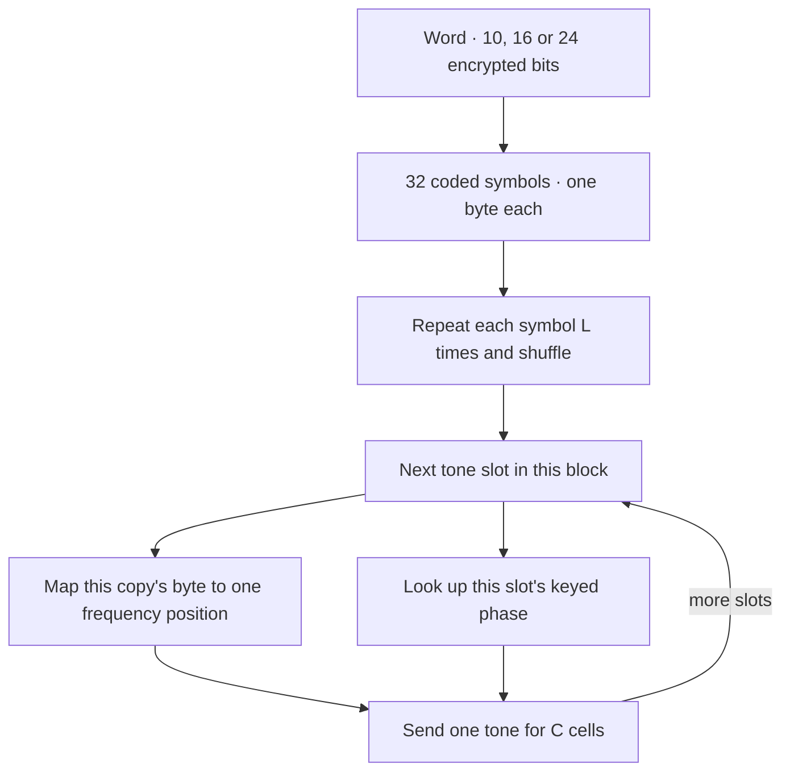
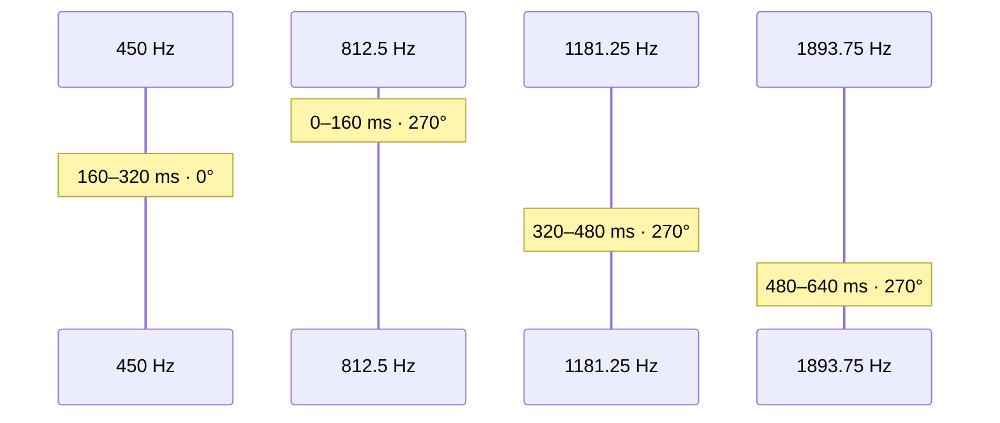
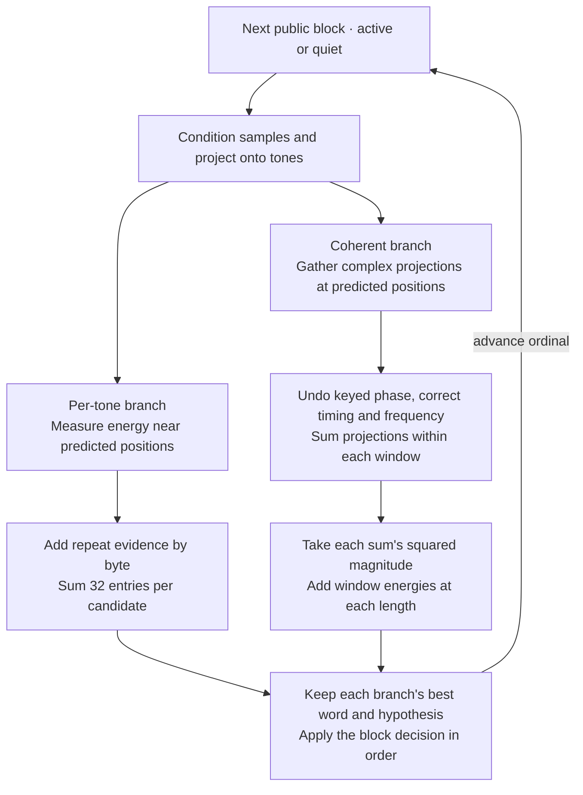
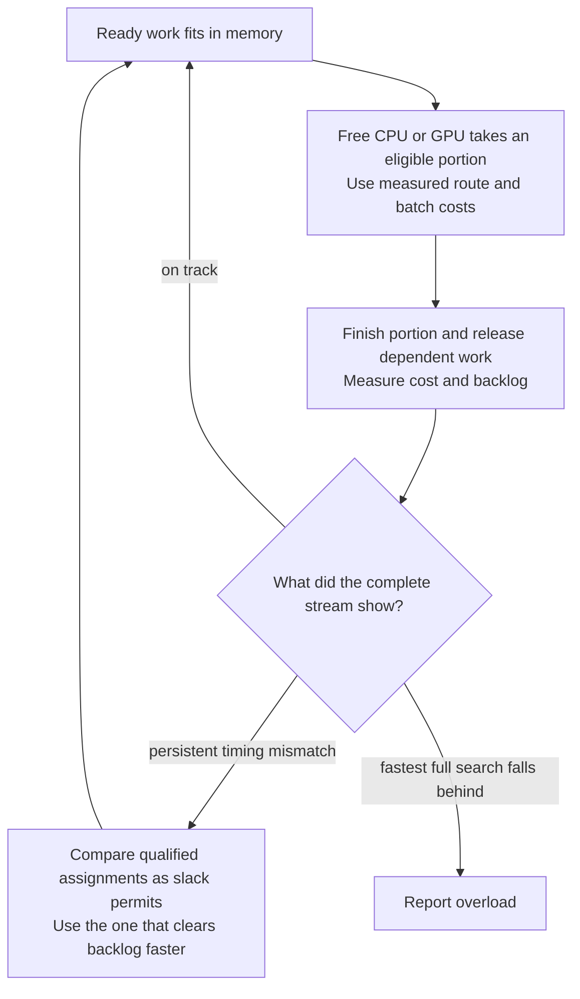

# Matrix Modem FSK specification

**One tone at a time.** Frequency-shift keying (FSK) carries one short word in a sequence of frequency choices. A shared schedule tells the receiver where each possible word would put its tones and what phase each tone would start with on HF. The receiver scores every candidate on the same samples in two ways. It can use the energy at the predicted frequencies even when the path spoils the phase relationship between tones.

This is a draft for a standalone modem. A native ten-bit HF experiment exercises a configured calendar with hopping off and reproducible test schedules. Wire interoperability, field sensitivity and sustained service for the full search remain open. [Implementation status](algorithms-matrixModem/block-reception/README.md#implementation-status) · [Research and measured limits](../_ref/algorithms-matrixModem/fsk-reconciliation.md)

## Reading the transmit format

| Term | How to read it |
| --- | --- |
| Block and symbol | A **block** is one calendar interval for a word. A **symbol** is one of its 32 coded bytes. |
| Cell, position and tone | The **cell** sets the clock and grid spacing. A **tone** sounds at one frequency **position** for one or more cells. |
| Hop | With frequency hopping (FHSS), a **hop** is the radio's stay on one hop frequency, including its quiet edges. Several tones can fit inside it. |
| Coherent window | The receiver chooses a span over which to add phase-aligned observations. Trying another window length uses the same transmission. |

### Four tones from one HF block

Time runs **down** and frequency increases **to the right**. Each box marks the one frequency that sounds for those 160 ms and its keyed phase offset. This is the start of a native ten-bit test block (word 173, ordinal 0, hopping off). The diagram shows the four used audio centres.

At 480 ms the frequency changes and the keyed phase stays at 270°. To add these tones coherently, the receiver first measures each at its own frequency. It rotates the three 270° observations back by a quarter turn (+90°) and leaves the 0° observation alone. On the flat, noiseless test path all four then point in the same direction. Their complex sum has four times the magnitude of one observation, even with an unknown common path phase. [Native trace and reproduction](algorithms-matrixModem/block-reception/README.md#four-tone-format-example)

## Waveform profiles

Use one full-power, constant-amplitude tone per flat interval. Only frequency position carries data. Choose integer scale `j ≥ 0`, cell duration `T = 0.160 × 2^j` seconds and `N ≥ 2` positions. Position `n` has centre `f₀ + n/T`, counting from zero. Hold it for `C ≥ 1` whole cells.

| Setting | HF | Below 9 kHz |
| --- | --- | --- |
| Cell and spacing | `j = 0` gives 160 ms and 6.25 Hz. | `j = 3` gives 1.28 s and 0.78125 Hz. Alternatives are 2 and 4 for `j`. |
| Frequency grid | Default 352 positions from 450 to 2643.75 Hz (2.2 kHz grid). Up to 448 positions in 2.8 kHz. | 16 positions in a 12.5 Hz nominal grid at `j = 3`. |
| Tone length | One or more cells. | Eight cells (10.24 s at `j = 3`), alternatively one or 32. |
| Hopping | Optional. Reference hop 0.4 s, alternate 40 s for one-cell tones. | Off. |
| Keyed phase | Apply the new offset at the tone boundary. | Change position at the boundary. Move linearly from the previous phase to the new phase over the first 80 ms of the tone, alternatively 160 ms. Use the shortest rotation with keyed direction for a half turn. |
| Frequency reference | Configured oscillator uncertainty. | Both ends GPS-locked. Log corrections or retime audio from the pulse-per-second reference. |

Choose each keyed offset from {0°, 90°, 180°, 270°} independently of payload and position. With hopping off, keep tones contiguous without amplitude ramps or guards. Carry forward the phase accumulated at the band origin `f₀`. Relative to that origin each grid position completes an integer number of cycles per cell. Below 9 kHz the receiver follows the phase ramp inside the tone.

With hopping on, retune during quiet. At the reference HF setting a 0.4 s hop contains, in order, **20 ms quiet · 20 ms amplitude ramp up · 320 ms flat · 20 ms amplitude ramp down · 20 ms quiet**. The amplitude ramps are raised cosines. Longer reference hops use 60 ms quiet at each edge and the same 20 ms ramps. Target 26 dB out-of-band attenuation relative to mean in-band power with a specified filter, measurement bandwidth and averaging interval. [Hop and phase definitions](../_ref/algorithms-matrixModem/fsk-design-study.md#43-hop)

## Block coding and calendar

1. Configure the profile and clock-derived calendar at both ends. Transmission uses no feedback or length fields. For each encrypted word `c` of `k ∈ {10,16,24}` bits, form 32 coded bytes `vₛ = Gₛc XOR mₛ` using keyed `8 × k` binary matrices and byte masks.
2. Schedule exactly `L ≥ 1` copies of each coded byte in shuffled order. Redraw the placement map for each of the `32L` tones. With `N ≥ 256`, the first 256 entries of a keyed permutation give each byte its own position. On smaller grids use an agreed pool of `P = 2^floor(log₂ N)` positions, `256/P` bytes per position, and `L ≥ ceil(8/log₂ P)`. A single observation can then represent several bytes. Distinguish candidates by their whole sequence of positions. [Codeword checks after erasures](../_ref/algorithms-matrixModem/fsk-code-identifiability.md)
3. Without hopping, a block lasts `32LCT`. With hopping, let `q = floor(flat cells per hop / C)` be the number of whole tones that fit. Require `q ≥ 1` and `L ≥ q`. A block uses `ceil(32L/q)` whole hop periods. Leave residual cells and unused slots in the final hop idle.

For the HF example, `L = 2` and `C = 1` give 64 tones in **10.24 s**. With the reference 0.4 s hop the same tones occupy 32 hops or **12.8 s**. Below 9 kHz, `N = 16`, `L = 2`, `C = 8` and `j = 3` also give 64 tones, but one block takes **655.36 s**. These durations cover one word. Physical completion uses the next two scored quiet blocks.

## Keys and addressing

Before coding, XOR the payload with AES-256-CTR and Serpent-256-CTR keystreams, preserving bit count. Use separate AES-256 purposes for symbol order, matrices, masks, placement, hops and phase. Address by epoch, ordinals and nominal shift rounded to the configured multiple of 10 Hz. Retunes and measured corrections preserve that address. [Key interface and unresolved wire details](../_ref/algorithms-matrixModem/fsk-reconciliation.md#integration-and-profile-selection)

## Receiver search

**Input and search coverage.** Use fixed gain and a linear guarded passband with radio blanking and noise reduction off. Translate and filter 48 kHz real audio to 3,200 complex samples/s. Allow wider qualified capture for offsets, spread and transitions, or filtered 400 samples/s at `j = 3`. Estimate component noise scale `σ` from the lower quartile of complex power under circular Gaussian noise. Round I/Q at `0.45σ` and erase a sample if either component code is nonfinite or outside −7…+7.

Search every word and every applicable configured timing, frequency-offset, drift and spread hypothesis on the selected sideband, including after a miss. The data search runs without pilot lock or a visible trace. Helper may independently narrow it. Fault searches require explicit selection and preserve ordinary sensitivity, false-word performance and capacity when off.

**Projections.** Match rectangular apertures to the tone, including intermediate frequencies for held tones and the configured phase ramp. The timing step is one eighth of the phase interval (one tone here). For coherent timing use `1/(8 × band span)` where finer. For a coherent window of duration `U`, use frequency step `1/(2U)`. Correct signed-frequency phase, samples entering and leaving a shifted window, clock slip and intra-window drift, or qualify the mismatch. [Timing coverage and cost](../_ref/algorithms-matrixModem/fsk-timing-coverage.md)

| What the receiver combines | Rule |
| --- | --- |
| Per-tone energy | For each block try a single bin and Gaussian full-2σ spread widths 10/30/60/120/250/500 Hz. Sum weighted bin energies, using one spread hypothesis across the block. Normalize by time and frequency medians, using surrounding noise bins for small grids. Weight each hop by inverse noise and erase unusable hops. Combine its tones at a common offset before marginalizing that offset. Clip at 4–8 times the noise mean and quantize to 0…15. |
| Complex tone projections | For one candidate and one timing/frequency trajectory, let `zₜ` be its corrected complex projection for tone `t`. Within each window, add the projections first and then take the squared magnitude. At a given window length, add those energies across windows, including the actual exposure of a final partial window. The receiver also evaluates shorter within-tone windows where configured. |
| Window lengths | Without hopping the longest coherent span is the block. With hopping it is the active part of one hop, since a retune can introduce an unknown phase. Add energies across hops. On HF subdivide to the configured shortest window (target 1/64 block, limited by the hop). Below 9 kHz use cells within tones, per-tone energy, then two-tone windows doubling up to the block. |

**Why keep both branches?** Two corrected projections of `+1` and `−1` contribute zero to a long complex sum, yet each carries unit energy. Undoing the keyed phase leaves any phase difference imposed by the path. A shorter window can help if it separates opposing contributions. If the path removes the energy at all used positions, both branches lose it. [Static two-path example](../_ref/algorithms-matrixModem/fsk-lattice-validity.md#when-the-tones-survive-but-their-coherent-sum-vanishes) · [Measured coherent and per-tone decisions](algorithms-matrixModem/block-reception/README.md#coherent-branch-and-protected-per-tone-fallback)

## Block decision and completion

The reference standardizes the word scores **within each hypothesis** before comparing maxima. Give each branch half the block's false-admission budget and calibrate a separate cutoff for its maximum over the entire configured search. Use deterministic ties and strict exceedance. Recalibrate changes to conditioning, searched hypotheses, truncated apertures or the decision rule. The provisional ten-bit target is `10⁻⁴` false admissions per quiet block. In the tested HF fixture one of 30,000 fresh quiet blocks was admitted. Its one-sided 95% upper bound, `1.58 × 10⁻⁴`, still exceeds the target. [Quiet-block measurements](algorithms-matrixModem/block-reception/README.md#one-false-admission-per-ten-thousand-quiet-blocks)

| First matching condition | Block result | Effect on an open message |
| --- | --- | --- |
| Input unusable or either branch unavailable | **Unscored** | Break the consecutive-absence count. |
| Per-tone maximum exceeds its cutoff | **Per-tone winner** | Accept word and clear the absence count. |
| Coherent maximum exceeds its cutoff | **Coherent winner** | Accept word and clear the absence count. |
| Both branches scored and neither passed | **Scored absence** | Count one. Close on the second consecutive scored absence. |

For example, **word → absence → unscored → absence → word** stays open. Retain the interior gap as erasures. **Word → absence → absence** closes on the second absence. Two fully extinguished transmitted blocks can look exactly like physical quiet and cause premature closure. Continue advancing the public ordinal across closure. The next accepted word opens a new message. Payload, idle slots inside a hop, EOF and resource limits cannot close a message. [Outage and missing-input evidence](../_ref/algorithms-matrixModem/fsk-reconciliation.md#receiver-evidence)

## Processing limits

Share `W = 2H` native software workers across stages, where `H` is effective logical CPU capacity after affinity and quota. Honor explicit limits. Reuse schedules, projections and gathers within admitted workspace. Target four-bit input, evidence and complex-bin components. Size accumulators and squared magnitudes for the maximum block.

The following is the **proposed assignment loop** for both profiles. A portion can be a batch of tone transforms or a range of candidate words. Prepare the next batch while independent work runs, within the shared worker and workspace limits. Splitting the work must still cover every configured hypothesis.

Choose the fastest qualified **complete** search on active, quiet and unsuccessful blocks. Within the selected stage take its oldest ready portion. Leave it for another device when that device can clear the queue sooner. Count preparation, transfers, live workspace and ordered decisions through closure. Any reduced-work route requires explicit identification, recalibrated decisions, and demonstrated sensitivity and deadline margin. [Assignment evidence and limits](../_ref/algorithms-matrixModem/fsk-reconciliation.md#assigning-work-across-cpu-and-gpu) · [Receiver qualification requirements](algorithms-matrixModem/block-reception/README.md#receiver-qualification-requirements)
