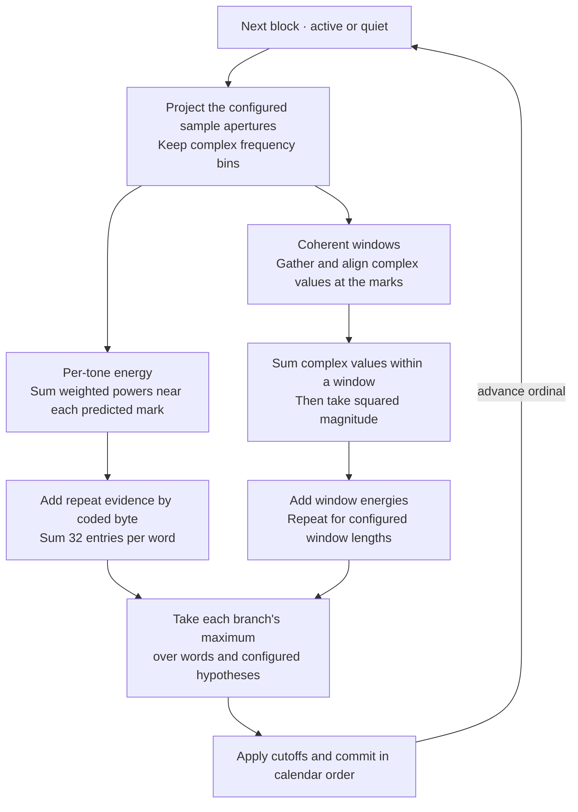
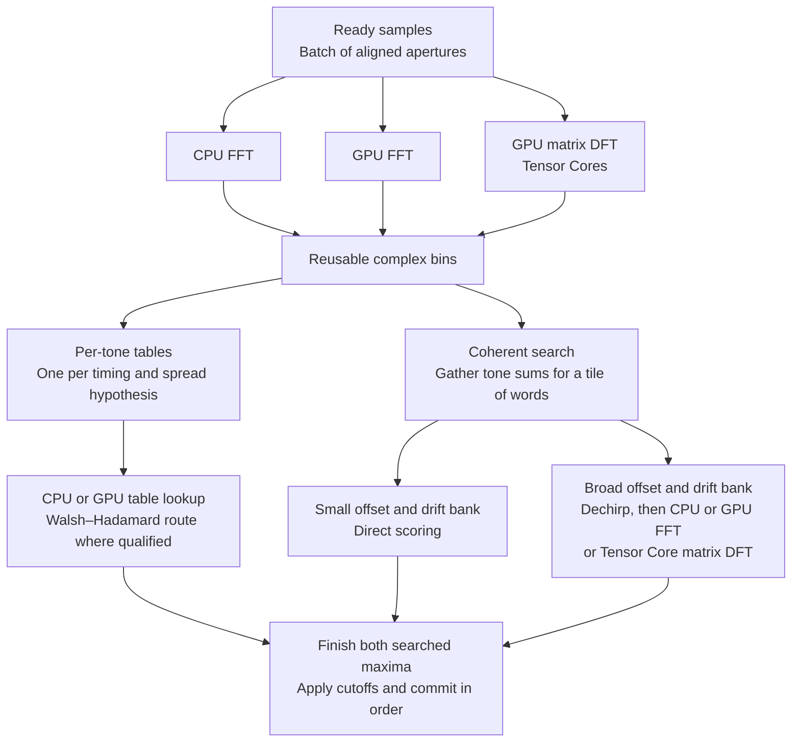
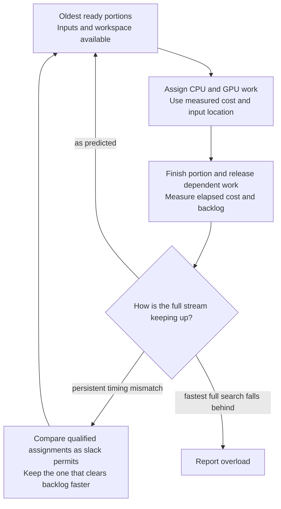

# Matrix Modem FSK specification

Draft for a standalone modem. The native ten-bit HF reference uses a configured calendar, hopping off and reproducible test schedules. Wire interoperability, field sensitivity and sustained service for the full search remain open. [Implementation status](algorithms-matrixModem/block-reception/README.md#implementation-status) · [Research and measured limits](../_ref/algorithms-matrixModem/fsk-reconciliation.md)

## Reading the transmit format

| Term | Matrix FSK meaning |
| --- | --- |
| **Tone** | One FSK beep at one assigned frequency position, held for `C` cells. A **held tone** uses `C > 1`. |
| **Cell** | Base time unit `T`. For spacing `Δf` in Hz, a cell lasts `1000/Δf` ms. At one cell per tone, that is also `1000 / tone rate` ms. |
| **Row** | One cell of time on this format waterfall. A tone spans `C` rows. |
| **Position** | One allowed tone centre. Positions are spaced `Δf = 1/T` apart when `T` is in seconds. |
| **Block** | The full waterfall rectangle for one scheduled word, including all rows and any hop guards or unused slots. |
| **Hop** | With frequency-hopping spread spectrum (FHSS), one stay at a temporary shift frequency, including its quiet edges. A hop can hold several tones. |
| **Coded symbol** | One of 32 bytes computed from the word. Each **copy** uses one tone slot and that slot's placement map. |
| **Keyed phase** | One scheduled phase offset per tone, even when the tone spans several cells. Consecutive tones can receive the same offset. |

The plot uses the native no-hop HF fixture. Each mark is the ideal on-grid FFT peak of a one-cell tone. The expanded view keeps the frequency scale and skips the intervening rows. Phase angles are schedule annotations. [Reproduce the figure](algorithms-matrixModem/block-reception/README.md#reproduce-the-transmit-waterfall)

### Mandatory tone rules

- **One tone at a time.** Use a full-power, constant-amplitude tone during each flat interval. Only the selected frequency position carries data.
- **One keyed phase assignment per tone.** Select from {0°, 90°, 180°, 270°} independently of the byte and its position. Apply it at the tone boundary, as a step or the profile's phase ramp. A held tone has no additional keyed phase assignments at its interior cell boundaries.
- **Whole cells.** Set `C ≥ 1` for the profile. With hopping off, transmit consecutive tones without amplitude ramps or guards. Carry forward the phase at the band origin `f₀`. Relative to that origin each position completes a whole number of cycles per cell.

## Block coding and calendar

1. **Code the word.** Form 32 bytes from the encrypted word `c` of `k ∈ {10,16,24}` bits. Each byte is `vₛ = Gₛc XOR mₛ` using a keyed binary `8 × k` matrix and byte mask. This provides coding redundancy across the block. The receiver scores each candidate using the available tone evidence.
2. **Repeat and interleave.** Shuffle exactly `L ≥ 1` copies of each coded byte into `32L` tone slots. The green pair in the figure carries symbol 15 at 812.5 and 1243.75 Hz, 3.68 s apart. Either copy can contribute evidence if the other is lost.
3. **Place each copy.** Draw a fresh byte-to-position map per tone. For `N ≥ 256` positions, use the first 256 entries of a keyed permutation. For smaller grids use an agreed pool of `P = 2^floor(log₂ N)` positions, with `256/P` bytes per position and `L ≥ ceil(8/log₂ P)`. The receiver distinguishes words by their complete position patterns. Recovery after a fade depends on whether the surviving positions still distinguish the words. [Codeword and burst-loss checks](../_ref/algorithms-matrixModem/fsk-code-identifiability.md)
4. **Fix the calendar.** Both ends agree on the profile and clock-derived schedule. With hopping off a block lasts `32LCT`. With hopping on, `q = floor(flat cells per hop / C)` whole tones fit per hop. Require `q ≥ 1` and `L ≥ q`. A block occupies `ceil(32L/q)` whole hops. Leave residual cells and unused final slots idle. Transmission uses no feedback or length fields.

## Waveform profiles

### Choose spacing and tone rate

| Control | Effect and selection |
| --- | --- |
| **FSK spacing `Δf`** | Pick a position grid for expected Doppler spread, offset uncertainty and usable passband. A tighter grid fits more positions into a narrow band. A wider spacing separates adjacent alternatives when spread blurs them. The draft grids use `Δf = 6.25/2^j` Hz, integer `j ≥ 0`. The lattice scale `j` indexes these spacing presets. It also fixes the cell duration. |
| **FSK tone rate `Δf/C`** | At a fixed spacing, choose `Δf`, `Δf/2`, `Δf/3`, … tones/s by holding each tone for `C` whole cells. At 6.25 Hz spacing, 160 ms tones give 6.25 tones/s and 320 ms tones give 3.125 tones/s. These are rates during the flat interval. |
| **Grid origin `f₀` and position count `N`** | Use `N ≥ 2` centres `f₀ + nΔf` for `n = 0 … N−1`. At fixed spacing, `N` changes the total grid span and the number of distinct labels a slot can carry. Budget passband for offset, spread and filter transitions. |
| **Copies per symbol `L`** | More copies add tones and airtime at the same FSK rate. Size them for received power, loss duration, diversity and deadline. |

**Choose spacing for the channel, then set the tone rate.** Increase `C` to slow the tones on the same grid. At fixed power this collects more energy per tone. Faster phase variation can favor shorter observation windows, even inside a held tone. Change `j` to change the grid itself, for example to fit the same number of positions in a narrower passband. The reciprocal cell duration aligns positions with rectangular FFT bins. The power-of-two presets also let those cells use 512 samples at a correspondingly decimated rate where the passband permits. [Lattice and sample rates](../_ref/algorithms-matrixModem/fsk-design-study.md#3-lattice) · [Tone length comparisons](../_ref/algorithms-matrixModem/fsk-reconciliation.md#choosing-tone-length-and-power-constraints)

Spacing measures adjacent grid positions. Successive tones can skip bins or repeat the same position. A wider-spaced placement pool at the same cell duration is also a candidate for strong spread. It gives up frequency choices in a fixed passband, so check the surviving codewords and receiver sensitivity for that pool. [Adjacent and spaced-bin comparisons](../_ref/algorithms-matrixModem/fsk-lattice-validity.md#adjacent-tones-under-diffuse-doppler)

### Example profiles

| Setting | HF reference | Narrowband example below 9 kHz |
| --- | --- | --- |
| Spacing and cell | 6.25 Hz and 160 ms (`j = 0`). | 0.78125 Hz and 1.28 s (`j = 3`). Alternatives are 1.5625 Hz and 0.390625 Hz. |
| Positions | 352 from 450 to 2643.75 Hz (2.2 kHz grid). Up to 448 in 2.8 kHz. | 16 in a 12.5 Hz nominal grid at `j = 3`. |
| Tone length | One or more cells. | Eight cells (10.24 s), alternatively one or 32. |
| Hopping | Optional. Reference hop 0.4 s, alternate 40 s for one-cell tones. | Off. |
| Keyed phase transition | Step at the tone boundary if the offset changes. | Set the next tone's position at the boundary. When the offset changes, rotate linearly in the first 80 ms, alternatively 160 ms. Use the shortest rotation with keyed direction for a half turn. The receiver follows the ramp. |
| Frequency reference | Configured oscillator uncertainty. | Both ends GPS-locked. Log corrections or retime audio from the pulse-per-second reference. |

With `L = 2`, the one-cell HF example takes **10.24 s** with hopping off or **12.8 s** with 0.4 s hops. The eight-cell narrowband example takes **655.36 s**. Each duration is for one word. Physical completion uses two further scored quiet blocks.

### Hop edges and spectrum

Retune during quiet. The 0.4 s HF hop uses **20 ms quiet · 20 ms raised-cosine amplitude ramp up · 320 ms flat · 20 ms ramp down · 20 ms quiet**. Longer reference hops use 60 ms quiet at each edge and the same 20 ms ramps. Target 26 dB out-of-band attenuation relative to mean in-band power with a specified filter, measurement bandwidth and averaging interval. [Hop and phase definitions](../_ref/algorithms-matrixModem/fsk-design-study.md#43-hop)

## Keys and addressing

Before coding, XOR the payload with AES-256-CTR and Serpent-256-CTR keystreams, preserving bit count. Use separate AES-256 purposes for symbol order, matrices, masks, placement, hops and phase. Address by epoch, ordinals and the operator-configured nominal shift rounded to the configured multiple of 10 Hz. Every hop and receiver correction uses that same nominal shift for the key address. [Key interface and unresolved wire details](../_ref/algorithms-matrixModem/fsk-reconciliation.md#integration-and-profile-selection)

## Receiver search

An **aperture** is the receiver's sample interval for one projection. The aligned reference plot uses one cell per aperture. A held tone can use both cell-length and longer apertures. For each timing hypothesis, both scoring branches reuse the complex frequency projections where their apertures match.

| What can happen to the transmitted marks | Receiver response |
| --- | --- |
| A row has one narrow mark near its predicted frequency. | Try one-bin per-tone evidence. Shift the prediction under the configured frequency-offset hypotheses. |
| Doppler spread blurs each mark across nearby columns. | Try weighted sums of bin energies at the configured spread widths. Add evidence along the candidate's track even when the phase changes between rows. |
| Several rows are faint and their complex projections share a consistent phase after correction. | Gather at the predicted frequencies. Undo the keyed phases and correct timing, offset and drift. Try adding complex values over windows of different lengths. |
| Multipath changes the phase from frequency to frequency. | Try shorter coherent windows and retain per-tone evidence. A deep fade can leave little energy for either branch. |

In the close-up, slots 23–26 have keyed offsets **90°, 180°, 90°, 90°**. Rotate their captured projections by the opposite angles. On the flat test path they then point in the same direction. A four-tone window sums them before squaring the magnitude. The per-tone score uses each row's energy first. The receiver scores both branches on the same block, including when spread is plausible, and applies their separate calibrated cutoffs.

**Input and search coverage.** Use fixed gain and a linear guarded passband with radio blanking and noise reduction off. Translate and filter 48 kHz real audio to 3,200 complex samples/s. Allow wider qualified capture for offsets, spread and transitions, or filtered 400 samples/s at `j = 3`. Estimate component noise scale `σ` from the lower quartile of complex power under circular Gaussian noise. Round I/Q at `0.45σ` and erase a sample if either component code is nonfinite or outside −7…+7.

Search every word and every applicable configured timing, frequency-offset, drift and spread hypothesis on the selected sideband, including after a miss. The data search runs without pilot lock or a visible trace. Helper may independently narrow it. Fault searches require explicit selection and preserve ordinary sensitivity, false-word performance and capacity when off.

**Projections.** Match rectangular apertures to the tone, including intermediate frequencies for held tones and the configured phase ramp. The timing step is one eighth of the phase interval (one tone here). For coherent timing use `1/(8 × band span)` where finer. For a coherent window of duration `U`, use frequency step `1/(2U)`. Correct signed-frequency phase, samples entering and leaving a shifted window, clock slip and intra-window drift, or qualify the mismatch. [Timing coverage and cost](../_ref/algorithms-matrixModem/fsk-timing-coverage.md)

| What the receiver combines | Rule |
| --- | --- |
| Per-tone energy | For each block try a single bin and Gaussian full-2σ spread widths 10/30/60/120/250/500 Hz. Sum weighted bin energies, using one spread hypothesis across the block. Normalize by time and frequency medians, using surrounding noise bins for small grids. Weight each hop by inverse noise and erase unusable hops. Combine its tones at a common offset before marginalizing that offset. Clip at 4–8 times the noise mean and quantize to 0…15. |
| Complex tone projections | For one candidate and one timing/frequency trajectory, let `zₜ` be its corrected complex projection for tone `t`. Within each window, add the projections first and then take the squared magnitude. At a given window length, add those energies across windows, including the actual exposure of a final partial window. The receiver also evaluates shorter within-tone windows where configured. |
| Window lengths | Without hopping the longest coherent span is the block. With hopping it is the active part of one hop, since a retune can introduce an unknown phase. Add energies across hops. On HF subdivide to the configured shortest window (target 1/64 block, limited by the hop). Below 9 kHz use cells within tones, per-tone energy, then two-tone windows doubling up to the block. |

**Why keep both branches?** Two corrected projections of `+1` and `−1` contribute zero to a long complex sum, yet each carries unit energy. Undoing the keyed phase leaves any phase difference imposed by the path. A shorter window can help if it separates opposing contributions. If the path removes the energy at all used positions, both branches lose it. [Static two-path example](../_ref/algorithms-matrixModem/fsk-lattice-validity.md#when-the-tones-survive-but-their-coherent-sum-vanishes) · [Measured coherent and per-tone decisions](algorithms-matrixModem/block-reception/README.md#coherent-branch-and-protected-per-tone-fallback)

## Block decision and completion

The reference standardizes the word scores **within each hypothesis** before comparing maxima. Give each branch half the block's false-admission budget and calibrate a separate cutoff for its maximum over the entire configured search. Use deterministic ties and strict exceedance. Recalibrate changes to conditioning, searched hypotheses, truncated apertures or the decision rule. The provisional ten-bit target is `10⁻⁴` false admissions per quiet block. In the tested HF fixture one of 30,000 fresh quiet blocks was admitted. Its one-sided 95% upper bound, `1.58 × 10⁻⁴`, still exceeds the target. [Quiet-block measurements](algorithms-matrixModem/block-reception/README.md#one-false-admission-per-ten-thousand-quiet-blocks)

| First matching condition | Block result | Effect on an open message |
| --- | --- | --- |
| Input unusable or either branch unavailable | **Unscored** | Break the consecutive-absence count. |
| Per-tone maximum exceeds its cutoff | **Per-tone winner** | Accept word and clear the absence count. |
| Coherent maximum exceeds its cutoff | **Coherent winner** | Accept word and clear the absence count. |
| Both branches scored and neither passed | **Scored absence** | Count one. Close on the second consecutive scored absence. |

For example, **word → absence → unscored → absence → word** stays open. Retain the interior gap as erasures. **Word → absence → absence** closes on the second absence. Two fully extinguished transmitted blocks can look exactly like physical quiet and cause premature closure. Continue advancing the public ordinal across closure. The next accepted word opens a new message. Payload, idle slots inside a hop, EOF and resource limits cannot close a message. [Outage and missing-input evidence](../_ref/algorithms-matrixModem/fsk-reconciliation.md#receiver-evidence)

## Processing limits

Share `W = 2H` native software workers across stages, where `H` is effective logical CPU capacity after affinity and quota. Honor explicit limits. Reuse schedules, projections and gathers within admitted workspace. Target four-bit input, evidence and complex-bin components. Size accumulators and squared magnitudes for the maximum block.

**Tone gathers and cell transforms scale separately.** At fixed spacing and airtime, longer tones with fewer copies leave fewer tones to gather per candidate. The number of cell apertures stays the same if the receiver still projects every cell. At fixed copy count, longer tones give the receiver more time per block and add cell apertures. Measure both stages and the full timing, frequency and drift search when qualifying a slower profile. [Sub-9 kHz tone-rate study](../_ref/algorithms-matrixModem/Fable-5.2/sub9khz-fsk-rate-and-spacing.md#5-tone-rate)

### What the CPU and GPU can take

A **transform portion** is a batch of ready sample apertures at one timing alignment, such as several one-cell rows. FFT routes compute a regular grid of bins. A matrix-product DFT can compute just the requested frequencies. The output is a tile of complex bins shared by hypotheses with compatible apertures. A **search portion** is a range of candidate words at a ready alignment or evidence table. Those words reuse the same projections. Candidate tiling bounds the live tables and leaves more workspace for incoming blocks.

Choose one qualified transform route for each batch and one scoring route for each portion of its branch. The lower matrix DFT searches residual frequency using each candidate's tone sums. Its input comes from the upper transform and the gather. Reuse the gather over compatible hypotheses. Recompute or correct the projection when the timing hypothesis moves the sample boundaries. Qualify each route for its geometry, arithmetic and decision rule. [Route and reuse details](../_ref/algorithms-matrixModem/fsk-design-study.md#13-computation-and-simulation)

### How work is rebalanced

Start from measured route costs and the oldest ready work. For example, while the GPU scores a large candidate tile, the CPU can transform a batch of later rows or prepare the next schedule. Dispatch more transform batches to the GPU when it has room and that clears the full queue faster. A downstream search becomes eligible when its required bins are ready. Keep bins resident when that saves a transfer, and reserve workspace for search and ordered results before preparing more rows.

On the recorded Blackwell transform benchmark, cuFFT beat the FP16 matrix DFT by **2.08×** for batches of 4,096 apertures. At 32,768 apertures the matrix DFT led by **1.21×**. Its lead at that size shrank to **1.02×** during concurrent direct search. Measure whole-stream service under load to decide which assignment of CPU and GPU work clears the backlog fastest. The benchmark used synthetic stage inputs. [Batch timings](algorithms-matrixModem/fsk-lattice/results/gpu/chunks.out) · [Concurrent timings](algorithms-matrixModem/fsk-lattice/results/gpu/contend.out) · [Assignment evidence and limits](../_ref/algorithms-matrixModem/fsk-reconciliation.md#assigning-work-across-cpu-and-gpu)

Choose the fastest qualified **complete** search on active, quiet and unsuccessful blocks. Preserve all configured hypotheses across portions. Count preparation, transfers, live workspace and ordered decisions through closure. Any reduced-work route requires explicit identification, recalibrated decisions, and demonstrated sensitivity and deadline margin. [Receiver qualification requirements](algorithms-matrixModem/block-reception/README.md#receiver-qualification-requirements)
