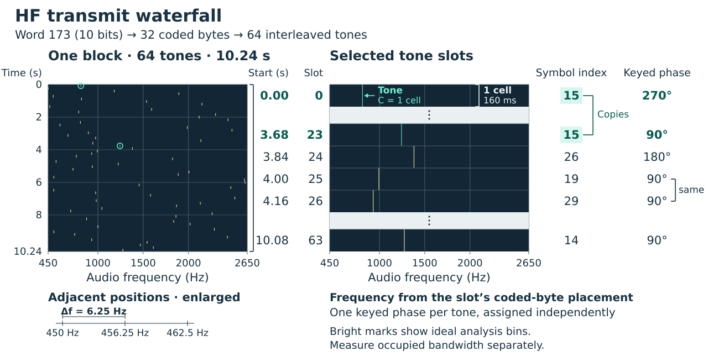
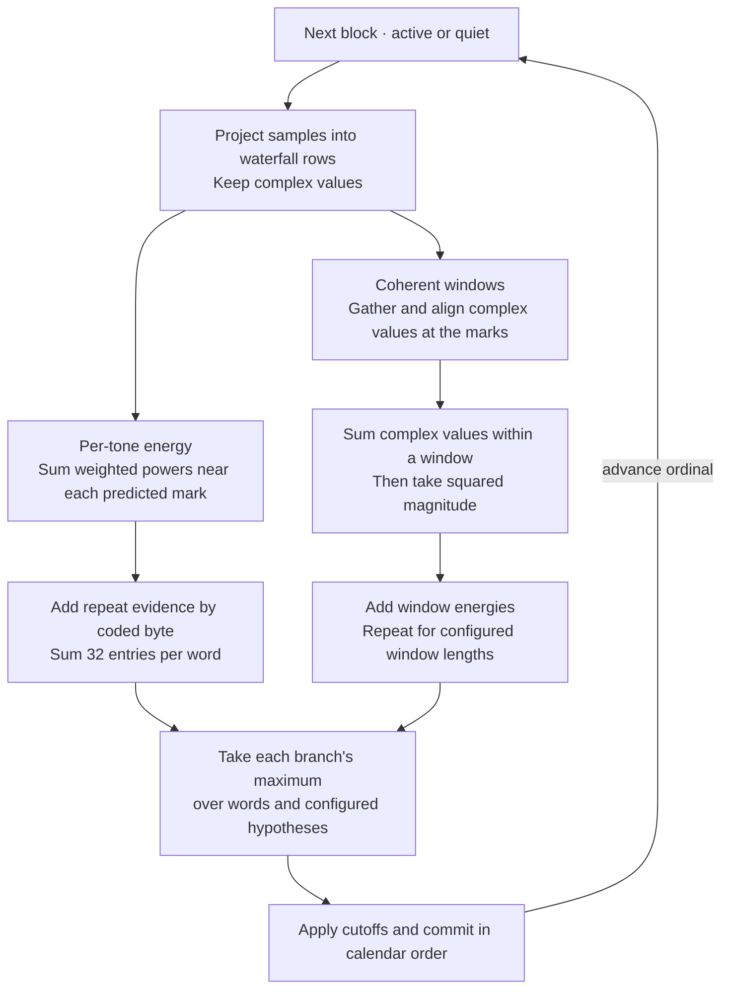
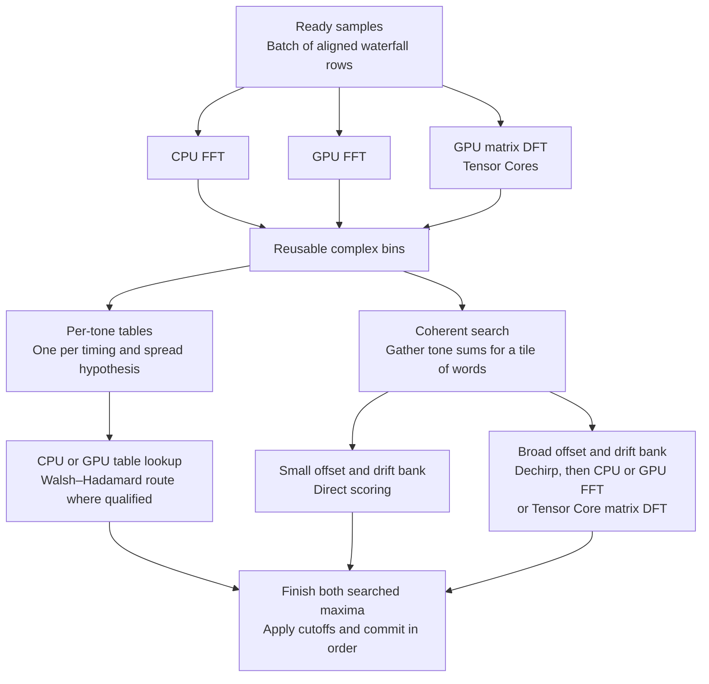
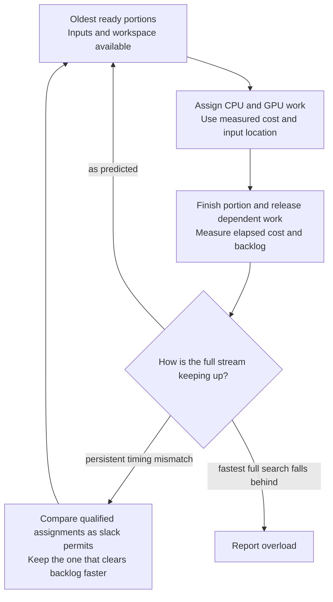

# Matrix Modem FSK specification

**Read one row at a time.** A Matrix FSK block puts one tone on the waterfall in each active slot. The tone’s frequency carries data. The sequence of frequencies across the block identifies a short word. The receiver can follow the expected frequencies by their energy, or combine the underlying complex observations when their phases line up.

This is a draft for a standalone modem. A native ten-bit HF experiment exercises a configured calendar with hopping off and reproducible test schedules. Wire interoperability, field sensitivity and sustained service for the full search remain open. [Implementation status](algorithms-matrixModem/block-reception/README.md#implementation-status) · [Research and measured limits](../_ref/algorithms-matrixModem/fsk-reconciliation.md)

## Reading the transmit format

The full waterfall uses the 160 ms cadence of the native ten-bit HF test (word 173, ordinal 0, hopping off). The close-up keeps the same frequency axis and expands selected rows. Its two breaks skip the intervening tones. Each mark shows one on-grid FFT bin at the transmitted centre under ideal, noiseless conditions. The phase labels come from the shared schedule. A power waterfall cannot show those angles. [Native trace and reproduction](algorithms-matrixModem/block-reception/README.md#reproduce-the-transmit-waterfall)

| What you see | Format term |
| --- | --- |
| A bright mark at one frequency | **Position** on the frequency grid. A **tone** holds that position for one or more **cells**. A cell is the time unit that sets the spacing of the grid. |
| The full 64-row rectangle | **Block**, the calendar interval for one word. Each row in this example is a one-cell tone slot. |
| The same symbol label on different rows | Copies of one **coded symbol**, an eight-bit value. Each slot has its own byte-to-position map, so the copies can light up different frequencies. |
| An angle beside a row | **Keyed phase offset**, known from the schedule. A change of frequency can leave the keyed phase unchanged. |
| With hopping enabled, a segment between retunes | **Hop**. Several tones can fit on the same hop frequency. Retuning takes place in the quiet edges. |

### How coding and interleaving change the waterfall

Each encrypted word produces 32 coded bytes. Each byte contains eight scheduled binary combinations of the word’s bits, with a keyed mask. Each candidate word therefore predicts a sequence across the entire waterfall. Coding gives the receiver many observations of that word. Repetition gives it multiple looks at each coded byte, and interleaving spreads those looks among other symbols in time.

Follow **symbol 15** in the figure. The first copy lights up **812.5 Hz** in slot 0. The shuffled copy lights up **1243.75 Hz** in slot 23, **3.68 s later**. A fade at the first mark can leave the second available. The per-tone decoder adds evidence for the same byte at its two scheduled frequencies. Even if both copies vanish, surviving coded symbols can distinguish the word when their position sequences separate the candidates. On a small grid, several bytes can light up the same position in one row. The receiver uses their wider pattern across rows to resolve those collisions. [Codeword and burst-loss checks](../_ref/algorithms-matrixModem/fsk-code-identifiability.md)

## Waveform profiles

Use one full-power, constant-amplitude tone per flat interval. Position `n`, counting from zero, has centre `f₀ + n/T`. The tone lasts `C × T` seconds. The four knobs below change the waterfall in different ways.

| Knob | What changes on the waterfall | When to consider it |
| --- | --- | --- |
| `j`, the lattice scale | Start at `j = 0` with a 160 ms cell and 6.25 Hz spacing. Each increment doubles the cell duration and halves the spacing. In general `T = 0.160 × 2^j` s and spacing is `1/T`, with integer `j ≥ 0`. | A smaller `j` puts more Hz between positions. A larger `j` fits the same number of positions into less bandwidth. Compare the spacing with Doppler spread and oscillator error, and check antenna and filter bandwidth. |
| `C`, cells per tone | Hold the same frequency for `C ≥ 1` whole cells. Each tone gets taller with the same horizontal grid. | Longer tones collect more energy at fixed power and can help on weak, stable paths. Shorter tones limit exposure to rapid phase change. The receiver can also score shorter windows within a held tone. |
| `N`, number of positions | `N ≥ 2` sets how many columns the transmitter can choose. At fixed `j`, a larger `N` widens the grid. | A wider grid accommodates more distinct byte labels and can place copies outside a narrow fade. A narrow grid fits a restricted passband. Closely spaced alternatives can become hard to tell apart under spread or a shared fade. |
| `L`, copies per coded symbol | Increasing `L` adds rows to the block at the same tone duration. | Extra rows collect more energy at fixed power and offer more chances to survive a fade. They also use more airtime and receiver work. Compare the likely outage duration against a whole block. |

Use expected received power after path and pointing loss, Doppler spread, usable bandwidth and the delivery deadline to choose a profile. At HF the recorded equal-airtime comparison found a benefit from longer tones in slow fading, while both tested choices were weak at the same energy in faster fading. [Profile comparisons](../_ref/algorithms-matrixModem/fsk-reconciliation.md#choosing-tone-length-and-power-constraints)

| Setting | HF | Below 9 kHz |
| --- | --- | --- |
| Cell and spacing | `j = 0` gives 160 ms and 6.25 Hz. | `j = 3` gives 1.28 s and 0.78125 Hz. Alternatives are 2 and 4 for `j`. |
| Frequency grid | Default 352 positions from 450 to 2643.75 Hz (2.2 kHz grid). Up to 448 positions in 2.8 kHz. | 16 positions in a 12.5 Hz nominal grid at `j = 3`. |
| Tone length | One or more cells. | Eight cells (10.24 s at `j = 3`), alternatively one or 32. |
| Hopping | Optional. Reference hop 0.4 s, alternate 40 s for one-cell tones. | Off. |
| Keyed phase | Apply the new offset at the tone boundary. | Change position at the boundary. Move linearly from the previous phase to the new phase over the first 80 ms of the tone, alternatively 160 ms. Use the shortest rotation with keyed direction for a half turn. |
| Frequency reference | Configured oscillator uncertainty. | Both ends GPS-locked. Log corrections or retime audio from the pulse-per-second reference. |

Choose each keyed offset from {0°, 90°, 180°, 270°} independently of payload and position. With hopping off, keep tones contiguous without amplitude ramps or guards. Carry forward the phase accumulated at the band origin `f₀`. Relative to that origin each grid position completes an integer number of cycles per cell. Below 9 kHz the receiver follows the phase ramp inside the tone.

With hopping on, retune during quiet. At the reference HF setting a 0.4 s hop contains, in order, **20 ms quiet · 20 ms amplitude ramp up · 320 ms flat · 20 ms amplitude ramp down · 20 ms quiet**. The amplitude ramps are raised cosines. Longer reference hops use 60 ms quiet at each edge and the same 20 ms ramps. Target 26 dB out-of-band attenuation relative to mean in-band power with a specified filter, measurement bandwidth and averaging interval. [Hop and phase definitions](../_ref/algorithms-matrixModem/fsk-design-study.md#43-hop)

## Block coding and calendar

1. Configure the profile and clock-derived calendar at both ends. Transmission uses no feedback or length fields. For each encrypted word `c` of `k ∈ {10,16,24}` bits, form 32 coded bytes `vₛ = Gₛc XOR mₛ` using keyed `8 × k` binary matrices and byte masks.
2. Schedule exactly `L ≥ 1` copies of each coded byte in shuffled order. Redraw the placement map for each of the `32L` tones. With `N ≥ 256`, the first 256 entries of a keyed permutation give each byte its own position. On smaller grids use an agreed pool of `P = 2^floor(log₂ N)` positions, `256/P` bytes per position, and `L ≥ ceil(8/log₂ P)`. A single observation can then represent several bytes. Distinguish candidates by their whole sequence of positions. [Codeword checks after erasures](../_ref/algorithms-matrixModem/fsk-code-identifiability.md)
3. Without hopping, a block lasts `32LCT`. With hopping, let `q = floor(flat cells per hop / C)` be the number of whole tones that fit. Require `q ≥ 1` and `L ≥ q`. A block uses `ceil(32L/q)` whole hop periods. Leave residual cells and unused slots in the final hop idle.

For the HF example, `L = 2` and `C = 1` give 64 tones in **10.24 s**. With the reference 0.4 s hop the same tones occupy 32 hops or **12.8 s**. Below 9 kHz, `N = 16`, `L = 2`, `C = 8` and `j = 3` also give 64 tones, but one block takes **655.36 s**. These durations cover one word. Physical completion uses the next two scored quiet blocks.

## Keys and addressing

Before coding, XOR the payload with AES-256-CTR and Serpent-256-CTR keystreams, preserving bit count. Use separate AES-256 purposes for symbol order, matrices, masks, placement, hops and phase. Address by epoch, ordinals and nominal shift rounded to the configured multiple of 10 Hz. Retunes and measured corrections preserve that address. [Key interface and unresolved wire details](../_ref/algorithms-matrixModem/fsk-reconciliation.md#integration-and-profile-selection)

## Receiver search

For each plausible alignment, form a table of complex frequency projections for the waterfall rows. Both scoring branches start with those values where their apertures match. The power display uses their squared magnitudes. The coherent branch also needs the retained phase.

| What can happen to the transmitted marks | Receiver response |
| --- | --- |
| A row has one narrow mark near its predicted frequency. | Try one-bin per-tone evidence. Shift the prediction under the configured frequency-offset hypotheses. |
| Doppler spread blurs each mark across nearby columns. | Try weighted sums of bin energies at the configured spread widths. Add evidence along the candidate's track even when the phase changes between rows. |
| Several rows are faint and their complex projections share a consistent phase after correction. | Gather at the predicted frequencies. Undo the keyed phases and correct timing, offset and drift. Try adding complex values over windows of different lengths. |
| Multipath changes the phase from frequency to frequency. | Try shorter coherent windows and retain per-tone evidence. A deep fade can leave little energy for either branch. |

In the close-up, slots 23–26 have keyed offsets **90°, 180°, 90°, 90°**. Rotate their captured projections by the opposite angles. On the flat test path they then point in the same direction. A four-tone window sums them before squaring the magnitude. The per-tone score uses each row's energy first. The receiver scores both branches on the same block, including when spread is plausible, and applies their separate calibrated cutoffs.

**Input and search coverage.** Use fixed gain and a linear guarded passband with radio blanking and noise reduction off. Translate and filter 48 kHz real audio to 3,200 complex samples/s. Allow wider qualified capture for offsets, spread and transitions, or filtered 400 samples/s at `j = 3`. Estimate component noise scale `σ` from the lower quartile of complex power under circular Gaussian noise. Round I/Q at `0.45σ` and erase a sample if either component code is nonfinite or outside −7…+7.

Search every word and every applicable configured timing, frequency-offset, drift and spread hypothesis on the selected sideband, including after a miss. The data search runs without pilot lock or a visible trace. Helper may independently narrow it. Fault searches require explicit selection and preserve ordinary sensitivity, false-word performance and capacity when off.

**Projections.** Match rectangular apertures to the tone, including intermediate frequencies for held tones and the configured phase ramp. The timing step is one eighth of the phase interval (one tone here). For coherent timing use `1/(8 × band span)` where finer. For a coherent window of duration `U`, use frequency step `1/(2U)`. Correct signed-frequency phase, samples entering and leaving a shifted window, clock slip and intra-window drift, or qualify the mismatch. [Timing coverage and cost](../_ref/algorithms-matrixModem/fsk-timing-coverage.md)

| What the receiver combines | Rule |
| --- | --- |
| Per-tone energy | For each block try a single bin and Gaussian full-2σ spread widths 10/30/60/120/250/500 Hz. Sum weighted bin energies, using one spread hypothesis across the block. Normalize by time and frequency medians, using surrounding noise bins for small grids. Weight each hop by inverse noise and erase unusable hops. Combine its tones at a common offset before marginalizing that offset. Clip at 4–8 times the noise mean and quantize to 0…15. |
| Complex tone projections | For one candidate and one timing/frequency trajectory, let `zₜ` be its corrected complex projection for tone `t`. Within each window, add the projections first and then take the squared magnitude. At a given window length, add those energies across windows, including the actual exposure of a final partial window. The receiver also evaluates shorter within-tone windows where configured. |
| Window lengths | Without hopping the longest coherent span is the block. With hopping it is the active part of one hop, since a retune can introduce an unknown phase. Add energies across hops. On HF subdivide to the configured shortest window (target 1/64 block, limited by the hop). Below 9 kHz use cells within tones, per-tone energy, then two-tone windows doubling up to the block. |

**Why keep both branches?** Two corrected projections of `+1` and `−1` contribute zero to a long complex sum, yet each carries unit energy. Undoing the keyed phase leaves any phase difference imposed by the path. A shorter window can help if it separates opposing contributions. If the path removes the energy at all used positions, both branches lose it. [Static two-path example](../_ref/algorithms-matrixModem/fsk-lattice-validity.md#when-the-tones-survive-but-their-coherent-sum-vanishes) · [Measured coherent and per-tone decisions](algorithms-matrixModem/block-reception/README.md#coherent-branch-and-protected-per-tone-fallback)

## Block decision and completion

The reference standardizes the word scores **within each hypothesis** before comparing maxima. Give each branch half the block's false-admission budget and calibrate a separate cutoff for its maximum over the entire configured search. Use deterministic ties and strict exceedance. Recalibrate changes to conditioning, searched hypotheses, truncated apertures or the decision rule. The provisional ten-bit target is `10⁻⁴` false admissions per quiet block. In the tested HF fixture one of 30,000 fresh quiet blocks was admitted. Its one-sided 95% upper bound, `1.58 × 10⁻⁴`, still exceeds the target. [Quiet-block measurements](algorithms-matrixModem/block-reception/README.md#one-false-admission-per-ten-thousand-quiet-blocks)

| First matching condition | Block result | Effect on an open message |
| --- | --- | --- |
| Input unusable or either branch unavailable | **Unscored** | Break the consecutive-absence count. |
| Per-tone maximum exceeds its cutoff | **Per-tone winner** | Accept word and clear the absence count. |
| Coherent maximum exceeds its cutoff | **Coherent winner** | Accept word and clear the absence count. |
| Both branches scored and neither passed | **Scored absence** | Count one. Close on the second consecutive scored absence. |

For example, **word → absence → unscored → absence → word** stays open. Retain the interior gap as erasures. **Word → absence → absence** closes on the second absence. Two fully extinguished transmitted blocks can look exactly like physical quiet and cause premature closure. Continue advancing the public ordinal across closure. The next accepted word opens a new message. Payload, idle slots inside a hop, EOF and resource limits cannot close a message. [Outage and missing-input evidence](../_ref/algorithms-matrixModem/fsk-reconciliation.md#receiver-evidence)

## Processing limits

Share `W = 2H` native software workers across stages, where `H` is effective logical CPU capacity after affinity and quota. Honor explicit limits. Reuse schedules, projections and gathers within admitted workspace. Target four-bit input, evidence and complex-bin components. Size accumulators and squared magnitudes for the maximum block.

### What the CPU and GPU can take

A **transform portion** is a batch of ready sample apertures, such as several waterfall rows at one timing alignment. FFT routes compute a regular grid of bins. A matrix-product DFT can compute just the requested frequencies. The output is a tile of complex bins shared by hypotheses with compatible apertures. A **search portion** is a range of candidate words at a ready alignment or evidence table. Those words reuse the same rows of the waterfall. Candidate tiling bounds the live tables and leaves more workspace for incoming blocks.

Choose one qualified transform route for each batch and one scoring route for each portion of its branch. The lower matrix DFT searches residual frequency using each candidate's tone sums. Its input comes from the upper transform and the gather. Reuse the gather over compatible hypotheses. Recompute or correct the projection when the timing hypothesis moves the sample boundaries. Qualify each route for its geometry, arithmetic and decision rule. [Route and reuse details](../_ref/algorithms-matrixModem/fsk-design-study.md#13-computation-and-simulation)

### How work is rebalanced

Start from measured route costs and the oldest ready work. For example, while the GPU scores a large candidate tile, the CPU can transform a batch of later rows or prepare the next schedule. Dispatch more transform batches to the GPU when it has room and that clears the full queue faster. A downstream search becomes eligible when its required bins are ready. Keep bins resident when that saves a transfer, and reserve workspace for search and ordered results before preparing more rows.

On the recorded Blackwell transform benchmark, cuFFT beat the FP16 matrix DFT by **2.08×** for batches of 4,096 apertures. At 32,768 apertures the matrix DFT led by **1.21×**. Its lead at that size shrank to **1.02×** during concurrent direct search. Measure whole-stream service under load to decide which assignment of CPU and GPU work clears the backlog fastest. The benchmark used synthetic stage inputs. [Batch timings](algorithms-matrixModem/fsk-lattice/results/gpu/chunks.out) · [Concurrent timings](algorithms-matrixModem/fsk-lattice/results/gpu/contend.out) · [Assignment evidence and limits](../_ref/algorithms-matrixModem/fsk-reconciliation.md#assigning-work-across-cpu-and-gpu)

Choose the fastest qualified **complete** search on active, quiet and unsuccessful blocks. Preserve all configured hypotheses across portions. Count preparation, transfers, live workspace and ordered decisions through closure. Any reduced-work route requires explicit identification, recalibrated decisions, and demonstrated sensitivity and deadline margin. [Receiver qualification requirements](algorithms-matrixModem/block-reception/README.md#receiver-qualification-requirements)
