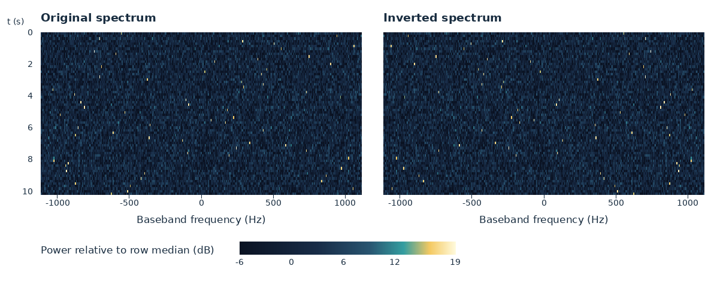

# Receiving a visible Matrix FSK signal from a faulty transmitter

On 64 simulated ten-bit transmissions, reversing the sideband preserved the waterfall and caused the original receiver to miss every word at 34 dB block energy over noise density. Searching both orientations recovered all 64 words on the same samples. This case is recoverable because complex conjugation leaves the complete received waveform available. When the tone spacing also changes and damaged tones dominate the display, the ten-bit receiver can propose frequency maps from every pair of rows and test each map against all 64 coded tones. This keeps a few conspicuous errors from deciding which word the receiver can hear. A damaged transmitter can also put almost all its power into a carrier that carries no data. The two cases warrant different design requirements. [Paired native experiments](../../_appraisal/algorithms-matrixModem/block-reception/fault-tests.md)

## Specification supplement for acquisition and recovery

Apply these requirements to the acquisition, word-selection and qualification provisions in sections 8 and 15 of the [FSK draft](../../_appraisal/matrixModem-FSK.md).

1. **Declare which signals the receiver can recover.** Give the captured passband, orientation and possible reflection centres, carrier-offset trajectory, relation between intended and radiated tone frequencies, timing offset and rate, schedule/ordinal uncertainty, and allowed missing observations. Give the observation deadline and resource limit. Preserve the payload-bearing part of the passband and its guards. Once an analog filter has removed a tone, changing a lookup table cannot restore it.
2. **Give the payload a way into acquisition.** On each usable public block evaluate the configured soft per-tone and coherent evidence, even if there is no Helper, recognizable waterfall, pilot, or prior lock. For a capture supporting both sidebands test both orientations before discarding tone evidence. Let bright tones propose additional spacing/offset hypotheses when useful. Retain soft energy at competing frequencies long enough to verify those proposals against the full coded word. A hard choice of one frequency per row can throw away recoverable data.
3. **Measure what the operator would lose on the same samples.** Specify a reproducible waterfall statistic, its frequency/time resolution, threshold, observation duration and false-alarm rate. Count correct, wrong and missed words, and visible records in each category. Compare an unassisted receiver with an otherwise identical receiver given the true fault, whenever such a comparison is possible. A high oracle success rate locates an engineering deficit. At a specified correct-word probability, bracket a dB threshold only with an adequate energy grid and uncertainty. State if the detector and decoder have different false-alarm budgets. The observer in this work is a reproducible machine measurement. Human recognition is unmeasured.
4. **Charge every additional search to the final decision.** Include both orientations, all words, trial maps and data-selected alternatives. Train on quiet and freeze before the holdout. Evaluate strong wrong schedules, a stuck carrier, missing samples, restored transmission, and the final two scored quiet blocks separately. Report which decision wins if two branches accept different words. A conspicuous line alone can neither supply a word nor establish that this transmitter is still active. Lost input breaks the run of scored quiet. Keep capture history under a declared memory/time limit when retaining it for another search.
5. **Measure the worst supported work as well as sensitivity.** For the most expensive declared search, include repeated unsuccessful blocks, bright interference that triggers extra work, workspace, and oldest input waiting for service. A conditional path that keeps running on an unrelated carrier is a recurring receiver cost. One captured ten-bit block and several simultaneous Monte Carlo workers establish neither continuous broad-search service nor the 24-bit computational ceiling.

## Sideband reversal and a wrong deviation setting

The 512-point transform has 352 data positions in signed bins −176 through +175, at 6.25 Hz per bin. Reversing the array of 352 positions puts the origin half a bin off. Reflection about sampled baseband DC requires the bin at the opposite physical frequency, including the +176 edge. For the coherent branch the conjugation identity is `FFT(conj(x))[k] = conj(FFT(x)[−k])`. The experiment reuses all three timing apertures' FFTs, gathers the correct guard bins for each orientation, and corrects the phase before coherent accumulation. An image mixed with the original, a mirror about an unknown offset, and a transmitter with its tone table reversed but its phase key intact are distinct faults. [Sample-domain scorer](../../_appraisal/algorithms-matrixModem/block-reception/block_reception.cpp)

The empirical 1% diagnostic on the steady single-ray fixture found a two-sided decoding cost small enough to resolve the original failure. At 18 dB the two-orientation decoder recovered all 64 normal and all 64 mirrored words even though the waterfall test crossed on none of them. At 44 dB the waterfall crossed on every mirrored word, yet the original receiver still recovered zero. These are tested points 26 dB apart. They establish no continuous threshold difference. The same diagnostic admitted two of 64 strong wrong-schedule blocks and one of 64 fixed carriers in its blind search. In a separate mirrored continuous-IQ example it preserved an interior erasure and closed on the second trailing quiet period. [Counts, uncertainty, closures and timing](../../_appraisal/algorithms-matrixModem/block-reception/fault-tests.md)

The HF experiment uses a configured 10.24 s calendar, a known ordinal and a finite timing and frequency bank. The plotted block is a 34 dB simulated transmission of word 946, chosen as trial zero before plotting. Both panels use the same colour scale and fixed nominal-time apertures. Each has a mean strongest-bin/median power ratio of 49.92, against the frozen waterfall cutoff of 10.02. These panels show the digitized receiver input after component coding and the native FFT. [Native export and plotting command](../../_appraisal/algorithms-matrixModem/block-reception/fault-tests.md)

The earlier observer screen calculated a power-detector threshold for ideal orthogonal frequency schedules, including cases with the true schedule in the observer's bank. Here the observer sees the same noisy, quantized time-frequency record as the receiver, chooses its own brightest bin in each row, and has no word or schedule. Its success on the mirror test therefore does not require matching the keyed signal. Both studies assume an observation window; neither measured a human searching an arbitrary length of radio history. [Earlier observer assumptions](../../_appraisal/algorithms-matrixModem/observer-screen/README.md)

For a transmitter with mis-set deviation, write the received tone in bin units as `a + b·k`, where `k` is the scheduled signed tone. The experiment fits a common offset and either sign of scale for each candidate word. The transmitted cases use 73% spacing shifted up 108.59 Hz, and 81% spacing reversed and shifted down 85.16 Hz. Symbol duration stays fixed. The receiver is given neither these settings nor the emitted word. At 27 dB a fit to the brightest bin in each row (also trying the strongest half of the rows) recovered only 6 of 48 words for each of two distorted maps. All 48 on each map crossed the waterfall threshold. A decoder given only the correct map recovered 48 on both. At 34 dB the blind fit recovered all 48 on each map, but replacing one tone in eight reduced its correct count to 11 of 48. The known-map decoder again recovered 48. These failures motivated a second experiment using pairs of strong tones to propose a mapping and accumulated soft evidence to decide the word. [Paired spacing experiments](../../_appraisal/algorithms-matrixModem/block-reception/fault-tests.md)

The second search takes up to 16 anchor rows, including the strongest row in each eighth of the block. For every word, two sufficiently separated scheduled tones and their observed peak locations define a possible signed scale and offset. Each physically admitted map then scores the received energy at the predicted positions of **all 64 tones**, including rows whose highest peak is elsewhere. The fixed ten-bit search has at most 120 proposed pairs per word and 7,864,320 energy lookups before skipping pairs with insufficient separation or an out-of-envelope map. Work remains bounded on a bright, unrelated signal. Multiplying the word count from 1,024 to 2²⁴ would increase that upper bound by 16,384. This implementation gives no service measurement at that size.

Perfect frequency measurements still need enough different transmitted tones. For each of eight schedules, all 1,024 whole-word shapes were distinct even allowing arbitrary signed scale and translation. On ordinal zero, if only the first two tones survive, word 0 emits bins (165, −48). Word 14 emits (173, −61). Scaling the latter by 71/78 and adding 587/78 bins gives exactly the same two frequencies, inside the tested uncertainty range. Both words use the same scheduled phase at each surviving tone. An arbitrarily bright observation of just those tones cannot resolve this pair. This extends the retained erasure calculation to the ambiguity introduced by the transmitter fault. [Exact shape enumeration](../../_appraisal/algorithms-matrixModem/block-reception/affine_trial.hpp) · [Known-label erasure bounds](fsk-code-identifiability.md)

On fresh 27 dB blocks the peak fit recovered 7/48 for each distorted map. Rescoring the candidate maps recovered 48/48 on each, with zero wrong words, and 48/48 with eight substituted tones. At 24 dB the same method recovered 38/48 at positive scale and 37/48 at negative scale. It still missed one of 17 visible records and two of 18 visible records, respectively. At 18 dB neither distorted map yielded a correct blind word, while a receiver supplied with the map recovered 23 and 26. It would be unsafe to require two identifiable peaks before attempting any weak-signal recovery. These are pointwise results with diagnostic thresholds. The separate attended experiment measures the cost of deciding among all branches. [Fresh seed protocol, comparator and false words](../../_appraisal/algorithms-matrixModem/block-reception/fault-tests.md)

The attended comparison trained on 39,999 quiet blocks. For the initial three-family receiver (two orientations of per-tone and coherent search, plus the peak fit), one of 30,000 new quiet blocks produced a word, from the peak fit. The exact one-sided 95% upper bound is 1.58 × 10⁻⁴, above the 10⁻⁴ target. At 15 dB strengthening the cutoffs reduced correct normal-orientation admissions from 46/64 to 35/64. In exchange, the receiver recovered 35/64 mirrored words there and 64/64 at 18 dB, where the original recovered zero. Both displaced/compressed maps yielded 64/64 correct at 34 dB. The receiver admitted none of 64 wrong-schedule and none of 64 stuck-carrier controls at either 34 or 44 dB. A mixed continuous-IQ episode recovered the two intended words and closed after both trailing quiet blocks. These small active and interference samples cannot establish a rare field error rate. [Frozen false-admission, payload and closure tests](../../_appraisal/algorithms-matrixModem/block-reception/fault-tests.md#false-words-at-the-attended-target)

**Use the directly calibrated soft-map score as the experimental recovery path.** Requiring an unusually bright waterfall to enable this extra search saved work on quiet. It also admitted only 1/64 and 2/64 correctly at 24 dB on the positive and negative distorted grids. Giving the same quiet budget directly to the maximum soft-map score recovered 56/64 and 52/64 on those same samples, with zero wrong intended words. Of the 25 and 22 records above the diagnostic waterfall threshold, the direct rule recovered 25 and 21 respectively. At 27 dB the direct rule recovered 64/64 in each of three cases, including eight replaced tones. Each alternative added zero Gaussian false words to the three-family decision on the reused 30,000-block panel. The direct rule admitted one of 64 other-schedule blocks at each of 34 and 44 dB, and zero stuck carriers. A stronger received signal can make an accidental fit to unrelated traffic more convincing. The preferred path is a recoverability choice for this fixture; the attended confidence endpoint and the field-interference qualification are open. [Integrated controls and work](../../_appraisal/algorithms-matrixModem/block-reception/fault-tests.md)

**Do not derive every spacing proposal from the brightest rows.** A stronger failure appeared when the wrong tone in each group of eight had 15 dB more power than an intact tone. At both nominal block energies (27 and 34 dB) all eight original anchors were corrupted on every one of 48 independent records. All 48 were visible and zero words were recovered by the original soft-map scorer. The 56 intact tones retained their original amplitudes. Actual total block energies were 33.84 and 40.84 dB because the eight replacements were brighter. A second search selected the runner-up row in each group to propose frequency maps. Pooling the two proposal sets, scoring every proposal on all 64 rows, and recalibrating the bank recovered 48/48 at each level. There were 3/400 false words in quiet and 2/64 on similarly damaged wrong-schedule signals in this diagnostic. A design claiming tolerance of more corrupted rows, or damage correlated with a different grouping, needs evidence that some of its candidate maps can still be formed. [Contaminated-anchor control and independent thresholds](../../_appraisal/algorithms-matrixModem/block-reception/fault-tests.md)

For the ten-bit geometry, **use all pairs of rows when proposing the map**. With two loud substitutions in each group, the strongest-row and runner-up alternatives both missed all 32 words on each of the three maps at 27 dB nominal energy. Using all 2,016 pairs recovered 32/32 on each. At 24 dB with the same damage, it recovered 32/32 on the nominal grid, 31/32 on the shifted compressed grid and 30/32 on the reversed compressed grid. The known-map comparator recovered 32 in all three. All these damaged records crossed the waterfall threshold. The second damaged tone adds a total of 9.37 dB over an intact block when 16 tones are replaced at +15 dB each and the other 48 keep their power. No sensitivity gain from brighter data is implied. [Fixed two-substitution experiment](../../_appraisal/algorithms-matrixModem/block-reception/fault-tests.md)

The general search still takes **one observed peak per row** to construct its proposals. It needs at least one pair of useful peaks whose scheduled bins differ by at least 64, and their measured frequencies must yield an admissible map. All rows contribute soft evidence once that map exists. A permanent unrelated line that dominates every row can defeat the proposal stage even if weaker, displaced data are present. That case is distinct from a carrier with too little information for any decoder. Conditioning persistent spectral lines or retaining several credible within-row peaks would need its own interference tests, calibration and workspace budget. Unknown symbol rate, unknown epoch, multipath and field recordings are outside this qualification. [Retained narrowband conditioning tests](Fable-5.2/othr-and-interference-tolerance.md) · [Finite sample and aperture losses](fsk-lattice-validity.md)

Numerical boundary checks changed the scorer. The earlier floating-point expression could send a tone at exactly −5.5 bins to −6, or reject a perfectly admissible −24-bin intercept after division. The corrected receiver checks the signed slope and intercept by integer cross-products. It rounds each predicted frequency to its nearest bin, resolving half-bin ties toward increasing frequency. With this finite geometry, a fixed-point multiply and shift reproduces exact rational rounding. Exhaustive comparison covered 50,534,452 admissible slope/displacement calculations. At all eight signed scale/offset corners, both independently generated strong-signal test words were recovered (16/16). A transform or GPU implementation must preserve these edge cases if it claims the same search envelope. [Exact-bin algorithm and checks](../../_appraisal/algorithms-matrixModem/block-reception/affine_trial.hpp)

For one 1,024-word block the all-pairs search considers at most 2,064,384 proposed maps and 132,120,576 one-byte evidence lookups before geometry rejection. On ordinary quiet it admitted about 60,781 maps for scoring. On the Ryzen 5 PRO 5650U the corrected all-pairs proposal and scoring stage averaged 31.5 ms on quiet and 34.4 ms on the positive-compression two-damaged-tone fixture while other CPU work was active. The earlier floating run took 16.7 and 18.1 ms under different load. These measurements exclude the shared FFT and cannot isolate the cost of the numerical correction. The complete serial receiver timing below is the relevant deadline comparison. Scaling these counts to 24 bits multiplies them by 16,384. The smaller proposal sets remain useful comparators where that larger search cannot meet its deadline, with the demonstrated sensitivity failures attached. [Work counts, native timings and hardware](../../_appraisal/algorithms-matrixModem/block-reception/fault-tests.md)

### Complete decision on the ten-bit calendar

At the attended setting the corrected all-pairs receiver delivered **64/64 correct words on each of the two shifted, compressed grids at 24 dB**. This included all 25 and 22 records respectively above the ordinary waterfall threshold. It also delivered **64/64** on the positive grid with sixteen boosted wrong tones at each of 27 and 34 dB nominal energy (36.37 and 43.37 dB total). The three smaller proposal policies delivered zero on both sixteen-tone cases. These 64-record studies do not settle the probability of failure across the envelope. The separate 32-record diagnostic above found three visible misses across its two distorted 24 dB rows under sixteen substitutions. [All receiver decisions and paired visibility counts](../../_appraisal/algorithms-matrixModem/block-reception/fault-tests.md)

The greatest all-pairs score on 39,999 quiet training blocks was 333. A word had to exceed that score for the fourth family to admit it. It contributed no new false words in the 30,000 quiet holdouts. The complete decision still admitted **one false word**, through the earlier peak fit. Its one-sided 95% upper bound, **1.58 × 10⁻⁴**, exceeds the attended 10⁻⁴ target. On unrelated undamaged traffic using the other schedule at 34 and 44 dB it admitted 0/64 and 2/64, respectively. All fixed-carrier controls were visibly occupied and yielded zero words under this rule. Quiet calibration alone cannot protect message integrity on occupied channels. [Calibration, controls and confidence endpoint](../../_appraisal/algorithms-matrixModem/block-reception/fault-tests.md)

In a continuous record, the receiver recovered word 617 despite sixteen boosted substitutions. Only the all-pairs branch supplied this word. A subsequent transmitted word was extinguished, then word 429 arrived with inverted spectrum. The receiver recorded one interior erasure, closed after the next two physical quiet blocks, and reopened on word 785 at the continuing ordinal. A separate test with unusable input in one FFT row broke the consecutive-quiet count. An acquisition miss therefore has a tested path back into reception on this configured calendar. [Continuous-stream regression](../../_appraisal/algorithms-matrixModem/block-reception/fault_admission.hpp)

On one thread of a Ryzen 5 PRO 5650U, the complete all-pairs block decision and calendar update took **31.6–33.9 ms median** across quiet, strong wrong-schedule traffic, compressed tones and boosted substitutions. The longest observed call was **41.0 ms for 10.24 s of input**, on a wrong-schedule block. Each timing series used 16 consecutive blocks after one warm-up. Direct scoring shared all 192 FFTs; the fitted map used the same central rows as the other searches. These CPU measurements use prepared IQ and eight public test schedules. Broad epoch acquisition and 24-bit service still require their own measurements. [Reproduction and timing conditions](../../_appraisal/algorithms-matrixModem/block-reception/fault-tests.md)

## A visible line with too little message-dependent energy

There is a physical limit even with the exact clock, schedule and distortion. Construct a damaged emission with a common carrier of energy `(1−η)E` and a ten-bit FSK waveform of energy `ηE`. Add independent circular complex Gaussian noise of variance `N₀` per unit-energy complex coordinate. Use 64 aligned, rectangular, 512-sample cells at 3,200 samples/s. Put the common line at bin +177. Every data tone occupies an integer bin −176 through +175. Within each complete cell the finite geometric sum between the line and each data tone is zero whatever their initial phases. Every word therefore has total received signal energy exactly `E`. The example describes a transmitter fault with leakage. The undamaged design transmits a single tone.

Make a 16-row waterfall, integrating four cells (0.64 s) per row. Search 355 column frequencies, bins −177 through +177 at 6.25 Hz spacing. At each column sum the 16 normalized powers. Under quiet, each column has a Gamma(16,1) law. A threshold of 44.52 gives a family false-alarm upper bound of `355 × exp(−44.52) × Σⱼ₌₀¹⁵ 44.52ʲ/j! < 10⁻⁴`. In the carrier column the data contributions cancel. If its normalized mean vector is μ, the real projection along μ is normal with mean ‖μ‖ and variance 1/2. Its square is bounded above by the sum of powers. Thus carrier energy of 57.4341 `N₀` suffices for at least 90% visibility. The detector searches all the columns and uses only powers.

Give an ideal decoder the carrier and subtract it. The average KL divergence of each remaining conditional output from pure noise is `ηE/N₀` nats. Mutual information cannot exceed that average (subtract the nonnegative divergence of the output mixture). For 1,024 equally likely words and at most 10% errors, including misses, Fano's inequality requires at least `ln(1024) − h(0.1) − 0.1 ln(1023) = 5.913339` nats, with natural-log binary entropy `h`. At **η = 0.001**, the sufficient visibility energy is approximately **17.596 dB**, and the necessary correct-word energy is approximately **37.718 dB**. The ideal receiver's threshold is therefore at least **20.12 dB** above that attainable waterfall threshold on the same record length. At η = 0 every message induces the same observation law, so the probability of admitting the correct word is exactly the probability of admitting any word divided by 1,024. This supplies a specific reason to specify a minimum surviving modulation energy and distinguishable codewords for each recoverable fault. [Standard-library calculation](../../_appraisal/algorithms-matrixModem/coherence-limits/visible_carrier.py) · [Numerical results](../../_appraisal/algorithms-matrixModem/coherence-limits/results/visible_carrier.txt) · [Retained energy converse](Sol-6.2/information-limits.md) · [Polyanskiy and Wu, chapters 2 and 5](https://ocw.mit.edu/courses/6-441-information-theory-spring-2016/pages/lecture-notes/)

## What experience with other receivers establishes

The choice of tone pairs also has a precedent outside radio. Chum and Matas draw minimal fitting samples from progressively larger ranked subsets. Botterill, Mills and Green examine the consequences of repeatedly sampling highly ranked outliers. The Matrix trials give that concern a physical interpretation: a damaged, unusually loud tone can be the least reliable evidence for placement. The observations above use deterministic candidate pairs and full-word energy scores. The computer-vision papers establish no radio sensitivity or false-admission rate. [Chum and Matas, CVPR 2005](https://cmp.felk.cvut.cz/~matas/papers/chum-prosac-cvpr05.pdf) · [Botterill, Mills and Green, BMVC 2009](https://bmva-archive.org.uk/bmvc/2009/Papers/Paper223/Abstract223.pdf)

The MFSK16 design describes waterfall tuning and a reverse switch for a wrong-sideband signal. Matrix can try both sides on the same FFT, include both in admission calibration, and relieve the operator of that choice. The Huygens checkout illustrates a different failure. In the planned descent geometry the receiver compensated carrier Doppler, but tests showed its symbol-timing loop could not track the associated 19 ppm at the expected signal energy. Investigators found this before descent. A frequency map for one block cannot correct a timing error that accumulates across many blocks. In particular, 19 ppm over one 10.24 s block amounts to 0.195 ms, versus about 68 ms in an hour. Frequency deviation, RF error and symbol-clock rate need independent tests. [MFSK16 specification, §4.7](https://www.arrl.org/mfsk-spec) · [Huygens Recovery Task Force, 2001, p. 9](https://descanso.jpl.nasa.gov/sreports/pdf/HUY-RP-12241_issue_1.pdf) · [Retained equipment and clock evidence](../highFidelity-triple_Robust_Modem/Fable-5.2/55-equipment-and-front-end-effects.md)

Messai et al. relate unequal modulation index to imperfect transmitter VCO calibration and derive soft demodulation for binary CPM. Gómez-Vilardebó et al. study soft metrics for orthogonal MFSK with Doppler frequency uncertainty. The former has phase memory and the latter treats a different family of frequency errors. Both motivate checking a distortion hypothesis against soft data; neither gives a threshold for this keyed Matrix code. The fixed-schedule Matrix erasure analysis also shows why recovering the correct label on a few tones can leave many words possible. [Messai et al., 2015](https://www.tlc.unipr.it/colavolpe/papers/j61.pdf) · [Gómez-Vilardebó et al., 2024](https://ieeexplore.ieee.org/abstract/document/10436069) · [Matrix code and erasure geometry](fsk-code-identifiability.md)

Lancho, Östman and Durisi distinguish a false alarm, a miss and an incorrectly decoded short packet when comparing joint and preamble-based receivers. Pfletschinger's 2026 single-packet study finds that including payload and surrounding noise can improve frame synchronization, while achievable synchronization depends on the modulation and code. Its packet-present, symbol-rate BPSK/OOK model supplies no false-completion probability for an unknown Matrix transmission. Both inform the choice to score whole words; the Matrix receiver still has to test independent noise, confusing traffic and physical quiet. Earlier Robust identical-input tests show how two extinguished blocks can close an active public calendar prematurely. [Lancho et al., 2021](https://arxiv.org/abs/2109.13669) · [Pfletschinger, 2026](https://link.springer.com/article/10.1186/s13638-026-02629-2) · [Robust outage test](../../_appraisal/highFidelity-triple_Robust_Modem/hf-fragment-integrity.md#exact-native-input-ambiguity-under-an-outage)
