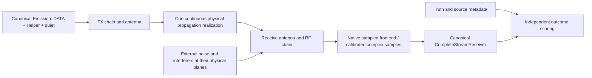

# Possible native implementations and current modem boundaries

Inspected source: `edafea00dcc73163cde2e06cc4b7df09b4eb3b53`, 13 November 2026.
These are source observations and implementation proposals. No new channel
engine, experiment executable or receiver algorithm was implemented or timed.
Better implementations may emerge after measurement validation; the options
below deliberately preserve that possibility.

## What “triple” means here

The canonical wire format is `independent-apsk-v2`, represented by
`Format::IndependentApskV2` in
[`triad_modem_v3.hpp`](../../../include/datapump/triad_modem_v3.hpp).
The `triad::v3` namespace and filenames are API names, not a different wire
revision. Three keyed DATA carriers form one composite waveform. Helper is
additional configured emission, not a fourth independently simulated link.

The geometry in
[`triad_modem_v3.cpp`](../../../src/triad_modem_v3.cpp) calculates fine chip
rate as `(configured inner rate / 6) * Added Symbols`, DATA carrier spacing as
`1.25 * fine chip rate`, and nominal occupied DATA bandwidth as three times
that spacing. `PatternSource::sample_at()` sums the shaped carriers at
offsets `−spacing`, `0`, `+spacing` with a common `1/sqrt(3)` scale.
**RF frequency and waveform bandwidth are independent inputs.** A 5.8 GHz
physical channel does not require sampling the RF sinusoid at gigahertz rates;
a correctly constructed complex envelope can represent the occupied band.
Conversely, a narrow DATA band does not justify ignoring a distant Helper,
interferer, RF preselector or broad front-end overload mechanism.

The [current architecture](../../../docs/robust-current.md) and
[channel guide](../../../docs/channel-models.md) are authoritative for the
present implementation. Earlier research under `_ref/resilience-...` remains
useful for alternatives and source leads, but some of its GUI and receiver
observations predate changes in this revision.

## Existing interfaces to reuse

| Existing native interface | Suitable role | Boundary that matters |
| --- | --- | --- |
| `PatternSource` in [`triad_modem_v3.hpp`](../../../include/datapump/triad_modem_v3.hpp) | Exact canonical DATA rendering and component controls | Alone it does not assemble complete message/Helper/calendar behavior |
| `PublicProfileConfig`, `PublicProfile` in [`triad_stream.hpp`](../../../include/datapump/triad_stream.hpp) | Public waveform, slot, calendar and search declarations | Received content must not select geometry |
| `Emission` and `Emission::source()` in the same header | Complete clean DATA, Helper, quiet or noise emission | Streaming ownership and configured ordinal must survive chunking |
| `EmittedSource` in [`triad_modem_v3.hpp`](../../../include/datapump/triad_modem_v3.hpp) | Already-composed input callback and frequency/workspace declarations | Forward integer-sample callback; caller-owned source must outlive consumer |
| `StreamingChannel` in the same header | Existing synthetic controls and useful baseline | Fixed configuration family; it is not already an arbitrary propagation-kernel plugin |
| `score_receiver_slot` in [`triad_receiver.hpp`](../../../include/datapump/triad_receiver.hpp) | Complete isolated Helper/coarse/fine slot check | Not continuous receiver throughput or message completion by itself |
| `CompleteStreamReceiver` in [`triad_stream_receiver.hpp`](../../../include/datapump/triad_stream_receiver.hpp) | Canonical continuous receiver, ordered commits, backpressure and messages | A rejected push consumes no samples; retry the same chunk correctly |
| [`triad-receiver-probe.cpp`](../../../tools/triad-receiver-probe.cpp) | Existing example of continuous composite emission and actual receiver use | Reuse interfaces and behavior, not a copied alternate probe implementation |

The existing CMake libraries are `datapump_triad`,
`datapump_triad_receiver` and `datapump_robust_session`. The probe target is
defined in [`cmake/TriadBench.cmake`](../../../cmake/TriadBench.cmake), with
transitive source/build fingerprints. A future isolated appraisal target can
link the canonical libraries from an out-of-source build. A proposed
subdirectory-level build integration must be checked against the top-level
options before implementation; no new CMake command is advertised as working
in this research deliverable.

The intended containment is straightforward: new channel research code and
experiment operating/test documents stay in
[`_appraisal/highFidelity-triple_Robust_Modem`](../../../_appraisal/highFidelity-triple_Robust_Modem/README.md).
The suite can be independently invoked without copying the modem, inventing
another codec, or changing production defaults. A standalone experiment is
not a standalone numerical reimplementation.

## Present simulation coverage, accurately bounded

The native channel already provides considerably more than AWGN. Its public
types include oscillator error/drift/phase-noise families, direct and delayed
rays, optional OU or Gaussian-Doppler gains, smooth delay motion, common
frequency wander, a finite signal outage, frequency-selective perturbations,
sampled frontends and validity-marked observation losses. State continues
through chunks, source silence and erased observations; delayed and filter
tails are retained. These are useful component stresses, not calibrated
predictions for the five requested environments.

The GUI currently chooses a bounded changing two-path realization. `HF Worst`
declares 7 ms excess-delay support and 30 Hz differential Doppler before
margin. One echo delay is drawn within support, echo power varies, and the
direct path remains present. Smooth-knot timing is synthetic. These numbers
are neither a measured joint distribution nor a universal environmental
maximum. Common wander and relative Doppler add; neither is automatically a
Gaussian Doppler-spectrum width.

| Present simplification | New research requirement | Why the distinction matters |
| --- | --- | --- |
| RF carrier affects clocks/path phase but selects no environmental solver | Explicit station/path/environment inputs | “1 MHz” alone cannot choose conductivity, terrain or season |
| One/two-ray families and finite stochastic alternatives | Conditioned discrete modes, diffuse components and disappearance where supported | Real energy may occupy multiple delays/polarizations or vanish |
| Scalar synthetic selective effects | Frequency response generated by a common physical channel | Correlation among DATA carriers and Helper should be an output |
| Gaussian receiver sample noise, synthetic impulses/tone | Calibrated colored and clustered noise, external interferer geometry | An amplitude histogram alone does not set burst duration or overload |
| Simplified converter/AGC/filter models | Measured transfer curves, passbands and recovery where relevant | A receiver may fail before its digital detector sees the waveform |
| A finite outage control | Environment-conditioned outage durations and transitions | Outages can alter completion and reacquisition, not just average SNR |
| Normalized sample power | Explicit antenna-terminal/receiver-input reference planes | Loss, antenna efficiency and noise temperature must not disappear |

The existing one-sample impulse process admits at most one event per sample;
it is not a measured lightning pulse train. The existing tone is in receiver
coordinates, not an independently propagated RF source across retuning.
The current source-history cap is an implementation resource bound, not a
scientifically justified maximum propagation delay. These observations come
from [`triad_modem_v3.hpp`](../../../include/datapump/triad_modem_v3.hpp) and
[`triad_simulation_stream.cpp`](../../../src/triad_simulation_stream.cpp).
No claim is made that every omitted phenomenon causes a receiver failure.

## Compare several implementation families

| Candidate | Where it could be useful | Main limitation | Evidence that would decide |
| --- | --- | --- | --- |
| Recorded I/Q replay | Real noise/frontend behavior and selected field episodes | Unknown transmitted waveform/channel, censoring, finite geography/time coverage | Calibration metadata, raw recording quality, independent replay cohorts |
| Measured channel-response replay | Apply a controlled canonical source to measured time-varying propagation | Sounder bandwidth, ambiguity, noise-floor truncation and interpolation | Reproduce original sounder processing before using finer resolution |
| Conditioned stochastic finite impulse response | Efficient moderate/severe families with measured correlation | Tail/model misspecification and uncertain regime transitions | Holdout delay–Doppler, joint carrier correlation and fade-duration distributions |
| Geometry/physics plus measured stochastic residual | Coherent station motion, path delay, polarization and nonstationarity | Environment inputs and unresolved scattering can dominate error | Independent episodes with varied conditions; comparison to simpler model |
| Detailed EM/propagation solver | Antenna/earth coupling, terrain, ionosphere or lunar-scattering subproblems | Cost, ill-known materials/environment and numerical approximation | Mesh/order convergence and measured reference geometry |
| Reduced surrogate of a validated solver | Cheap exploration of the validated solver's domain | Extrapolation, loss of tails/phase, shared model error | Holdouts from both solver and observations, explicit validity envelope |

The current research suggests a **candidate** hybrid approach: compute slowly
varying geometry and antenna/propagation response, then render bounded native
baseband with validated stochastic residuals and front-end effects. That is
a starting hypothesis, not a selected architecture or a claim of superior
fidelity. Measured replay may be the best first discriminator. For some
groundwave cases a smooth-Earth scalar response may be entirely adequate; for
some disturbed HF or lunar cases it may be inadequate regardless of tuning.

### Domain-specific native components worth comparing

- **Sub-9 kHz:** measured or EM-derived antenna terminal impedance/effective
  height and losses; matching-network transfer; waveguide transfer varying
  with ground/ionosphere; finite-band lightning and local noise. An earth
  electrode channel requires a distinct field/coupling calculation, not the
  same far-field antenna formula with a changed gain.
- **1 MHz groundwave:** spherical-Earth response with specified conductivity
  and permittivity, then mixed-path/terrain alternatives where needed. Add
  skywave as a separately conditioned contribution when physically present.
- **30 MHz nominal groundwave:** explicitly compare surface-wave, space-wave,
  diffraction and atmospheric alternatives instead of burying all mechanisms
  inside a fitted surface-loss coefficient.
- **HF skywave:** magnetoionic mode/ray trajectories or measured modes, with
  correlated stochastic scattering and absorption. Ray tracing alone does
  not supply unresolved small-scale fluctuations; a Watterson generator alone
  does not supply path availability or storm evolution.
- **5.8 GHz EME:** retarded two-leg geometry, weighted lunar surface scattering,
  polarization and beam patterns, plus separate RF/tropospheric/frontend
  effects. Compare a reduced delay–Doppler kernel to a surface model; whole
  disk geometric support does not mean uniform power across that support.

Evidence and uncertainties for these components are in the linked domain
chapters, not inferred from their availability as algorithms.

A named research package is not an already integrated backend. Its source
availability, license, language interface, numerical conventions and usable
input/output data still need checking. A published ray-tracing result can be
an independent reference without requiring that package in the operating
modem. Reuse a compatible native implementation when available; otherwise
evaluate a contained native adapter or a narrower reference-data interface
before committing to a new solver.

## A proposed processing boundary

This is a conceptual diagram; the exact split depends on the model and
available calibration. Noise can enter at several planes, not just the one
shown. For a purely linear calibrated experiment several stages may be
combined into one transfer kernel. Nonlinear effects must retain their
physical order. Avoid passing the same samples through both the new physical
channel and an enabled legacy synthetic impairment unintentionally.

The propagation engine should accept the complete emitted waveform and own
bounded history for variable/fractional delays and interpolation. Forward-only
`EmittedSource` does not grant arbitrary backward reads. Allocate the tail
from declared physics/filter support; retain a documented residual-energy
bound for truncated infinite-memory models. Changing chunk size must not
change the realization or reset clocks, noise, modes or source ordinal.
Absolute bulk delay can be represented by timestamp offsets where correct;
it should not require storing seconds of zeros merely for convenience.

Coefficient/control updates can often run more slowly than sample rendering,
but that is an approximation requiring spectrum and phase-error checks.
Overlap-save/add, vectorized fractional-delay banks and batched complex
products are candidates for the native renderer. Block boundaries must not
freeze rapid dynamics or produce circular convolution wraparound. Native
libraries/backends are optional implementation choices, not fidelity evidence.

Counter-based or otherwise index-stable random streams are worth considering
for reproducibility across chunks and parallel schedules. Independent seed
domains separate noise, propagation, interference and oscillator experiments;
they must not erase known physical correlations. Store the actual state/model
version and seed scheme with results, not just an integer seed.

## Receiver implications that the suite must expose

**Configured-calendar reception remains the present scope.** The public epoch,
keyed ordinal, waveform/key and configured FEC are agreed inputs. Unknown
epoch/ordinal/start acquisition is unqualified; expanding the channel model
does not fix it. A separate blind-acquisition study would need competing
address hypotheses, incorrect-address controls and their complete cost.

**Physical completion is an observability problem as well as a decoder
problem.** Current message assembly requires two fully scored quiet slots
after DATA. Ambiguous slots reset the quiet run; an interior missing interval
can remain an erasure if DATA resumes before completion. EOF or cancellation
does not manufacture silence. See
[`triad_message_receiver.cpp`](../../../src/triad_message_receiver.cpp) and
[`triad_receiver.cpp`](../../../src/triad_receiver.cpp).

A proposed critical case is a real fade/outage covering two quiet-scoring
apertures while the transmitter is still active. Those noise-only samples
are valid observations, unlike missing capture marked invalid. If two
physical histories yield identical received samples, no receiver can always
distinguish them from those samples alone. This elementary observability
argument is not a measured defect rate. The appraisal should measure early
completion, integrity rejection, accepted truncation where possible,
reacquisition and later suffix handling separately. It must preserve the
existing physical-completion contract while exposing its environmental limits.

**A better generator need not resemble the detector.** Keep the production
receiver fixed for initial characterization. Challenging channel truth must
not reduce its public search or choose favorable nuisance states. Later
receiver candidates can be compared against the same frozen scenario and
holdout definitions. Parameter tuning against the test corpus creates a new
validation requirement.

## Resource and implementation limits

The operating stack stays C++. Python may orchestrate native executables and
analyze output; it should not own the channel DSP, modem or persistent receiver
state. Preserve one canonical modem, shared immutable samples and explicit
native owners. See the [development contract](../../../docs/development.md).

Receiver measurements retain `W = 2*H`, based on actual affinity/quota, with
explicit limits exact. Source/channel generation and receiver computation
must be timed separately as well as together when relevant: an expensive
simulator is not evidence that the real receiver cannot keep up. Independent
simulations in parallel are not one-stream receiver throughput. Record
admitted workspace, all required public hypotheses, failed Helper acquisition,
fine tracking, quiet completion and recurring work.

Do not prescribe universally FP64 channel rendering or universally low
precision. Phase coordinates, long delays and cancellation can require careful
arithmetic; bulk rendering may admit cheaper representations. Validate the
observable consequences and receiver outcomes. For receiver automatic mode,
the project's computational-ceiling and precision contracts still apply.

No GPU rental or hardware qualification is required for this documentation
phase. If accelerated experiments later become justified and authorized,
follow the project's full-device RTX PRO 6000 Blackwell preference and record
actual arithmetic/stage execution. None of this research is a CPU capacity,
GPU performance, sensitivity, release or physical-radio qualification.

The concrete proposed stages, data fields, bounded pilot and acceptance
distinctions are kept with the experiment documentation in
[the appraisal protocol](../../../_appraisal/highFidelity-triple_Robust_Modem/experiment-protocol.md).
