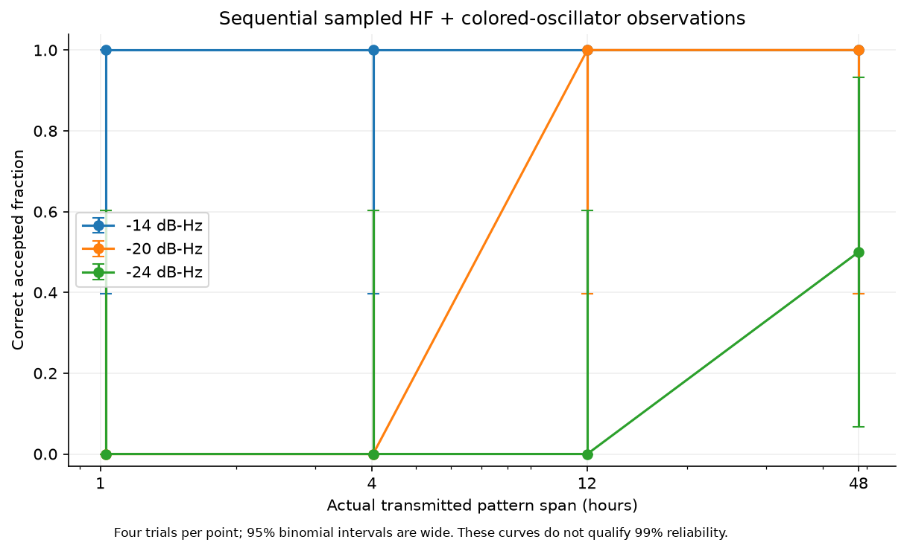
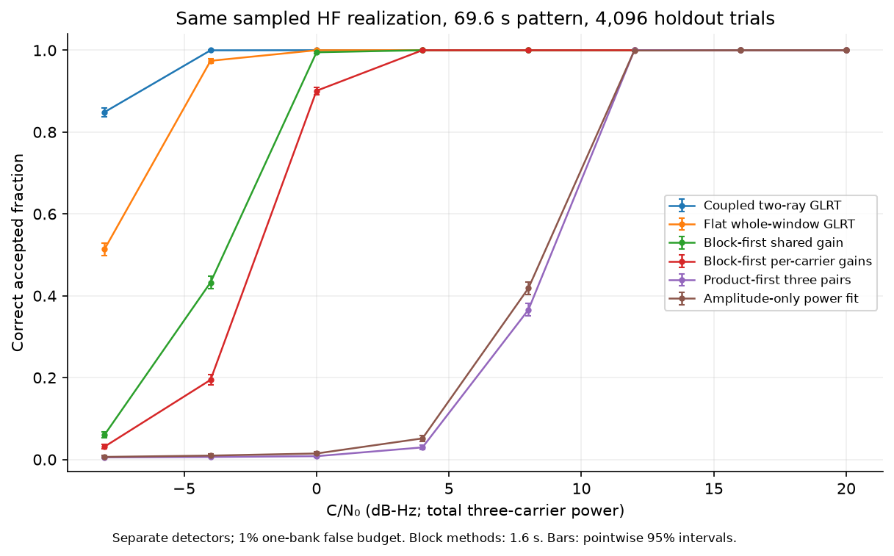
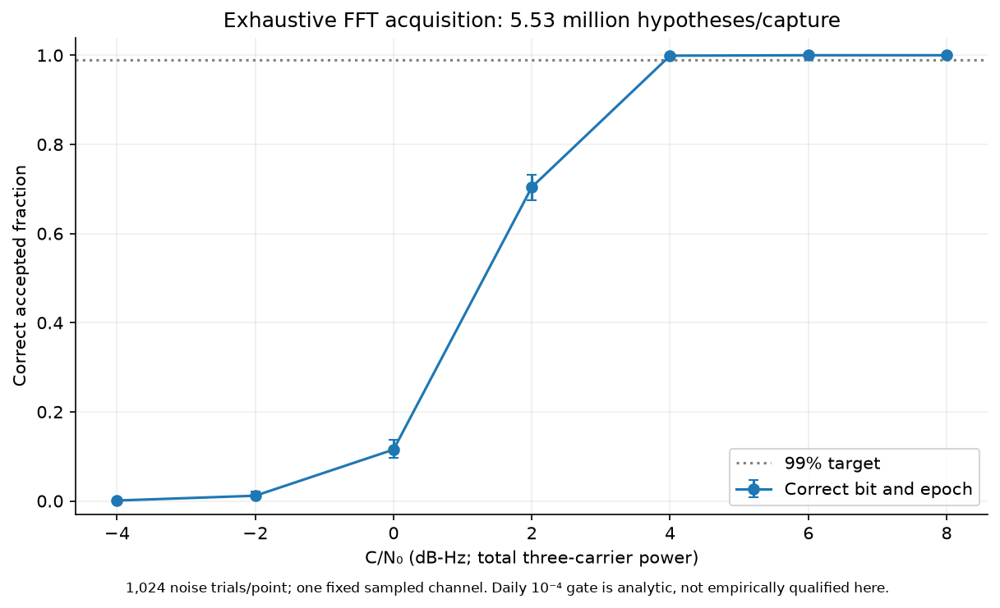

# Three-carrier v3: sampled reception, duration and GPU studies

These are software experiments for the isolated v3 modem, dated 31 October
2026. The [design and model contract](../../../triad-v3.md) defines the format,
receiver, planner and conditional statistical bounds. No ordinary Robust
receiver integration, unrelated regression campaign, radio measurement or
release certification is included.

The focused streaming result is **320/320 correct accepted one-bit messages
at 8 dB-Hz in the selected HF model**, using 23.2 seconds of transmitted pattern
and known alignment. Its one-sided 95% exact binomial lower bound is 0.990682.
The original daily noise-only holdout produced **13 admissions in 100,000
simulated days** and did not establish the requested 0.0001/day target. After
reserving a stricter threshold, a fresh 500,000-day projected-Gaussian
holdout produced **12 null admissions** and **499,207 correctly acquired
messages at 8 dB-Hz**. The respective one-sided 95% bounds are 0.000038885
and 0.998318, satisfying both targets for that fixed-bank Gaussian model.
This larger study does not execute sampled waveforms. Separate full-stream
observations extend to 172,871.2 seconds, with memory bounded by tiles rather
than duration; their four trials per operating point do not qualify 99%
reliability. A separate sampled GPU acquisition study evaluates 5,533,164
timing/frequency/epoch/bit hypotheses per capture and achieves 1,023/1,024
correct acceptances at 4 dB-Hz for one exported flat-channel realization.

The compact [evidence archive](evidence.tar.gz) contains raw result rows,
campaign commands/seeds, original failures, final test logs, exported-input
manifests and exact remote study scripts. The [artifact manifest](artifact-manifest.json)
binds their SHA-256 digests; [final source/binary hashes](final-source.sha256)
bind the final focused checks. Earlier campaign hashes remain separate below.

## Evidence and interpretation

| Evidence | Actual execution | What it establishes |
|---|---|---|
| C++ short, target and long campaigns | Shaped complex samples through sequential source, sampled channel and streaming QR receiver | End-to-end behavior of that synthetic pipeline and declared candidate bank |
| Paired Python detector study | Independently exported sampled signals, sampled AWGN, finite-window carrier separation | Conditional detector comparison using identical observations; one channel realization per export |
| Raw daily GPU study | Sampled AWGN and projections for every scheduled observation window | A fixed-bank daily schedule under known white Gaussian noise |
| Gaussian sufficient-statistic study | Joint complex Gaussian correlations generated from the exported basis Gram matrix | Much larger sampling of the same fixed linear Gaussian model; not an independent sampled-waveform receiver validation |
| Shared-phase study | Finite-state likelihood over complex block correlations, checked with raw and sufficient noise samplers | A known-unit-gain Wiener-phase alternative and an explicit colored-noise mismatch failure |
| Wide FFT acquisition | Sampled noise and complete finite timing/frequency/epoch/bit grid | Broad acquisition for one constant-gain template model and one exported signal realization |
| Precision and kernel benchmark | The same resident matrices evaluated on CPU and GPU | Numerical agreement and kernel acceleration; not streaming receiver throughput |

The C/N₀ figures are dB-Hz referenced to total nominal triplet power. In the
unit-power simulation, `E|noise[k]|² = sample_rate / 10^(C/N₀/10)`. They are
not in-band SNR. Rate 36 with Added Symbols ×10 has 60 fine cells/s/carrier,
75-Hz spacing and 225-Hz nominal combined bandwidth; 8 dB-Hz corresponds to
about −15.52 dB in that bandwidth. Actual received energy also depends on
shaping, channel gains, guards, erasures and burst waits.

The standard synthetic HF selection has two equal-power rays, 1.5-ms excess
delay, 0.3-Hz Doppler separation, and additional 5% slow and 5% fast
frequency-selective amplitude perturbations. It can have deep fades; it is
not a flat channel with only 5% variation. The default relative Wiener-phase
coefficient is approximately 0.00872665 rad/√s. “None” bypasses spread and
selective modulation, but does not necessarily disable oscillator error or
AWGN. All these are model selections, not measurements of a particular path
or oscillator.

Counts below distinguish correct accepted messages, wrong accepted bits,
misses and noise-only admissions. Repeated acquisition hypotheses are not
independent trials. C/N₀ sweeps reuse noise and, within named C++ groups,
seed indices; do not pool those rows as independent replications. Exact
one-sided binomial bounds use the Clopper–Pearson method at 95%. The few
two-sided binary-error intervals identified below use Wilson's method.

## Streaming receiver and short cases

`triad-stream-study.py --suite short --trials 8 --workers 4` ran 286 processes:
276 signal captures, four noise-only captures, four wrong-key captures and
two expected microwave capture-range rejections. There were 215 correct
acceptances, zero wrong acceptances, 61 misses, zero null admissions and zero
wrong-key admissions. All 286 outcomes matched the harness's execution
expectations; this does not mean all signal messages were received.
There were no incomplete observations or unexpected process outcomes.

The main table uses known alignment and 1.6-second scoring blocks. HF searches
the declared flat and coupled two-ray bases; the no-spread case uses the flat
basis. Each entry is correct accepted messages out of eight; there were no
wrong acceptances in this table. Requested durations are rounded to complete
private source tiles.

| Requested active duration | C/N₀ | No spread | HF |
|---:|---:|---:|---:|
| 16 s (23.2 s actual) | 8 | 8/8 | 8/8 |
| 16 s | 4 | 8/8 | 7/8 |
| 16 s | 0 | 2/8 | 1/8 |
| 16 s | −4 | 0/8 | 0/8 |
| 60 s (69.6 s actual) | 8 | 8/8 | 8/8 |
| 60 s | 4 | 8/8 | 8/8 |
| 60 s | 0 | 7/8 | 5/8 |
| 60 s | −4 | 0/8 | 0/8 |
| 240 s | 8 | 8/8 | 8/8 |
| 240 s | 4 | 8/8 | 8/8 |
| 240 s | 0 | 8/8 | 8/8 |
| 240 s | −4 | 8/8 | 4/8 |

At 4 dB-Hz in HF with 60 seconds requested, the block-duration sweep gave
3/8 at 0.1 s, 6/8 at 0.2 s, and 8/8 at each of 0.4, 0.8, 3.2 and 6.4 s.
The separate default 1.6-s group also gave 8/8. These are small diagnostics of
the coherence/model-dimension tradeoff, not a validated choice of optimum
block length.

Other short checks each had zero wrong acceptances:

| Check | Correct accepted | Scope |
|---|---:|---|
| Rate 360, FHSS envelope, 18.4-s actual pattern | 8/8 | Transmitter envelope and retained channel tails; no RF retuning |
| Symbol Burst with one 11.6-s wait tile, 127.6-s elapsed pattern | 8/8 | Explicit silence and active-energy accounting |
| 10-ms erasure starting 200 ms into every 400-ms dwell | 8/8 | Declared sample masks, 69.6-s pattern |
| ±30-ppm sample-clock bank | 8/8 | Finite declared clock hypotheses |
| Blind timing/frequency/epoch, HF at 8 dB-Hz | 4/4 | Small finite search, 23.2-s pattern; not a broad RF capture test |
| 5.8 GHz, declared ±6-kHz CFO prior, 960 samples/s | 2/2 expected rejections | Correct refusal of an aliased search; no microwave reception result |

Eight successes have a one-sided 95% lower probability bound of only 0.68766;
four successes give 0.47287. The short null and wrong-key checks are defect
screens, not operational false-admission qualifications.

The separate target run used 320 independent seeds, a 23.2-s pattern,
1.6-s blocks, the selected HF model, 8 dB-Hz and known alignment. All 320 bits
were correctly accepted, with zero wrong acceptances and zero misses. There
were 24,503 samples per capture and four declared candidates; the reported
pipeline workspace bound was 1,590,456 bytes. The exact one-sided lower bound
of **0.990682** supports the configurable 99% reception target at this
conditional operating point. It does not establish blind acquisition, other
channel distributions, or the daily false-admission target. Each run scores
one capture even though its threshold budgets repeated attempts over a day.

## Long observations and oscillator checks

The long suite ran 54 complete observations: 48 colored-oscillator HF captures
and six flat controls. It produced 30 correct acceptances, zero wrong
acceptances, 24 misses and no incomplete or unexpected outcomes. It uses
Rate 3.6, Added Symbols ×10, 64 samples/s, 6 fine cells/s/carrier, nominal
bandwidth 22.5 Hz, and 24-s blocks. This narrower waveform is not a duration-only
extension of the 225-Hz short experiment.

The colored oscillator includes the default relative Wiener term, white FM
0.002 Hz√s, random-walk FM 10⁻⁶ Hz/√s, finite-band flicker FM 0.002-Hz RMS
over time constants 0.1–86,400 s, and white PM 0.01 rad. The selected HF channel
and its 5%/5% modulation remain active. Every source, channel and receiver
sample was processed sequentially; time was not compressed and the channel
state was not reset between chunks.

| Actual elapsed pattern | C/N₀ −14 | C/N₀ −20 | C/N₀ −24 |
|---:|---:|---:|---:|
| 3,709.2 s | 4/4 | 0/4 | 0/4 |
| 14,499.6 s | 4/4 | 0/4 | 0/4 |
| 43,274.0 s | 4/4 | 4/4 | 0/4 |
| 172,871.2 s | 4/4 | 4/4 | 2/4 |



Entries are correct acceptances. The two-day capture contains 11,064,065
complex samples. The reported four-candidate HF pipeline bound remains
1,571,464 bytes across these durations. The flat, no-FM controls at −20 dB-Hz
gave 0/2 at one hour and 2/2 at each of twelve and forty-eight hours. These
small samples show actual duration scaling and failures; none qualifies 99%
reception or a generic multi-day propagation model.

A separate two-day, flat-spread, colored-oscillator realization was correctly
accepted at −20 dB-Hz. It processed 11,064,065 samples in 55.308 s wall time
(63.814 s CPU time, two receiver threads), with a 1,069,336-byte reported
pipeline bound. This is a computational diagnostic of the narrow sampled
model, not a real-time radio or competing-load benchmark. The parallel
campaign process timings are not used as isolated throughput measurements.

The oscillator diagnostic exercises the actual `StreamingChannel`, extracting
phase from a noise-free flat signal sampled at 1 Hz after edge exclusion.
It retained 7,304 phase observations. With independent equal TX/RX terms,
measured/theoretical overlapping Allan-deviation ratios at averaging times
1–32 s were 0.9794–1.0042 for white FM, 1.0170–1.0742 for random-walk FM, and
0.9820–1.0000 for white PM. The finite-band OU flicker approximation had a
log–log slope of −0.0483 over 1–512 s. These scaling checks passed the stated
45% diagnostic tolerance. Effective degrees of freedom and confidence
intervals for the overlapping estimates were not calculated; this is not
device-specific oscillator qualification or a proof of an exact flicker law.

## Paired receiver alternatives

The Python study compares product-first correlation using all three carrier pairs,
accumulate-first block detectors, amplitude-only evidence and full sampled
subspace likelihoods. These alternatives are study implementations; the C++
streaming receiver currently implements the joint sampled QR likelihood.
The Python carrier separation uses disjoint circular finite-window DFT bands,
not a streaming analog/channelizer model. All methods see identical sampled
noise and the same exported channel realization. There are 8,192 independent
calibration captures and 4,096 holdout captures per detector. Thresholds target
1% per capture **for each detector separately**; admitting whichever detector
passes would require a new combined calibration.

The 69.6-s HF export with 0.4-s blocks gave the following correct acceptances
out of 4,096. “Shared” fits one common gain across the three accumulated
carriers per block; “separate” fits three gains. Flat and two-ray GLRT columns
use their declared whole-capture sampled subspaces.

| C/N₀ | Product first | Block shared | Block separate | Flat GLRT | Coupled two-ray GLRT |
|---:|---:|---:|---:|---:|---:|
| −12 | 23 | 48 | 41 | 556 | 1,129 |
| −8 | 28 | 132 | 86 | 2,106 | 3,477 |
| −4 | 38 | 807 | 351 | 3,990 | 4,095 |
| 0 | 69 | 3,739 | 2,554 | 4,096 | 4,096 |
| 4 | 240 | 4,096 | 4,096 | 4,096 | 4,096 |
| 8 | 2,154 | 4,096 | 4,096 | 4,096 | 4,096 |

At −4 dB-Hz, product-first had 38 correct acceptances, 33 wrong acceptances
and 4,025 misses; the coupled likelihood had 4,095 correct, zero wrong and
one miss. Product-first also had 1,908 raw candidate-bit errors before gating.
At 8 dB-Hz it still had 222 wrong acceptances and 1,720 misses. Its problem
cannot be repaired solely by lowering an admission threshold. Null admissions
were respectively 50, 40, 47, 30 and 27 out of 4,096. Those are one shared
null holdout per detector, repeated in each SNR row; they are not additional
independent null trials.

The analogous 23.2-s flat export gave, at −4 dB-Hz, 37 product-first, 338
shared-block, 122 separate-block and 3,588 flat-GLRT correct acceptances.
At 0 dB-Hz those counts were 51, 2,182, 694 and 4,096. Thus the ordering is
not solely a consequence of the two-ray basis. However, the whole-capture
GLRT also assumes a more persistent low-dimensional channel than the block
methods. The measured gap combines coherence/model effects with the
noise-times-noise penalty of early multiplication; it cannot all be assigned
to multiplication loss.

A six-method HF study with 1.6-s blocks added a constrained, centered-power
amplitude detector. At 8 dB-Hz it had 1,714 correct, 11 wrong and 2,371 misses,
versus product-first's 1,498 correct, 90 wrong and 2,508 misses. At 12 dB-Hz
amplitude-only had 4,093 correct, zero wrong and three misses; at 16 dB-Hz all
4,096 were correctly accepted. Its null count was 42/4,096. This demonstrates
amplitude distinguishability for this waveform/model; it is not a Rice
likelihood, a universal sensitivity penalty, or a simulated-AGC result.



The figure uses the six-method, 1.6-s-block experiment; the earlier table
uses 0.4-s blocks. All three pair products are dependent and their combined
score is empirically calibrated, not treated as three independent tests.

GLRT gates use the specified Gaussian projection law. Product, block and
amplitude gates use independent empirical order-statistic calibration of the
full candidate maximum. The latter has marginal calibration guarantees, not
a proof that each realized threshold has exactly 1% conditional false
admission. The retained signal fractions of the finite DFT bands were about
0.999986. This single finite-window metric does not establish spectral
compliance, adjacent-carrier isolation, Gaussian statistics or low probability
of intercept.

## Shared phase inference and model mismatch

The separate phase study retains complex block correlations and marginalizes
a finite circular phase trajectory with 64, 128 or 256 states. It uses a
normalized predictive likelihood and a finite-family Markov/union bound for
analytic admission. The constant-phase and independent-block comparisons
instead use their Gaussian projection null laws. Each method is budgeted
separately at 1% per capture; selecting whichever method passes is not the
tested policy. The phase model has a known-unit-gain prior, while the GLRT
comparisons fit free gains. These are different nuisance assumptions, not
equal-information implementations of one optimum detector.

Each export is a 3,714.015625-s capture with 237,697 samples at 64 samples/s,
two candidate bits and 16-s blocks. The receiver sees public diffusion
parameters, not the hidden realized phase. One export uses relative Wiener
diffusion 0.05 rad/√s; the other uses the default 0.00872665 rad/√s plus the
white FM, random-walk FM, finite-band flicker FM and white PM settings listed
for the long study. There is one fixed noiseless channel/phase realization
per export. Calibration has 999 noise captures; holdout has 512. Raw-noise
and sufficient-statistic modes use independent random streams, while methods
and C/N₀ points within each mode share noise.

The table shows **raw sampled-noise holdout correct acceptances out of 512**.
The first three detector columns use analytic gates; the final column uses
the independent empirical 1%-per-capture calibration for the 256-state phase
likelihood.

| Export / C/N₀ | Constant phase | Independent blocks | Phase, analytic | Phase, empirical |
|---|---:|---:|---:|---:|
| Wiener / −24 | 451 | 27 | 382 | 472 |
| Wiener / −20 | 512 | 221 | 510 | 512 |
| Wiener / −16 | 512 | 511 | 512 | 512 |
| Colored / −24 | 6 | 19 | 0 | 8 |
| Colored / −20 | 10 | 214 | 0 | 14 |
| Colored / −16 | 29 | 510 | 0 | 101 |

At Wiener −24 dB-Hz, analytic phase inference had 382 correct, zero wrong,
130 misses and zero null admissions. Its empirical gate had 472 correct,
one wrong, 39 misses and four null admissions. Constant-phase GLRT had 451
correct, zero wrong, 61 misses and five null admissions. The sufficient-mode
comparison gave respectively 384, 462 and 445 correct acceptances. These
results support retaining trajectories and complex evidence over independent
short-block energy, but do not establish a universal sensitivity gain over
constant-phase reception. The analytic likelihood-ratio bound is visibly
conservative in this case, and empirical calibration changes the comparison.

The colored export explicitly permits mismatch between its oscillator and
the scalar Wiener prior. At −16 dB-Hz the original phase prior accepted no
signal captures, while independent block energy accepted 510/512, with zero
wrong bits, two misses and four null admissions. Lowering the phase threshold
through independent calibration recovered only 101 correct, one wrong and
410 misses, with four null admissions. The true waveform's noiseless energy
projection onto the constant-phase template was only 0.009799, versus 0.996980
onto the independent-block subspaces. For the Wiener export these fractions
were 0.612072 and 0.993986. These evaluator-only diagnostics explain the
constant-phase loss and expose the danger of an incorrectly constrained
trajectory; the receiver does not use the realized fractions or hidden path.

All analytic decisions agreed across 64/128/256 states. Maximum adjacent-grid
log-likelihood differences were 0.10964 for the Wiener campaign and 3.65466
for the mismatched colored campaign. The latter's empirical −16-dB-Hz raw
correct counts changed from 107 to 103 to 101 across those grids, so identical
analytic rejection is not sufficient evidence of useful grid convergence.
Zero null admissions in 512 captures gives an upper bound of 0.005834 per
capture, not a daily false-admission qualification.

Two diagnostic follow-ups broadened the assumed scalar diffusion to 0.05 and
0.1 rad/√s while retaining the same colored signal and noise realizations.
Both explicitly allow model mismatch. Their analytic family count is six,
reserving three scalar-prior choices for two bit patterns; this also raises
the comparison detectors' analytic thresholds. At −20 dB-Hz the raw-noise
holdout gave:

| Receiver / gate | Correct | Wrong | Missed | Null |
|---|---:|---:|---:|---:|
| Independent blocks / analytic family six | 148 | 1 | 363 | 2 |
| Phase diffusion 0.05 / analytic family six | 94 | 0 | 418 | 0 |
| Phase diffusion 0.1 / analytic family six | 468 | 0 | 44 | 0 |
| Independent blocks / empirical single-bank gate | 217 | 2 | 293 | 4 |
| Phase diffusion 0.05 / empirical single-bank gate | 439 | 2 | 71 | 5 |
| Phase diffusion 0.1 / empirical single-bank gate | 507 | 1 | 4 | 3 |

Each row has 512 signal and 512 null trials and uses 256 phase states where
applicable. This is substantial recovery from the original narrow prior's
0/14 analytic/empirical correct counts. The 0.1-prior analytic and empirical
correct-probability lower bounds are nevertheless only 0.890881 and
0.979577. The broader priors were chosen after inspecting the first failure,
using one channel realization and reused noise; this is not independent
model-selection qualification. Empirical gates each calibrate one exercised
bank and do not jointly calibrate an adaptive choice among priors. The 0.05
study had up to two analytic admission differences across phase grids; the
0.1 study had none, with maximum adjacent-grid log-likelihood difference
0.02273. A frequency-state or colored-noise model, multiple independent
oscillator paths and independently validated selection remain necessary to
establish the broader sensitivity benefit.

## Known-channel benchmark and remaining sensitivity gap

For known sampled means in complex AWGN, equal-prior binary classification has
`P(error) = Q(sqrt(||s1−s0||²/(2σ²)))`. The study independently exported both
bit waveforms with identical channel/clock settings and calculated their
actual FP64 squared distance. A nearest-known-mean oracle then used the same
positive noisy observations as the other detectors. This benchmark knows
alignment, phase and channel, and has no noise-only admission requirement.

| Export / C/N₀ | Theoretical binary error | Observed errors / 4,096 | Two-sided 95% Wilson interval |
|---|---:|---:|---:|
| Flat / −12 | 0.113678 | 462 | [0.103466, 0.122846] |
| Flat / −8 | 0.027856 | 111 | [0.022553, 0.032533] |
| Flat / −4 | 0.001213 | 7 | [0.000828, 0.003524] |
| HF / −12 | 0.017140 | 62 | [0.011826, 0.019356] |
| HF / −8 | 0.000397 | 3 | [0.000249, 0.002151] |

The squared sampled distances were 44,346.22098 (flat) and 136,346.86513 (HF).
The observed binary errors agree with this known-mean benchmark at the
displayed uncertainty. At flat −12, −8 and −4 dB-Hz, the unknown-phase GLRT
made respectively 1,008, 330 and 18 raw bit errors, compared with the oracle's
462, 111 and seven. Additional admission and acquisition penalties must be
measured separately; raw binary accuracy is not accepted-message probability.

Inverting the oracle's observed binary-error rates through the same `Q`
formula gives implementation energy losses of −0.033 dB at flat −12 dB-Hz
and −0.054 dB at −8 dB-Hz. Mapping two-sided 95% exact binomial intervals
through that formula gives respectively [−0.394, 0.341] dB and
[−0.418, 0.317] dB. The negative estimates are sampling variation, not
performance better than the bound. These two checks demonstrate less than
1 dB implementation loss for the **known-channel binary oracle** at those
operating points; they do not demonstrate a near-bound unknown-channel
receiver or operational acquisition result.

Under the guide's ideal orthogonal unknown-phase assumptions, the intrinsic
energy gap to the known-phase binary benchmark is 1.6008 dB at 99% and
2.9223 dB at 90%. Those are analytical reference points, not measured triad
gaps. The desired implementation target of within 1 dB of a matched
unknown-channel reference remains unqualified across synchronization and
channel uncertainty. The present evidence establishes numerical projection
agreement and selected operating points, not universal optimality.

Known coherent collection gives `T ∝ (C/N₀)⁻¹` at fixed energy target. For
independent short noncoherent blocks at low per-block SNR, the useful mean
shift grows with `C/N₀ × T` while null fluctuation grows roughly with `√T`;
the resulting duration can scale as `(C/N₀)⁻²` at fixed block length. Product
statistics likewise incur a low-SNR quadratic signal term. These scaling laws
require the stated fixed models, noise and coherence assumptions; the small
long-duration table does not fit or validate a universal asymptotic law.

## Daily false admission and acquisition schedule

The daily experiment declares 1,440 nonoverlapping attempts, spaced 60 s
apart, with a 270-candidate bank: five arrivals, nine frequencies, three
epochs and two bit values. There is one flat channel model, one clock rate
and one duration. Thus 388,800 candidate tests are budgeted per 86,400-s day.
The windows contain 24,521 samples at 960 samples/s (25.542708 s); the last
window ends at 86,365.542708 s. Frequency spacing is 0.0625 Hz and timing
spacing is 0.005 s. This is a declared finite schedule, not continuous coverage
of every possible message arrival. The same bank is reused at each attempt;
clock-changing templates throughout a day are not exercised.

Under fixed known white Gaussian noise and rank-one fixed bases, the null
energy is `Gamma(1,1)`. The exact quantile and Bonferroni allocation give a
threshold of 22.0811607 for a nominal 10⁻⁴ daily bound. Correlation between
candidates does not invalidate that union bound. Noise estimation, adaptive
model selection, undeclared durations or a changing template schedule require
their own declared model and budget.

Two raw sampled-waveform GPU shards each ran 500 calibration and 500 holdout
days at 4 dB-Hz. Combining the independent holdouts gives 331 correctly
accepted bit labels, zero wrong bit labels, 669 misses and zero null
admissions in 1,000 days. The one-sided 95% upper null probability is
**0.00299125**, far above 10⁻⁴. These legacy label counts did not verify that
the winning attempt and epoch matched the transmitted event. Each sampled
day generated 82,910,921 complex noise samples across its scheduled windows.

The sufficient-statistic backend preserves the entire exported candidate
covariance using its Gram matrix and independently samples disjoint windows.
It does not generate time-domain samples. FP64 covariance reconstruction
relative error was 3.12×10⁻¹⁵; the selected FP32 factor's error was
3.59×10⁻⁸. For 100,000 days the first candidate's null mean and variance were
1.000168 and 1.000230, consistent with the nominal unit-exponential model.
That moment check is useful but does not by itself qualify a rare tail.

| Original daily holdout | Correct same attempt and epoch | Wrong bit accepted | No admission | Noise-only admissions |
|---|---:|---:|---:|---:|
| C/N₀ 4, 100,000 days | 33,656 | 7 | 66,335 | 13 |
| C/N₀ 8, 100,000 days | 99,927 | 0 | 73 | same 13 null days |
| C/N₀ 12, 100,000 days | 100,000 | 0 | 0 | same 13 null days |

The 4-dB-Hz row additionally has nine off-attempt and five wrong-epoch
admissions; these categories overlap with bit-label categories and must not
be added as disjoint outcomes. Its legacy correct-bit-label count is 33,658.
Positive and null trials share horizon noise, and the C/N₀ rows reuse common
noise. Calibration and holdout splits are independent. Calibration had
10/100,000 null admissions; holdout had 13/100,000. The holdout's one-sided
95% upper probability **0.000206678** does not demonstrate ≤10⁻⁴/day.
The conditional analytic union bound and this inconclusive empirical check
are different forms of evidence; neither should be relabeled as the other.

Each 100,000-day sufficient-statistic row took about 28.2–28.7 GPU seconds.
This exploits an exact distributional reduction under its assumptions; it
is not the runtime of 100,000 days through the C++ sampled receiver.

After the original calibration, a stricter threshold was fixed using an
analytic budget of 2.5×10⁻⁵/day, retaining the operational target of 10⁻⁴/day.
The threshold became 23.4674551. A new seed, 20261101, generated separate
500,000-day calibration and holdout splits at 8 dB-Hz. The holdout was not used
to choose that threshold.

| Fresh reserved-threshold holdout | Count / 500,000 | One-sided 95% exact bound |
|---|---:|---:|
| Correct bit at correct scheduled attempt and epoch | 499,207 | Probability ≥0.99831826 |
| Wrong bit accepted | 0 | Probability ≤0.00000599145 |
| Miss / no admission | 793 | — |
| Off-attempt or wrong-epoch admission | 0 | — |
| Noise-only admission anywhere in the declared day | 12 | Probability ≤0.00003888485 |

Calibration had 499,156 correct acquisitions, 844 misses and 11 null
admissions. The fresh holdout supports both 99% correct reception and
≤10⁻⁴ daily noise-only admission **within this fixed exported flat-channel
model and schedule**. The displayed confidence bounds are individually
one-sided 95% bounds, not a joint 95% coverage statement. This is the same
270-bank, 1,440-start, one-duration Gaussian projection experiment, including
the exported timing/CFO mismatch; it does not add changing clock epochs,
arbitrary arrival times, HF channel variation or raw sampled-waveform
validation. The separate raw 1,000-day result at 4 dB-Hz (33.1% correctly
accepted bit labels) agrees with the sufficient-model result (33.658%) at
its sampling precision, but cannot independently qualify the rare null tail.

A separate FP64 sufficient-statistic check with seed 20261102 had 3,364/10,000
correct same-attempt/epoch receptions at 4 dB-Hz and 9,991/10,000 at 8 dB-Hz.
There were no wrong accepted bits; the lower-SNR row had one off-attempt,
wrong-epoch admission. Its single shared null holdout had 1/10,000 admissions
(one-sided 95% upper bound 0.00047430). This supports distributional consistency
across precision choices, not a matched-input parity result or an independent
qualification of the rare daily tail.

## Full finite-grid FFT acquisition

The FFT study expands acquisition to 3,378 integer-sample arrival positions
over 14.0698 s, 63 CFO values spanning ±0.309 Hz, 13 epoch offsets (−6 to +6)
and both bit patterns: **5,533,164 hypotheses per capture**. Arrival spacing
is normally four samples at 960 samples/s; the final endpoint interval is
three samples. CFO spacing is 0.00996774 Hz. It uses the 23.2-s pattern in a
38,009-sample (39.592708-s) capture, zero-padded linear FFT correlations, cached
template transforms and cached CFO phasors. There is no observation-dependent
candidate pruning. The fitted nuisance is one constant common complex gain;
clock, drift and the flat tap model are fixed public inputs.

The analytic threshold of 32.009009 budgets 1,440 attempts, one duration and
one model over a day: 7,967,756,160 hypotheses and nominal daily probability
10⁻⁴. This is an analytic allocation under known white Gaussian noise, not
an empirical full-day campaign. Signal/noise trials are conditional on one
exported sampled flat-channel realization, with continuous timing/CFO mismatch
retained. Exhaustive grid evaluation does not remove off-grid loss or prove
operation for every true arrival, epoch or oscillator path.

| C/N₀ | Correct bit and epoch accepted / 1,024 | Wrong bit accepted | Missed |
|---:|---:|---:|---:|
| −4 | 1 | 0 | 1,023 |
| −2 | 12 | 0 | 1,012 |
| 0 | 118 | 0 | 906 |
| 2 | 721 | 0 | 303 |
| 4 | 1,023 | 0 | 1 |
| 6 | 1,024 | 0 | 0 |
| 8 | 1,024 | 0 | 0 |



The 4-dB-Hz result has a one-sided 95% exact lower correct-reception bound of
0.995376, supporting 99% reception for this fixed signal/noise experiment.
At 6 and 8 dB-Hz the bound is 0.997079. At 2 dB-Hz all raw winning bit labels
were correct but 303 captures failed the admission gate, illustrating the
additional evidence needed for rare false admission. At this and higher
C/N₀ points, the selected arrival error was 0.207764 ms and maximum absolute
CFO error 0.005515 Hz. These error summaries cover all captures in those rows,
including misses; they are not worst-case guarantees over arbitrary signals.

The independent null holdout had zero admissions in 1,024 single captures,
with upper bound 0.00292125 **per capture**. It is reused across every C/N₀
row, as is the positive trial noise. It cannot empirically qualify 10⁻⁴ per
day. The result is separate from the smaller-bank daily projected-Gaussian
qualification above; their search families and measured thresholds differ.

GPU resident FFT scoring took approximately 8.96 s per 1,024 positive
captures; complete recorded rows took about 9.03 s, after a 0.485-s shared
preparation. The reported array/workspace estimate was 2,978,265,648 bytes,
excluding framework runtime and allocator caches. CPU complex-FP64 direct
dot products checked selected maxima, extreme boundaries and independent
grid points in eight captures per row. There were no checked admission
disagreements; maximum score error was 9.39×10⁻⁵. This is a bounded point
reference, not full-grid FP64 ranking or a CPU/GPU speedup measurement.

A separate CPU/GPU timing comparison used the same full grid, strict FP32,
four captures per row, batches of two and frequency tiles of two. At 4 and
8 dB-Hz, four CPU threads took 2.422–2.423 s for resident FFT scoring versus
0.03573–0.03576 s on the GPU: **67.73–67.83×** acceleration. Complete recorded
positive rows took 2.433 s on CPU and about 0.0468 s on GPU, a
**51.96–52.07×** ratio. These row times include noise generation, transfers
and bounded CPU reference checks, but exclude shared preparation, which took
0.03866 s on CPU and 0.44394 s on GPU. They therefore describe reuse of a
prepared workspace, not cold-start latency or the complete streaming modem.
The CPU and GPU generated different noise samples; matching grid, precision
and batch sizes makes this a workload timing comparison, not matched-input
decision-parity evidence.

An additional evaluator-only noiseless scan measures the best deterministic
grid point's projected energy. The full scan uses FP32, followed by a CPU
FP64 direct projection at its selected point. That point has the correct bit
and nominal epoch and retains 0.966482 of the actual signal energy: a
**0.148062-dB projection mismatch loss**. The hidden noiseless signal is used
only for this diagnostic; it does not choose the receiver's grid, templates,
thresholds or noisy winners.

For that fixed point, `2 × score` has the specified noncentral chi-square
distribution with two degrees of freedom and noncentrality `2λ`. Using the
same 32.009009 threshold, the 90% and 99% pass targets require projected
energy λ of 42.54470 and 52.76059, corresponding to 2.81238 and 3.74702 dB-Hz
for this export. At 4 dB-Hz its theoretical pass probability is 0.995719.
The measured full-bank correct bit/epoch result of 1,023/1,024 at 4 dB-Hz
therefore demonstrates the 99% reception criterion at an operating point
**0.253 dB above this fixed-point 99% reference**. This is a useful quantified
comparison, not a bound on implementation loss against the optimal full-bank
receiver: a point's threshold crossing and a bank's correct winner are
different events, and neighboring correct templates can also contribute.

For comparison, an exactly known mean/phase **presence test**, with the same
per-hypothesis false allocation, needs energy 49.47847 for 99% pass probability
versus the unknown-phase point's 52.76059 (0.27893 dB apart). This benchmark
includes presence admission, unlike the earlier known-channel binary
classification bound, and must not be substituted for it. The numerical
comparisons are reproducible with [the benchmark analysis](analyze_benchmarks.py),
which uses SciPy's noncentral chi-square and Gaussian distributions.

## Planner examples and operational targets

The planner defaults to 99% correct reception and probability at most 10⁻⁴
of any noise-only admission per 24 hours. Both are configurable. The relaxed
comparison requested by the user is 90% and 1% per 12 hours; it is an explicit
alternative, not an automatic replacement when a detector fails.

At −20 dB-Hz, Rate 3.6, 64 samples/s and 24-s blocks, the current conditional
planner returned the following complete-tile durations. These calculations
assert retained energy 1, wrong-subspace projection fraction at most 0.08 and
zero outages through `--assume-model-bounds`; those certificates have not
been demonstrated across the selected HF/oscillator family.

| Assumed target | Returned elapsed / active duration | Nominal useful allocation | Total rank / daily tests |
|---|---:|---:|---:|
| 99%; 10⁻⁴ per 24 h | 47,994.8 s (13.332 h) | 45,546.667 s | 2,000 / 2,880 |
| 90%; 1% per 12 h | 30,910.0 s (8.586 h) | 29,333.333 s | 1,288 / 1,440 |

These are conservative conditional-model computations, not empirically
validated duration recommendations. The separate long-run table neither
proves nor contradicts their certificates. Generic planner rank assumes a
fixed number of dimensions per block, while actual masked sampled bases can
have lower rank. A trustworthy channel-specific plan needs measured lower
bounds on retained correct-pattern energy and upper bounds on wrong-pattern
projection, plus a declared outage model and acquisition family. No finite
duration can guarantee reception under unbounded outages. Minimum 64 inner
coefficients and 20 dwells prevent a trivially short pattern; they do not
prove distinguishability under arbitrary nuisance transformations.

## CPU/GPU execution and numerical limits

The GPU studies used two NVIDIA RTX PRO 6000 Blackwell Workstation Edition
devices and PyTorch 2.8.0+cu128. Bulk arithmetic was complex FP32 with TF32
disabled. The matched resident projection kernel was **57.7–60.8× faster**
than the same FP32 operation using four CPU intra-operation threads. Warmed
GPU kernel times were about 0.00365–0.00370 s. This is a kernel result: a
recorded row including preparation, random generation, transfers and CPU
references took about 0.996–1.254 s, and GPU-only end-to-end latency was not
isolated. The 106–112× comparison against CPU FP64 changes arithmetic as
well as device and is not the same-precision acceleration claim.

A 270-candidate, three-window study had zero FP32-vs-FP64 admission or
candidate-ranking differences in 3,072 paired positive/null comparisons.
The reference uses the same exported FP32 inputs, not a separately generated
C++ FP64 waveform. A deliberately near-collinear two-column fixture retained
rank two but exposed FP32 projector errors of 0.00503 and 0.00430; the
conditioning guard used FP64 basis preparation for both candidates, after
which the tested admissions/rankings again agreed. This checks the guard's
numerical purpose, not waveform sensitivity near every operational threshold.

The C++ streaming workspace is duration bounded, but it still creates worker
threads per chunk. Persistent workers, resident GPU execution of the complete
streaming receiver, continuous blind RF acquisition and checkpoint/restart of
multi-day sessions remain unimplemented. GPU batching here accelerates a
fixed exported linear model; it is not a production GPU modem.

## Reproduction, provenance and checks

The archive is 0.44 MB compressed. Its raw sampled I/Q exports and original
Linux study executable are additionally retained in the ignored local file
`local-evidence/triad-v3/triad-raw-export-backup.tgz` (90.24 MB); its digest is
in the artifact manifest. The exact main export command lines are in
`remote-metadata/*/manifest.json` inside the compact archive. Final source
fixes are not retroactively assigned to old campaign binaries. In particular,
the final source includes tile-rounding and physical-hop-origin repairs plus
public origin metadata that postdate those campaigns. None of the reported
CLI campaigns enabled actual RF retuning.

The optional analysis environment used NumPy 2.5.4, SciPy 1.18.1 and
Matplotlib 3.11.2. Both scripts below were rerun directly from the maintained
archive; all three PNGs and the numerical benchmark output reproduced exactly:

```sh
python3 docs/validation-data/triad-v3/2026-10-31/render_figures.py \
  --evidence docs/validation-data/triad-v3/2026-10-31/evidence.tar.gz \
  --output /tmp/triad-figures
python3 docs/validation-data/triad-v3/2026-10-31/analyze_benchmarks.py \
  --evidence docs/validation-data/triad-v3/2026-10-31/evidence.tar.gz \
  --output /tmp/triad-benchmarks.json
```

Representative GPU reproductions follow. Export directories must be new.
These commands use the final source; use the archived scripts and original
sample backup when exact historical input bytes are required. The large
Gaussian command runs separate calibration and holdout splits of 500,000
trials each. Neither command provisions cloud resources.

```sh
build/dev/triad_long --mode export --seconds 16 --channel none \
  --phase-diffusion 0 --start -.01 .01 .005 --frequency -.25 .25 .0625 \
  --epoch-offsets '-1,0,1' --memory-mib 256 --output /tmp/triad-search-repro
OMP_NUM_THREADS=4 MKL_NUM_THREADS=4 python3 tools/triad-sufficient-study.py \
  /tmp/triad-search-repro --device cuda:0 --trials 500000 --batch 64 \
  --attempt-tile 128 --attempts 1440 --stride-samples 57600 --cn0-grid=8 \
  --false-alarm-budget .000025 --seed 20261101 --memory-gib 8 \
  --output /tmp/triad-day-repro.jsonl
build/dev/triad_long --mode export --seconds 16 --channel none \
  --phase-diffusion .00872665 --start 0 14.07 14.07 \
  --frequency -.309 .309 .309 --epoch-offsets '-6,-5,-4,-3,-2,-1,0,1,2,3,4,5,6' \
  --memory-mib 256 --output /tmp/triad-wide-repro
OMP_NUM_THREADS=4 MKL_NUM_THREADS=4 python3 tools/triad-fft-acquire.py \
  /tmp/triad-wide-repro --device cuda:0 --trials 1024 --batch 4 \
  --frequency-tile 4 --cn0-grid=-4,-2,0,2,4,6,8 --seed 20261103 \
  --output /tmp/triad-fft-repro.jsonl
```

The temporary two-GPU Pod and its disposable container storage were removed
after all remote experiments finished and both downloaded artifact bundles
passed SHA-256 verification. No persistent volume was created. Cloud account,
access and billing records remain outside the repository.

The short and long campaign manifests record every command and deterministic
seed. Both used binary SHA-256
`78cecaea5ffa7059940d4d39e314c383b16d89ae75dbd3c16801123b3c755d76`,
CLI source SHA-256
`723e56da4fadafedda2d8e236196c50a981493c0ec5fea7ab878ca36a4a8351d`,
and runner SHA-256
`c236f9c6613e80e7786cc604002ad415c609781f8657c7bbb61b1409d4c8f65e`.
They started from repository commit
`11f1085ee2e6b264934407e1731695ddb57cd2b2` with the then-uncommitted study
implementation. These hashes bind the recorded campaigns, not subsequent
fixes or all Python exports.

Representative local commands, run from the repository root:

```sh
CCACHE_DISABLE=1 ./build.sh test triad --jobs 2
CCACHE_DISABLE=1 ASAN_OPTIONS=detect_leaks=0 ./build.sh sanitize triad --jobs 2
python3 tools/triad-stream-study.py --binary build/dev/triad_long \
  --output local-evidence/triad-v3/short-campaign --workers 4 --trials 8 --suite short
python3 tools/triad-stream-study.py --binary build/dev/triad_long \
  --output local-evidence/triad-v3/long-campaign --workers 4 --trials 4 --suite long
build/dev/triad_long --mode run --seconds 16 --cn0 8 --channel hf \
  --basis two-ray --block-seconds 1.6 --threads 1 --trials 320 --seed 900000
build/dev/triad_long --mode plan --cn0 -20 --rate 3.6 --sample-rate 64 \
  --block-seconds 24 --assume-model-bounds
build/dev/triad_long --mode plan --cn0 -20 --rate 3.6 --sample-rate 64 \
  --block-seconds 24 --correct .9 --false .01 --horizon 43200 --assume-model-bounds
```

The final recorded focused test run passed 10/10 in 4.47 s. The final
ASan/UBSan run passed 10/10 in 17.11 s with leak detection disabled. These
runs include the tile-rounding repair; they supersede the earlier pre-repair
sanitizer result. Leak detection remains unverified.
A sampled-coordinate repair reduced the exact-alignment fixture's relative
fit residual from approximately 3.1×10⁻⁷ to 9×10⁻¹⁶. A later duration repair
prevents floating-point representations of exact `N × tile_duration` requests
from accidentally allocating `N+1` tiles, while retaining upward rounding for
genuinely fractional requests. These focused checks are separate from the
older campaign binaries above.

The quantitative acceptance status is:

| Benchmark or target | Demonstrated result | Remaining scope |
|---|---|---|
| Known-channel binary implementation within 1 dB | Exact-binomial mapped loss upper endpoints 0.341 and 0.317 dB at two sampled flat operating points | This is the known-mean oracle, not acquisition |
| 99% selected HF streaming reception | 320/320; one-sided lower 0.990682 | Known alignment and declared channel/basis family |
| 99% wide-grid reception | 1,023/1,024 at 4 dB-Hz; lower 0.995376; 0.253 dB above the fixed-point 99% reference | One exported signal; no optimal full-bank or changing-channel bound |
| 99% reception and 10⁻⁴/day false admission | Fresh 500,000-day fixed-bank Gaussian study: lower correct 0.998318; upper null 0.000038885 | Projected statistics; one fixed bank, one duration, disjoint scheduled windows |
| Hours/days with bounded streaming memory | Complete 11,064,065-sample two-day captures; about 1.57 MB reported HF pipeline bound | Four trials per long operating point do not qualify reliability |
| Phase inference under colored noise | Broader diagnostic prior recovers 507/512 correct at −20 dB-Hz under an empirical gate | Lower bound 0.979577; post-selection and independent path validation remain |

The outstanding empirical gaps are daily false-admission qualification beyond
the fixed Gaussian schedule, acquisition with evolving clock/channel models
and changing epoch templates, confidence-qualified duration curves under
channel uncertainty, and a matched near-bound comparison for those unknown
channel models. Actual FHSS retuning,
GPSDO-free microwave capture, realistic non-Gaussian interference, public
waveform-signature measurements and operational multi-day recovery are also
outside the demonstrated scope. The results justify preserving complex
evidence and fitting a constrained joint channel, while leaving those
remaining conditions explicit.
