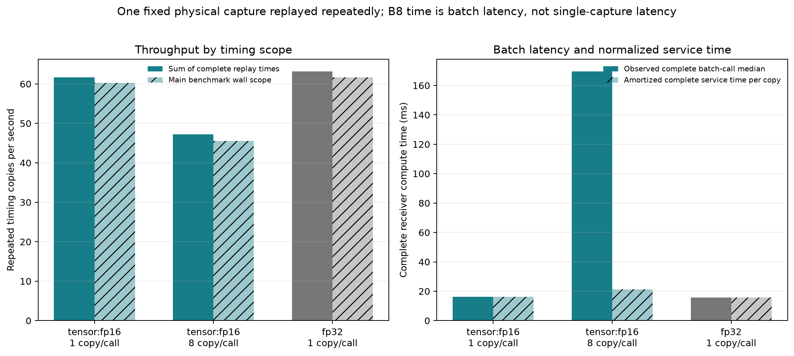
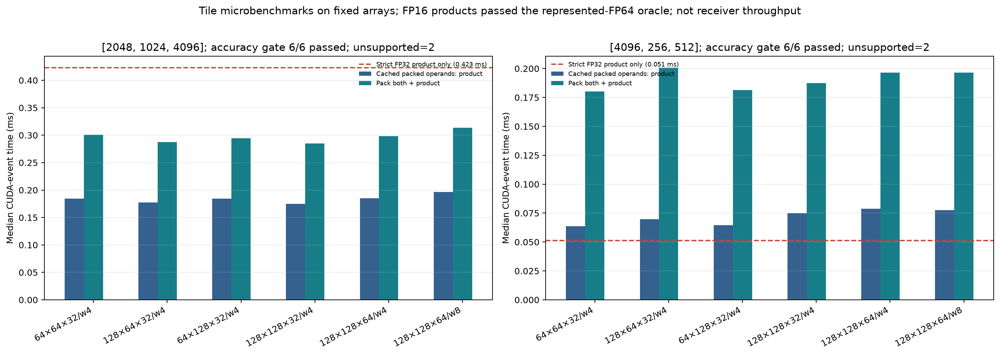
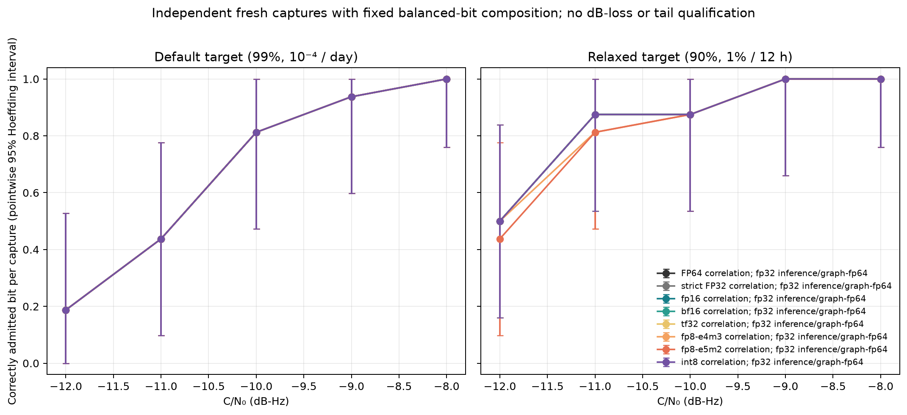
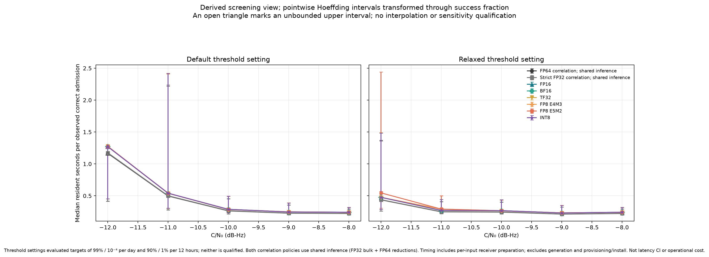
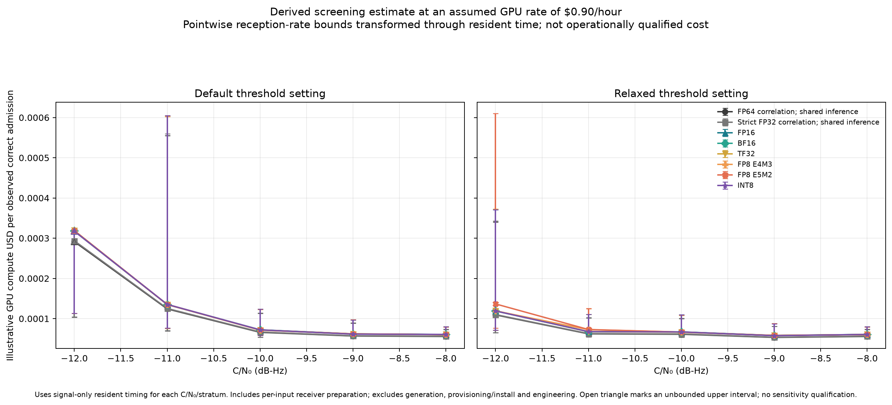

# Consumer GPU tensor arithmetic: RTX 4090

This extension keeps the isolated three-carrier modem and its exhaustive
candidate/timing/CFO/epoch search. It adds explicit consumer-GPU tensor formats,
fused packing and a short-partial accumulation option. Strict FP32 and FP64
correlation references remain available. No ordinary Robust receiver code,
wire format or default precision is changed.

The [protocol](PROTOCOL.md) defines the comparisons and reproduction commands.
The [preceding FP4 campaign](../2026-11-01-fp4/README.md) remains frozen evidence
for Blackwell, MIG, physical interference and long-duration experiments; this
extension does not requalify those results on consumer cards.

## Implementation and numerical findings

`tools/triad_tensor_native.py` separates storage, multiplication, accumulation,
normalization and output restoration. `--precision tensor --tensor-format ...`
requires an explicit format. `--tensor-engine auto` selects an implementation
of that format, never a different precision. Fused packing and partial sums
are separate explicit options; reference packing and native accumulation remain
available.

| Target | Implemented route | Evidence boundary |
| --- | --- | --- |
| RTX 2080 Ti / SM75 | FP16 operands, Torch CUDA GEMM with FP32 accumulation/output; full eager inference | Capability guards and CPU representation checks; no physical Turing run |
| RTX 3090 Ti / SM86 | FP16, BF16, explicit TF32 and INT8 Triton routes | Capability guards; no physical Ampere run |
| Desktop RTX 4090 / SM89 | Above plus FP8 E4M3/E5M2; full graph workspace | Actual cloud GPU arithmetic, full-search and sampled-capture experiments |
| Laptop RTX 4090, RTX 4060 Ti 16 GB eGPU / SM89 | Same format family | No local hardware available; power, link and sustained performance unmeasured |

These architectures do not provide native floating E2M1 FP4. Integer INT4 is
different arithmetic and is not implemented by this extension. See the
[primary architecture references](PROTOCOL.md#hardware-and-arithmetic-contracts).

Three failures mattered to numerical correctness:

1. Triton 3.4 rejected an integer masked-load fill for FP8. Floating zero fixes
   compilation without changing the intended padding.
2. The generated `libdevice.ldexp` path mishandled subnormal inputs. A direct
   discriminator found 72 mismatches in the initial 208 cases, while raw tensor
   multiplication was correct. The expanded 252-case check found zero errors
   for exact FP64 power multiplication followed by FP32 rounding. Production
   product restoration now uses that small FP64 epilogue. Packing retains its
   explicitly declared three-stage FP32 policy; that policy can double-round
   at a subnormal boundary and is not ideal single-rounding `ldexp`.
3. SM89 Triton lowering converted FP32 to FP16 with truncation before converting
   to FP8. Values just above a midpoint therefore disagreed with direct FP32
   nearest-even conversion. Explicit pre-rounding to the FP8 lattice makes the
   intermediate conversion exact; integer sign-bit restoration preserves −0.
   The final GPU suite passes all 14 tests, including exact packed bytes,
   exponents and diagnostics for all six formats.

FP32 accumulator/output labels alone did not establish FP32 summation accuracy.
On identical represented FP8 inputs, a constructed sum whose FP64 value is
65599.5 returned 65536 with a long native accumulator chain. K32 tensor partials
followed by explicit FP32 additions returned 65599.5. In the paired large random
GEMM, maximum arithmetic error fell 21.85× / 26.62× for E4M3/E5M2 at roughly
unchanged 0.15 ms kernel time. FP64 outer accumulation gave the same sampled
answers and took about 6.3× longer. The retained diagnostic distinguishes this
arithmetic error from template and observation representation error.

## Timing interpretation

The actual device is an RTX 4090, SM89, 24,564 MiB reported by `nvidia-smi`,
with driver 595.91.07, CUDA runtime 12.8, PyTorch 2.8.0+cu128 and Triton 3.4.0.
The host is a Threadripper PRO 3975WX with a measured cgroup quota of 10.2 CPU
cores. Software versions and transfer measurements accompany the artifacts.

The initial 2048×1024×4096 FP16 product took 0.184 ms versus 0.419 ms for
strict FP32, but both-operand packing plus product took 1.302 ms. Fused packing
reduced that to 0.307 ms: 4.24× over the original mixed-precision organization,
only about 1.37× over the strict FP32 product. These are synthetic GEMM timings,
not receiver gains. The receiver retains its full P512/F43/Q3 state, 85 blocks
and 36 public acquisition hypotheses.

Whole-workspace setup caches only identity-matched templates, indices, Gram
matrices and exact-time transitions. Every new observation is packed again.
Block-local lifetimes replaced a sum-of-all-temporaries memory estimate, with
allocated/reserved caps still enforced. The FP16 development workspace used
137,214,976 peak allocated bytes and 375,390,208 peak reserved bytes; its
conservative preflight remains larger. A/zero-B/A tests use zero B as a
stale-state falsifier and require bit-identical A restoration. B is not a fresh
sampled realization. Copied columns and timing replays are never
counted as independent reception trials.

Sustained runs supersede the apparent small advantage in seven-repeat timings:

| Full workspace replay | Replays × batch | Median batch latency | Capture replays/s (total / summed receiver time) | Complete subprocess time |
| --- | ---: | ---: | ---: | ---: |
| Strict FP32 | 4000 × 1 | 15.836 ms | 63.149 | 67.073 s |
| FP16, fused packing | 4000 × 1 | 16.196 ms | 61.708 | 69.071 s |
| FP16, fused packing | 500 × 8 copies | 169.483 ms | 47.197 | 90.094 s |

Each replay includes observation packing, transfers, full state inference and
CPU FP64 decision finishing. Fixed preparation is separate (0.315 / 0.358 /
0.397 s); the subprocess also includes imports, load/hash, baseline A/zero-B/A,
validation and serialization. The capture is the same development realization
throughout. Thus 36× these rates gives 2273 / 2221 / 1699 **replayed acquisition
hypotheses/s**, not independently validated hypotheses/s. At batch one, FP16
is 2.3% slower than strict FP32 by mean complete-replay time. Batch eight has
23.5% lower throughput than batch-one FP16. Both are unsuccessful receiver
optimizations for this fixed workload. The experiment does not measure live
continuous-state streaming or independent-trial batching.

The matching warmed per-capture bank reference took about 38.88 ms for FP32
and 51.64 ms for FP16. Whole-workspace replay improves those matched paths
about 2.46× and 3.19×, respectively. This is reuse of fixed preparation and graph
launch consolidation; it is not a gain from low-precision correlation. Against
the faster strict FP32 warmed bank, final FP16 replay improves about 2.40×.
The 5× complete-receiver objective is not achieved.

The tile sweep passed its sampled represented-FP64 output check in all 12
supported shape/tile combinations. Four oversized BM/BN configurations were
explicitly unsupported. For 2048×1024×4096, the best tested FP16 tile
(128×128×32, four warps) took 0.1751 ms with cached operands and 0.2847 ms
including both packs, versus 0.4228 ms for the strict FP32 product. At
4096×256×512, FP16 was slower: 0.0636 ms cached and 0.1802 ms including packing,
versus 0.0512 ms strict FP32. These are synthetic shape-specific results with
an 8×8 sampled-output arithmetic gate, not exhaustive output or reception
qualification. No global best tile is selected from them. The first sweep's
directory-creation failure is retained separately from the corrected run.

Nsight Compute is installed, but hardware counters fail with
`ERR_NVGPUCTRPERM`. Nsight Systems is unavailable in the image. RunPod UI and
timestamped `nvidia-smi` utilization are coarse activity indicators, not tensor
utilization, occupancy, DRAM traffic or arithmetic-intensity measurements.
CUDA-event timing, compiled PTX/SASS and CPU/CUDA profiler traces supply the
available implementation evidence. Low VRAM allocation is not used to infer
low bandwidth demand.

The instrumented two-repeat traces contain 39.628 ms (FP32) and 40.367 ms
(FP16) of GPU kernel time. Identified FP32 correlation product/reduction kernels
account for 1.373 ms (3.47%); FP16 product plus packing takes 1.968 ms (4.87%).
Deleting only those identified device kernels, with all other work fixed,
would improve kernel-only time at most 1.036× / 1.051×. This is a conditional
Amdahl calculation, not a ceiling on algorithm redesign or complete jobs.
Phase stencil, phase summation and a phase-update SGEMM family together account
for at least 32% of kernel time. The CPU/CUDA traces also show long gaps between
kernels during fresh preparation; profiler overhead and setup are included.
Those gaps are not measurements of steady-state GPU idle time.

RunPod's refreshed dashboard showed 24% GPU / 11% CPU, 67 W and 39°C during
fresh-capture evaluation, versus 98% GPU / 10% CPU, 304 W and 62°C during
sustained replay. The dashboard can retain stale values until refreshed and its
averaging window/CPU denominator are unspecified. Sustained cgroup accounting
independently reports about 1.02, 1.01 and 1.07 CPU cores used for the three
runs. GPU busy percentage establishes activity, not tensor-core saturation.

## Precision allocation and retained limits

| Stage | Policy in this comparison | Reason / limit |
| --- | --- | --- |
| Clock/sample coordinates, oscillator and sampled exporter | Existing FP64/stateful sampled path | Exact producer hashes and independent seed domains; no new hour/day qualification |
| AES/clock-derived ciphertext and waveform preparation | Existing CPU exporter and exact-identity caches | AES-NI versus GPU encryption is unmeasured; cached workspace timing excludes regeneration |
| Raw sampled IQ and independent basis | Complex128 source files | Actual sampled observations pass through quantization; no nonlinear Gaussian shortcut |
| Noise scaling, template energies and Gram construction | Existing FP64 path | Kept outside experimental low-precision multiplication |
| Input normalization | Three FP32 power multiplications, per-row scale | Fused path must match reference packed bytes; rounding policy is explicit |
| Correlation products | Strict FP64, strict FP32, or named tensor format | FP16/BF16/TF32/FP8 use FP32 accumulator/output; INT8 uses bounded INT32 accumulation |
| FP8 partial reduction | K32 plus explicit FP32 additions | Reduces measured carry-chain loss; remaining within-tile arithmetic loss is recorded |
| Product scale restoration | Exact FP64 power multiplication, one FP32 rounding | Corrects measured subnormal defect without FP64 bulk GEMM |
| Phase/frequency inference | Shared FP32 bulk with FP64 reductions | The `fp64` campaign label means FP64 correlation, not an entirely FP64 receiver |
| Final likelihood mixture, thresholds and verification | Existing CPU FP64 finish | Final decision time is included in complete receiver timings |
| QR/SVD, covariance estimation, nonlinear frontend and rich channels | Existing reference paths retained | Not newly qualified by this flat-channel consumer holdout |

The new input set has 128 distinct captures with independent key/channel/
oscillator/noise/frontend roots: 16 at each C/N0 of −12, −11, −10 and −9 dB-Hz,
32 signals at −8 dB-Hz and 32 noise-only captures. Bits are fixed balanced within
signal strata. Main intervals therefore use pointwise independent-trial
Hoeffding bounds. The sampled exporter requested 256 seconds and preserved the
complete sampled output and tails: 337.2 seconds of exporter-reported duration,
21,889 stored samples, and 21,673 retained template samples (338.640625 s).
Only the verified exactly-zero 216-sample template suffix is removed; no weak
candidate is pruned. Local generation took 17.63 s;
manifest totals separately record 9.105 s of sampled observation work and
6.879 s of basis generation/writing. RNG and AES are included in those stages,
not independently instrumented.

An initial holdout invocation produced 1,024 setup failures before DSP because
the loader did not recognize the producer's hash-field name. The versioned
adapter retains exact payload-key and SHA-256 checks; all 128 bindings were
verified before rerunning unchanged inputs and frozen policies. These setup
failures are not misses or false admissions.

The corrected run completed **1024 paired policy evaluations on 128 physical
captures**, with no setup failures, in 314.156 s. This is 3.26 policy
evaluations/s for the complete campaign loop; the eight policies on a capture
do not make eight independent trials. Generation is a separate 17.63 s local
stage, and this loop excludes cloud provisioning and package installation.

| C/N0 (dB-Hz) | Independent signal captures | Correctly admitted, default (all eight policies) | Relaxed, FP64/FP32/FP16/BF16/TF32/INT8 | Relaxed, FP8 E4M3 | Relaxed, FP8 E5M2 |
| --- | ---: | ---: | ---: | ---: | ---: |
| −12 | 16 | 3 | 8 | 8 | 7 |
| −11 | 16 | 7 | 14 | 13 | 13 |
| −10 | 16 | 13 | 14 | 14 | 14 |
| −9 | 16 | 15 | 16 | 16 | 16 |
| −8 | 32 | 32 | 32 | 32 | 32 |

These are correct bit admissions at a fixed endpoint. Timing/CFO/epoch recovery
and complete message reception are not separately qualified. FP8 E4M3 adds one
miss and E5M2 adds two at the relaxed gate relative to FP64 correlation with
the shared inference. All modes admit zero of the 32 noise-only captures at
both gates, and accept no wrong bit in the 96 signal captures for any policy.
Pointwise 95% Hoeffding half-widths are 0.3395 at n=16 and 0.2401
at n=32 for the fixed balanced design. In particular, 32/32 signal successes
has a lower bound of only 0.7599, and 0/32 null admissions an upper bound of
0.2401. These are not simultaneous intervals across policies or SNRs.

| Arithmetic vs FP64 correlation | Maximum candidate-score difference | Changed candidate winner in 1152 CFO/lag cells |
| --- | ---: | ---: |
| Strict FP32 | 0.0000119 | 0 |
| FP16 | 0.00715 | 0 |
| BF16 | 0.0667 | 0 |
| TF32 | 0.00709 | 0 |
| FP8 E4M3, K32 FP32 partials | 1.238 | 8 |
| FP8 E5M2, K32 FP32 partials | 2.429 | 35 |
| INT8 | 0.3505 | 4 |

The development-only CPU FP64 representation diagnostic separately quantizes
templates, observations and both, using actual sampled IQ. It isolates input
representation from tensor arithmetic and FP32 staging. It does not establish
that the mismatched-template score is a calibrated likelihood. Its final-source
rerun and the earlier source-bound record are both retained. The independent
holdout above validates joint quantization; template-only and observation-only
holdout reception/admission remain unmeasured.

Fresh-capture median resident time is 220.3 ms for strict FP32 and about
238–239 ms for the tensor modes, with per-input preparation and inference.
Changing templates and capture identities prevents this path from inheriting
all fixed-workspace savings. The plots keep this timing separate from sustained
replay and from the complete campaign wall time.

This view now uses the retained [standalone renderer and point data](../precision-controls/README.md#verify-and-reproduce-the-retained-analysis).
The original PNG remains in `plots/` with its original hash, but its renderer
was not retained. The new view derives the same screening statistic from the
saved summary and explicitly shows unbounded pointwise intervals.

The evidence audit also found that the original cost renderer pooled the 32
noise-only timings with 16 signal timings at −10 dB-Hz. The corrected views
above match timing to the signal stratum and check its trial count. Original
plots, analyzer and measurements remain preserved; the [derived point record](../precision-controls/resident-sensitivity-points.json)
quantifies the timing correction for each policy. Reception counts are unchanged.
Pooling overstated this point's cost proxy by 1.47–3.33%, depending on policy.

The cost curve assumes $0.90/hour and divides median resident latency by the
observed correct-admission fraction in each stratum. Resident latency includes
per-capture bank/receiver preparation. This is a median-latency cost proxy, not
total measured campaign cost divided by successes. It excludes input generation,
provisioning/install, failed development attempts and engineering time. It is **not** cost per
operationally validated result. Where no result meets the operational gate that
cost remains undefined; interpolation cannot create the missing qualification.

Neither 32 null captures nor this SNR grid can establish the default 99% /
10⁻⁴-per-day target, the relaxed 90% / 1%-per-12-hour target, or the requested
0.1/0.25/0.5/1 dB sensitivity-loss budgets. The full software search family and
repeated-attempt accounting remain mandatory. A cost per operationally validated
result is undefined until a policy meets those reception and admission gates.
No format is promoted to a default on the strength of these experiments.

## Reproduction and remaining work

Use [the frozen protocol and commands](PROTOCOL.md),
[the input generator](generate-inputs.py), [the campaign runner](run-campaign.py)
and [the analysis script](analyze.py). Preserve failed attempts and source-bound
variants when reproducing. The input generator binds the existing exporter
binary and the three unchanged physical-source files; it does not regenerate a
different waveform under the same identity.

The [technical archive](technical-evidence.tar.gz) preserves final and failed
records, source variants, sampled-input hashes/seeds, the exact exporter,
NPZ scores, generated PTX/SASS and compressed CPU/CUDA traces. It includes the
development IQ, while the 128 holdout waveforms can be regenerated from the
included exporter and per-case commands. [SHA256SUMS](SHA256SUMS) binds the
archive, report and scripts; the archive also has per-member hashes.
[Artifact verification](artifact-verification.json), the
[analysis report](analysis/report.txt) and [machine-readable analysis](analysis/summary.json)
record the checks and derived quantities. Account/billing/SSH details and UI
screenshots are excluded from the technical artifacts. The temporary GPU was
stopped and terminated after the result download was verified; no persistent
experiment storage was created.

Focused final-source checks completed:

The [evidence map and direct execution logs](../precision-controls/README.md#directly-browsable-execution-logs)
make the archived checks below, including failed intermediate attempts,
browsable without unpacking the technical archive.

| Check | Local CPU environment | Actual RTX 4090 |
| --- | --- | --- |
| Tensor backend | 11 passed, 3 CUDA checks skipped | 14 passed |
| Exhaustive correlation | 14 passed, 1 CUDA check skipped | 15 passed |
| Whole-scan workspace | 7 passed, 1 CUDA check skipped | 8 passed |
| Campaign input provenance and controls | 14 passed | CPU-only suite; no separate CUDA run |

The initial local system-Python invocation lacked NumPy/Torch and failed before
tests; the preserved rerun uses the existing CPU environment. Original GPU
compilation, numerical and setup failures remain in the archive alongside the
successful final checks. Python compilation and whitespace checks passed.
No ordinary Robust integration or unrelated regression campaign was run.

Priority follows the measured bottlenecks:

1. Fuse/cache the phase stencil, probability reduction and state-update pipeline
   while preserving every state and the FP64-reduction reference. These families
   materially outweigh correlation; compare full receiver latency and likelihood
   margins before any promotion.
2. Build an independent-capture pipeline that reuses immutable key/epoch
   templates, encrypts only new coordinates and overlaps preparation with GPU
   work. Measure AES-NI dispatch and CPU/GPU encryption separately; cached
   ciphertext is useful only for identical key/clock/waveform identity. The
   current regenerated-input path and copied-batch replay do not prove this gain.
3. Optimize large search banks only when correlation becomes a measured major
   cost. Retain exhaustive coverage and include packing, reconstruction and
   inference. The current 36-hypothesis state-heavy case cannot justify a
   correlation-only architecture choice for a much larger search.
4. Freeze a promising complete policy, then run a finer independent SNR sweep
   and calibration/holdout split sized for the default and relaxed gates. Resolve
   0.1/0.25/0.5/1 dB budgets with uncertainty before calling precision safe.
5. Run the same evidence-bound checks on physical Turing/Ampere and actual
   laptop/eGPU hardware; then repeat rich-channel, converter/interference,
   ill-conditioned, long-duration and continuous streaming boundaries. No
   consumer-device equivalence is inferred from the cloud Ada result.
