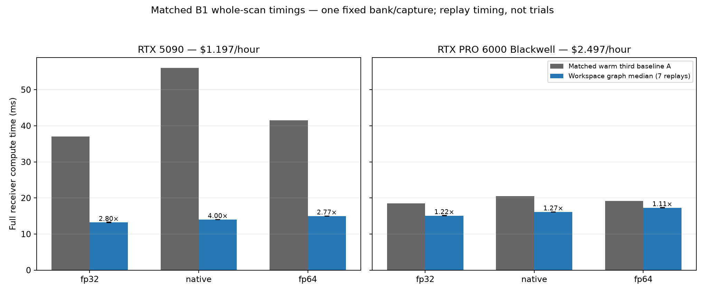
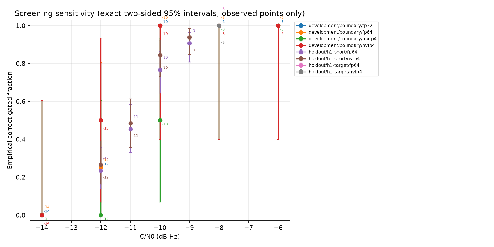
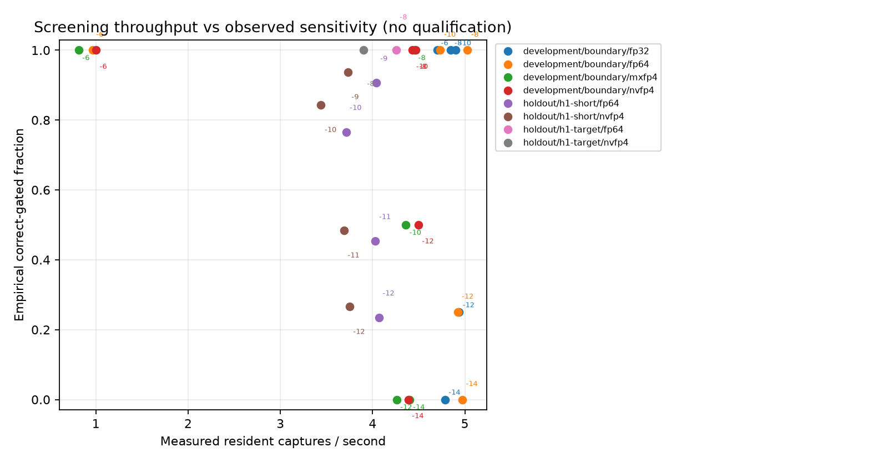
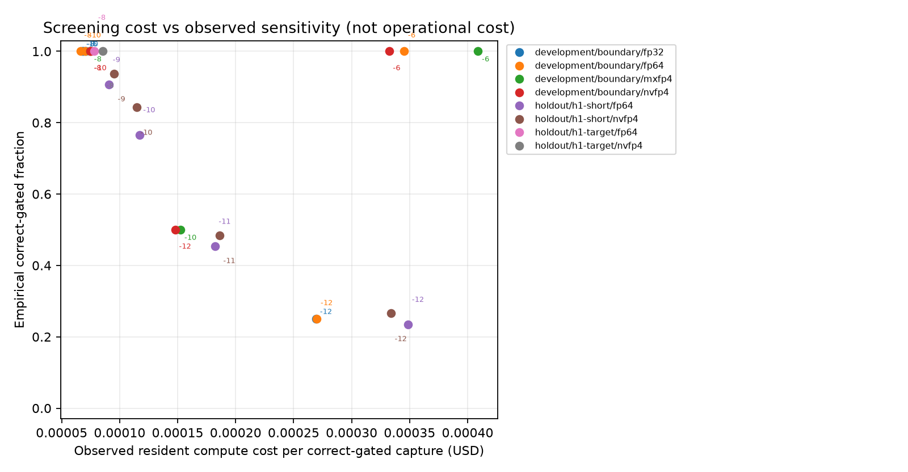

# Exhaustive native FP4 correlation campaign

This follow-up adds an optional exhaustive GPU backend to the isolated three-carrier study. It does not integrate with ordinary Robust reception or change a receiver default. The [frozen protocol](protocol.md), [reproduction guide](reproduce.md), input hashes and retained failures define the comparison. The starting Git revision was `ebfe649c1f9c0a5bace48594c982111f64c28f41`; source hashes also bind the existing uncommitted tensor-study work and this follow-up.

Native dense FP4 products are substantially faster for large matrices. Packing-inclusive correlation and complete reception improve much less, and quantized reception is **not operationally calibrated**. A fixed receiver workspace reduces the RTX5090 strict-FP32 complete compute time to 13.21 ms, versus 14.01 ms for native FP4 and 14.99 ms for FP64 correlations. The 5× objective concerns useful complete receiver results meeting both reception and admission requirements; it remains unmet. A synthetic GEMM gain does not satisfy that objective.

## Implementation and invariants

`tools/triad_exhaustive_correlation.py` constructs real GEMMs whose rows span CFO, candidate/epoch, coupled channel tap and quadrature, and whose columns span captures and timing windows. It scores the complete declared search. It never uses a coarse detector or shortlist. Observation packing is shared across the whole template bank; packed templates, strict Grams and fixed search geometry have separate bounded caches. Cache reuse requires the same template/key/epoch, physical coordinates and search identity.

The native backend uses E2M1 values with UE4M3 scales per 16 values (NVFP4), or E8M0 scales per 32 values (MXFP4), power-of-two row scaling and FP32 accumulation. Generated PTX contains dense `mma.sync ... kind::mxf4nvf4.block_scale ... f32.e2m1.e2m1.f32` instructions. Cubin and SASS are retained. There is no emulation fallback under the native label. Strict FP32 disables TF32; complex128 sampled observations, CPU FP64 products, FP64 correlations and FP64 inference remain available.

The optimized bank keeps trial/lag indices and FP64 residual phasors resident, removes repeated small host-to-device center transfers, and offers an **opt-in** FP64 reconstruction kernel. That kernel combines quadrature reconstruction, phase multiplication, normalization and output layout. It retains complex128 output and disables arithmetic reassociation. The original Torch reconstruction remains available. Fused/unfused full native-receiver scores were bit-identical in paired PRO 6000 and RTX5090 development checks; this is a bounded numerical check, not universal equivalence.

The sampled exporter retains the existing shaped waveform, AES clock addressing, interleaving, channel, oscillator, frontend and full tails. New optional oscillator/noise/frontend roots allow final validation to separate those domains from the channel root. Defaults preserve the previous RNG streams: three independent replay checks, including colored oscillator, overload and FHSS/tails, reproduced all nine basis/observation/mask hashes exactly. Erasure masks are explicitly rejected by this new backend until lag-dependent Grams are implemented. Nothing silently drops erased samples or channel effects.

## Workloads and measurement scope

The small complete receiver uses four bit/epoch candidates, three CFO centers and three integer lags: 36 external hypotheses. HF cases retain four additional two-ray candidates, hence 72 hypotheses. The phase model is P512/F43, with Q3 for flat candidates and Q24 for two-ray candidates. Each group retains its original gain prior. Requested 256-second observations round to 337.2 seconds of transmitted waveform, with complete physical capture/tails; the receiver processes 85 four-second blocks. Bit decisions mix candidates/epochs and maximize over CFO/timing. Thresholds conservatively charge all candidate hypotheses as well as attempts, duration and model alternatives; that extra candidate charge is a sensitivity cost separate from precision.

The large **correlation-only** bank has 32 candidates from 16 epochs, 65 CFO centers, 33 lags and 32 timing copies: 68,640 hypotheses per capture, 2,196,480 per batch. Its typical real GEMM is M4160/N1056/K512, repeated across 85 physical blocks. It includes packing, quantization, reconstruction, Grams, assembly and a checksum consumer. It excludes phase inference and admission. Copies measure batching, not independent trials. A fully materialized flat P512/F43/Q3 state for that batch alone would need about 580 GB of FP32 weights; the current conservative working-array bound is roughly 9.3 TB. That arithmetic estimate explains why this large correlation timing cannot be relabeled complete reception.

Timings distinguish first-use/compilation, warmed resident scans, input preparation/transfers, and complete Python calls. Compute latency excludes the physical observation time. A 337-second observation does not become a millisecond-latency radio reception. Warm fixed-bank scans also do not establish arbitrary moving-clock or changing-key streaming throughput.

## Measured arithmetic and pipeline results

On RTX5090, the dense 8192×8192×4096 NVFP4 tile (128×128×128, four warps) took 0.699 ms for products, 0.865 ms with cached A plus B packing, and 0.927 ms with both operands packed. Strict FP32 GEMM took 8.779 ms in the same host-paced sweep: approximately 9.5× including both packs. Unrolled CUDA-graph product timing was 0.684 versus 9.785 ms, about 14.3×. Those are synthetic arithmetic measurements, not modem throughput.

The nominal operation count is `2MNK` (549.8 billion operations for that matrix), approximately 804 TFLOP/s at the graph timing. Counting unique packed NVFP4 operands/scales and one FP32 output write gives about 306 MB and 1,790 operations/byte. This is a compulsory-traffic/intensity estimate, excluding rereads, caches, packing, row metadata and output consumers. The actual M4160/N1056/K512 bank has much lower corresponding intensity, about 236 operations/byte before complex reconstruction. Neither estimate substitutes for measured DRAM or cache traffic.

Tile choice mattered more than nominal precision peaks. A 128×256×128 four-warp tile took 30.42 ms and contained 1,843 static local-load and 2,318 local-store sites, with a 3,448-byte stack adjustment. Eight warps removed those spill sites and ran in 0.636 ms in a separate sweep. These are compiled instruction/resource observations; they are not dynamic traffic or occupancy counters. Small percentage differences between separate sweeps need interleaved repeats before precise claims.

Median warmed large correlation batch times, milliseconds:

| Device | Original FP32 | Original NVFP4 | Resident geometry FP32 | Resident geometry NVFP4 | Fused FP32 | Fused NVFP4 |
| --- | ---: | ---: | ---: | ---: | ---: | ---: |
| RTX5090 | 46.11 | 61.96 | 28.49 | 42.15 | 29.16 | 38.95 |
| Full PRO 6000 | 35.31 | 29.77 | 29.65 | 23.67 | 24.04 | 17.85 |
| MIG 1g.24gb | 169.93 | 145.53 | 163.18 | 139.16 | 98.74 | 75.78 |

The best choice depends on the device and shape. On this RTX5090 host, strict FP32 remains faster than FP4 for this complete correlation pipeline. On PRO/MIG, fusion materially improves the pipeline. No default precision is switched on that basis.

Warmed complete-receiver measurements after geometry caching and opt-in fusion:

| Device | FP32 B1 ms | NVFP4 B1 ms | FP32 B8 ms/batch | NVFP4 B8 ms/batch | NVFP4 B8 captures/s | NVFP4 B8 compute cost/capture |
| --- | ---: | ---: | ---: | ---: | ---: | ---: |
| RTX5090 | 37.46 | 45.19 | 103.77 | 105.48 | 75.84 | $0.00000438 |
| Full PRO 6000 | 17.18 | 18.43 | 99.57 | 101.51 | 78.81 | $0.00000880 |
| MIG 1g.24gb | 40.10 | 42.13 | 486.77 | 488.85 | 16.36 | $0.00001183 |

Rates used here include ephemeral disk: $1.197/$2.497/$0.697 per hour respectively. These are costs per timed capture, **not per operationally validated result**. The original small-receiver NVFP4 B1 medians were 67.46/28.07/52.51 ms. The same-device cache/fusion improvements are useful but do not establish the 5× qualified complete-job goal.

Observed hardware explains part of the comparison: RTX5090 exposes 170 SMs and 96 MiB L2; full PRO exposes 188 SMs and 128 MiB L2; the MIG partition exposes 46 SMs and 32 MiB L2. Host CPUs differ (Xeon Gold 6530, EPYC 9355 and EPYC 9555). All timings used two Torch CPU threads. Provider labels are not substituted for actual cgroup CPU/RAM limits, which are retained with the device observations. Single-capture and batch rankings differ; no claim attributes every difference solely to the GPU.

## Whole-scan workspace and cached ciphertext

The final optional `triad_scan_workspace.py` captures the exhaustive 85-block correlation and unchanged phase/channel inference in one CUDA graph. It retains packed template blocks, strict Grams, search geometry and every exact time-step transition. Each replay validates and copies fresh CPU IQ, resets scores and priors, gathers and quantizes the new observations, scores every hypothesis, transfers all candidate scores, and runs the CPU FP64 bit mixture and both gates. The reported complete interval charges all these replay operations. Template generation, loading, compilation and graph preparation remain separate cold costs.

This directly implements the persistent DSP workspace suggested for cached ciphertext: reuse is bound to the same key, epoch, waveform, coordinates, search, model, variance and dimensions. A changed signature requires rebuilding. No observation-dependent packed data or previous posterior is reused. It does not yet support advancing the absolute sample-clock origin without rebuilding.

Median complete compute time over seven timing replays, B1/flat/P512/F43/Q3/36 hypotheses; the matched baseline column is the warm third A in the same process:

| Device | Correlation | Matched baseline ms | Whole scan ms | Matched gain | Graph device ms | Fixed preparation s |
| --- | --- | ---: | ---: | ---: | ---: | ---: |
| RTX5090 | Strict FP32 | 37.00 | 13.21 | 2.80× | 12.76 | 0.334 |
| RTX5090 | Native NVFP4 | 56.08 | 14.01 | 4.00× | 13.47 | 0.410 |
| RTX5090 | FP64 | 41.54 | 14.99 | 2.77× | 14.49 | 0.351 |
| Full PRO 6000 | Strict FP32 | 18.48 | 15.10 | 1.22× | 14.89 | 0.167 |
| Full PRO 6000 | Native NVFP4 | 20.50 | 16.12 | 1.27× | 15.94 | 0.182 |
| Full PRO 6000 | FP64 | 19.14 | 17.29 | 1.11× | 17.12 | 0.154 |

The RTX5090 strict path processes 75.72 captures/s or 2,726 declared hypotheses/s in this fixed workload, costing $0.00000439 per timed capture before amortized preparation. Native FP4 processes 71.39 captures/s at $0.00000466. These are numerical/compute measurements, not calibrated useful-result rates. Compared with the earlier original strict median of 53.37 ms, the final strict path is about 4.04× faster across separate runs; the table's matched measurements provide the tighter comparison. The earlier original native median of 67.46 ms versus 14.01 ms is 4.82× across separate runs. Neither comparison reaches the qualified 5× objective.

Graph-device elapsed time is about 96.6% of the final RTX5090 strict interval. Even removing the remaining host work entirely would improve that interval only about 1.035×, if device work stayed unchanged. This is an interval bound, not measured SM utilization. FP64 correlation now costs only about 1.78 ms more than strict FP32 in this complete workload; keeping inexpensive higher precision is therefore a viable option. It does not remedy channel-model mismatch.

The six actual sampled A/zero-B/A comparisons are bit-identical to their corresponding baseline scores and decisions; independent random A/B/A qualification also passes on both devices. Zero B is a state-reset test, not a noise-only calibration sample. Seven repeated A timings are not seven physical trials. The whole-scan graph has not been qualified for B8, two-ray, MIG, moving-clock streaming, hour/day inference or a larger search. Actual process peak reserved Torch memory is approximately 0.37–0.41 GB here, while the deliberately conservative allocation bound is about 26.6 GB; neither is bandwidth evidence.

Initial graph attempts failed because exact floating-point time steps exceeded a small transition LRU, device aliases were compared without canonicalization, and capture under inference mode created incompatible PyTorch CUDA-generator bookkeeping. The repaired implementation retains every exact transition, checks the actual device, and owns mutable state/capture under normal no-grad context with inference mode disabled. It rejects inference-owned state and requires a fresh process if unrelated earlier code has already contaminated generator state. It does not round physical time steps, reset the global generator or hide the baseline under inference mode. Both capture orders are tested. Original failure logs remain in the archive.

## Sensitivity and admission evidence

The independent holdout contains 753 actual sampled captures and 1,506 completed paired policy evaluations, with no failed policy run. Each of the five seed domains has 753 unique roots; all 3,765 root values are globally distinct. It contains 256 boundary signals, 320 target-point signals, 128 null captures, 32 wrong-key captures, 16 continuous HF hour observations and one continuous flat day observation. Development SNR sweeps, precision pairs and timing copies are not counted as independent replications.

Correct accepted captures out of 64, using the same P512 inference and gate:

| C/N0 dB-Hz | Default FP64 correlation | Default NVFP4 | Relaxed FP64 correlation | Relaxed NVFP4 |
| --- | ---: | ---: | ---: | ---: |
| −12 | 15 | 17 | 33 | 37 |
| −11 | 29 | 31 | 45 | 49 |
| −10 | 49 | 54 | 62 | 62 |
| −9 | 58 | 60 | 63 | 63 |
| −8 (320 trials) | 320 | 320 | 320 | 320 |

At −8, 320/320 yields a two-sided exact 95% interval of [98.8538%,100%], or a one-sided 95% lower bound of 99.0682%. These are marginal reception bounds for this fixed condition, not a joint receiver qualification. NVFP4 had no FP64-only-correct discordance in the short boundary set, but the paired intervals remain broad. A favorable count after an uncalibrated score shift does not demonstrate sensitivity improvement.

Both policies/gates had 0/128 null admissions and 0/32 wrong-key admissions. Their two-sided exact 95% upper bounds are 2.84% and 10.89% per tested capture. Those samples cannot certify any-admission probability ≤10^-4/day or ≤1%/12 hours. At one acquisition per minute, a union-bound empirical campaign with zero events would require roughly 43 million independent acquisition tests for the default target at one-sided 95% confidence, absent a valid analytical tail bound. Repeated overlapping attempts need complete family accounting even when correlated.

The 0.1, 0.25, 0.5 and 1 dB loss budgets remain **unresolved**: the grid and confidence intervals do not identify a calibrated sensitivity crossing finely enough. The plots show empirical correct-gate rates and screening cost/throughput with intervals; they do not interpolate a qualified loss budget. A cost per result satisfying both operational targets is unavailable.

Long observations are feasibility failures, not hidden passes. At HF C/N0 −20, both policies accepted 1/8 correctly at the default gate and 2/8 at the relaxed gate; at −24 both were 0/8. The actual day capture contains 5,532,187 samples at 64 Hz and was missed by both gates/policies. Its true-bit log score was 4.780 with strict correlations and 8.329 with NVFP4. These observations preserve continuous physical state; they do not establish hour/day sensitivity equivalence or a successful long-duration receiver.

Generating the 753 distinct holdout inputs took 219.23 s. Summed complete scorer calls took 243.05 s for strict correlations and 264.95 s for NVFP4; the paired process took 578.09 s including 70.10 s of imports/index writing/other harness work outside those calls. Those cold changing-input totals include the real day and hour cases. They are separate from warmed fixed-bank timings. Even eliminating scorer time entirely would bound this measured generation-plus-scoring workload to about 2.11×/2.21× respectively, before harness overhead; accelerating GEMM alone cannot meet 5× for that workload.

Separate sampled diagnostics evaluate TᴴX, Q(T)ᴴX, TᴴQ(X), and Q(T)ᴴQ(X), with FP64 represented-product oracles and fixed downstream inference. The diagnostic staging inputs are FP32; the original complex128 reference is separate. The template-only variant intentionally retains the original strict Gram to measure implementation loss; it is not automatically a calibrated likelihood for Q(T). Adaptive block quantization of observations is nonlinear, so no Gaussian projection shortcut or Gaussian tail qualification is inherited. Native products are also compared with decoded-operand FP64 products to isolate arithmetic from representation error.

Sampled frontend screens include nominal ADC/DAC16, headroom overload, a strong tone and impulsive interference. The strong tone produces large likelihoods under the mismatched noise model; overload causes misses. These are physical-model limitations, not errors repaired by FP64. Nominal bit depth is not ENOB, and these few cases do not qualify general interference/AGC/dither behavior. Existing FHSS and burst/wait sampled paths preserve state and tails; this backend does not establish a new RF retuning or overload-rejection model.

## Precision allocation and profiling limits

| Stage | Preserved/reference precision | Experimental allocation and evidence |
| --- | --- | --- |
| Ciphertext/clock keystream | Exact CPU AES256-CTR/integer addressing | No GPU AES replacement; packed templates cached only under identical identity. |
| Waveform, channel, oscillator coordinates | Sampled complex128 / FP64 | Continuous hour/day physics retained; seed-domain controls do not change defaults. |
| ADC/DAC/frontend | Physical sampled quantization with declared full scale | Separate from GPU multiplication precision; nonlinear outputs are actually sampled. |
| Template energies and Grams | FP64, cached preparation | Kept strict for every projection mode; no rank policy is silently reduced. |
| CFO generation and lag/origin phase | FP64 coordinates and complex128 phasors | Resident caching; fused reconstruction still uses FP64. |
| Bulk correlations | FP64 and strict FP32 | Native E2M1 products/FP32 accumulation; NV/MX scales explicit; no TF32 substitution. |
| Phase/channel inference | Full FP64 reference available | FP32 bulk state with FP64 register partials/final normalizers and log-evidence reductions. |
| Thresholds and duration/family arithmetic | CPU FP64 | Quantized/noise-mismatched admission remains unqualified. |

On the paired complete development capture, full FP64 inference versus FP32 bulk with FP64 reductions differed by at most 2.61×10^-6 log-likelihood, with the same winning hypothesis. This single comparison does not replace the prior numerical study or qualify all phase/channel conditions.

Nsight Systems traces, CUDA events and CPU cProfile evidence are retained. The original large correlation trace exposes repeated center H2D copies and synchronization, reconstruction/layout traffic, and host gaps. Native product time falls while surrounding work dominates. Nsight Compute returned `ERR_NVGPUCTRPERM`; measured SM/tensor utilization, DRAM/cache traffic and occupancy counters are unavailable. Operation-count TFLOP/s and static spill sites are explicitly estimates/static evidence.

The full-receiver cProfile+Nsight+event run substantially perturbs wall time. Graph replay envelopes must be included in GPU interval unions; visible eager kernels alone underestimate work. Some later verification replays have incomplete exported envelopes and are excluded from GPU coverage claims. Event stage elapsed time includes launch/queue gaps. Conditional Amdahl calculations from those instrumented stages are scenario bounds, not uninstrumented operational ceilings. No warm FFT bottleneck was observed; CPU inverse FFTs appear only in cached transition preparation.

Four paired AES capability-control blocks produced byte-identical outputs. Masked/default total CPU time ratio was 1.057 (95% paired interval 1.010–1.107); template generation plus writing was about 42% of cold exporter wall time. Eliminating that entire stage would give at most about 1.73× export speedup, and the stage includes shaping/I/O, not just AES. This supports keeping CPU AES and measuring cache amortization before moving encryption to GPU; it does not establish actual AES instruction dispatch or a CPU-versus-GPU AES ranking.

## Remaining boundaries

The new backend has no unsafe pruning, but also no operational qualification for quantized observations, adaptive covariance, clipping/AGC or strong interference. It rejects erasures, and the native packer bounds K to 32,768; long coherent sums need explicit partial accumulation work rather than silently shortening the phase block. Very large full likelihood searches need tiled inference with complete family accounting. This FP4 follow-up does not rerun all rates, bandwidths, covariance estimates, nearly singular subspaces, FHSS occupancy patterns or multi-GPU sharding from the broader study. Prior evidence is not promoted into new-backend equivalence.

Retained unsuccessful work includes a Triton scale-load compile correction, an invalid cold cuBLAS baseline (excluded from speedup claims), severe register spills in one tile, initial two-ray graph-cache memory refusals (rerun with an explicit 8 GiB limit and unchanged model), a missing sweep artifact argument, and the hardware-counter permission denial. No failed or omitted coverage is counted as passed.

Raw generation summary wording originally called the holdout strict-all and listed 36 hypotheses for every case. Actual scoring used paired strict-correlation and NVFP4 runs; HF results correctly charged 72. The repaired generator and this report correct that metadata while preserving executed raw evidence and all input identities.

## Validation, artifacts and next experiments

The focused build/CTest run passed all 10 isolated triad tests. Final CPU Python runs passed 21 FP4/campaign/representation tests, 14 correlation tests with one explicit CUDA skip, and two workspace tests with one explicit CUDA skip. Actual CUDA qualification passed all 15 correlation tests and all three workspace tests on both RTX5090 and PRO. The whole-scan FP64/FP32/NVFP4 sampled comparisons passed on both devices. These checks cover the changed isolated implementation; ordinary Robust integration and its unrelated regression campaign were intentionally outside this study.

The [reproduction guide](reproduce.md) gives exact commands and source/input identities. [Technical evidence](technical-evidence.tar.gz) contains frozen sources and exporter binary, all holdout metadata/results, two raw development captures, compiler artifacts, timing/profiling evidence and retained failures, with an internal SHA256 manifest. [Analysis data](analysis/analysis.json) and [workspace timing data](analysis/workspace-summary.json) can be regenerated with the accompanying scripts. Profiler environment and provider identifiers were removed from retained SQLite files; CUDA/NVTX/event tables are unchanged and before/after hashes are recorded. Raw private traces remain outside the repository. The outer [SHA256SUMS](SHA256SUMS) binds this report and the compact artifacts.

All three temporary GPU pods were terminated after results were retrieved. The provider subsequently showed zero GPUs, vCPUs, storage and endpoints and a $0.00/hour spend rate. The observed account balance reduction for this follow-up was $4.94, below the $8 reservation; delayed billing means this is a balance observation rather than a final invoice. Private billing/resource controls and screenshots remain outside the repository.

Ranked next experiments, based on the measured limits:

1. Derive or calibrate a likelihood for quantized sampled observations and mismatched interference, then use fresh holdouts with full search/attempt accounting. The current 0/128 null sample is orders of magnitude too small, and positive score shifts already prevent a sensitivity-equivalence claim. Resolve this before choosing an FP4 admission threshold.
2. Profile and tile the phase/channel inference across candidate groups while retaining complete mixtures and maxima. After launch reduction, the complete graph takes 12.76 ms on RTX5090 and native FP4 is slower overall; very large searches exceed current state-memory bounds. Further GEMM-only tuning has limited receiver value.
3. Extend the fixed workspace to changing clock coordinates and streamed chunks, then validate continuous state, tails and erasure-dependent Grams against sampled FP64. Existing hour/day observations fail their reception gates and the new backend explicitly rejects erasures. Those gaps take priority over a claimed streaming speedup.
4. Run finer paired boundary grids at 0.1/0.25/0.5/1 dB with independent final roots after selecting a calibrated policy. Current one-dB spacing and confidence intervals cannot resolve those comparison budgets. Include precision × interference × coherent-length interactions and nearly singular channels.
5. Re-measure B8/two-ray and MIG whole-scan graphs, interleave the promising eight-warp tile with its baseline, and then evaluate independent multi-GPU sharding. Current hardware results identify shape/host dependence; they do not establish an optimal device or multi-GPU scaling.

The implemented cache, geometry and graph changes demonstrate substantial bounded improvements. Calibrated FP4 useful throughput, qualified 5× complete-job improvement, all four sensitivity-loss budgets and general long-duration equivalence remain open, with the observed constraints above. Higher arithmetic peaks alone do not resolve them.
