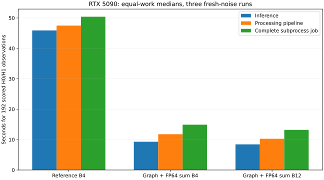
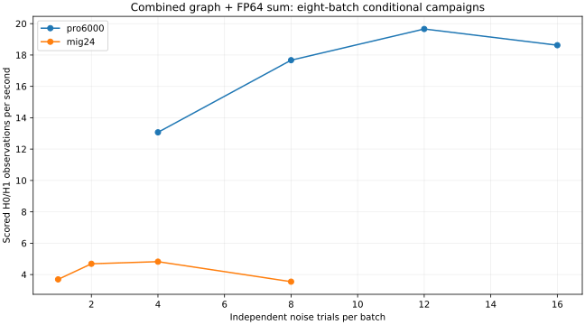

# Hardware, complete-job timing and cost

These are conditional fixed-design measurements. No hardware produced an
operationally qualified reception result. Prices are the observed rental rates
for this campaign, including its ephemeral container disk; they are not future
price promises. Results and profiler failures are in `evidence.tar.gz`.

## Equal work on the RTX 5090

All three modes score 192 observations (96 H1 and 96 paired H0), 929 full blocks
per observation, with the same P512/F43/Q24 two-tap model. Three repetitions use
fresh holdout root seeds 170121–170123. Reference B4 and optimized B4 use identical
represented observations and have zero ranking/bit/admission disagreements;
maximum log-likelihood error is 5.66e-6. B12 has the same physical design and
observation count but different batch-shaped noise draw ordering. It is an
equal-count timing comparison, not a paired numerical comparison with B4.
Separate same-B12 development comparisons are retained.

| Median of three runs | Reference B4 ×24 batches | Graph + FP64 reducer B4 ×24 | Graph + FP64 reducer B12 ×8 |
| --- | ---: | ---: | ---: |
| GPU inference, synchronized wall | 45.8938 s | 9.2909 s | 8.4258 s |
| Complete processing pipeline | 47.4876 s | 11.7625 s | 10.2761 s |
| Parent complete job, including imports/output | 50.4042 s | 14.9011 s | 13.1961 s |
| Parent job range | 49.795–54.856 s | 14.456–14.982 s | 12.842–13.237 s |
| Processing observations/s | 4.043 | 16.323 | 18.684 |
| Complete-job observations/s | 3.809 | 12.885 | 14.550 |
| Rental-rate estimate per 1,000 complete-job scored observations | $0.08729 | $0.02581 | $0.02285 |

The best tested organization improves the processing pipeline **4.62×** and the
complete job **3.82×**. The matched B4 numerical comparison improves those
quantities **4.04×** and **3.38×** respectively. The initial same-B32 5.62× result
is real, but is neither the best-configuration comparison nor a complete-job
operational success.

To reach 5× relative to this equal-work reference, the optimized complete job
would need to fall from 13.196 to 10.081 seconds, another 23.6% reduction. If
only inference changes, its time must fall about 37%. Holding other stages
unchanged and making inference free gives an idealized 10.6× ceiling relative
to the reference. This does not establish that 5× is unattainable or that GPU
utilization is optimal; it quantifies the remaining gap and the fixed costs.

| Median stage | Reference B4 | Combined B12 |
| --- | ---: | ---: |
| CUDA context | .2716 s | .2663 s |
| Public design/validation | .0278 s | .0325 s |
| Receiver preparation/warmup/capture | .3221 s | 1.1542 s |
| Paired simulated observation/RNG + conversion | .8732 s | .3674 s |
| Observation H2D | .00324 s | .00168 s |
| Inference | 45.8938 s | 8.4258 s |
| Explicit state reset | .00282 s | .00175 s |
| Scores D2H | .00577 s | .00280 s |
| Verification | .00314 s | .00311 s |

Allocation/Gram H2D and output/hash costs are also itemized in raw JSON. Medians
of individual stages need not sum exactly to the median total. Acquisition and
sampled source regeneration are absent from this fixed-bank runner, not zero-cost
operations. The preparation microbenchmark separately attributes RNG, covariance
projection and normalization; the native physical source generator still lacks
that separation. Parent job timing includes subprocess launch/imports, context,
preparation, all batches, verification and output, but excludes rental idle,
upload/download, and physical source regeneration.

## Devices and host constraints

| Device | Actual partition | SMs | L2 | Usable memory reported by Torch | Rental rate |
| --- | --- | ---: | ---: | ---: | ---: |
| RTX 5090 | Full GPU | 170 | 96 MiB | 33.67 GB | $1.197/h |
| RTX PRO 6000 Blackwell Server | Two full GPUs in pod | 188 each | 128 MiB each | 101.98 GB each | $4.987/h for entire two-GPU pod |
| RTX PRO 6000 Blackwell Server | MIG 1g.24gb | 46 | 32 MiB | 25.37 GB | $0.697/h |

All are compute capability 12.0, driver 595.91.07, Python 3.12.3,
Torch 2.8.0+cu128, CUDA 12.8, Triton 3.4.0, NumPy 2.5.2 and SciPy 1.16.3.
The study explicitly disables TF32 in strict FP32 modes.

PRO host: AMD EPYC 9575F; MIG host: EPYC 9555. The provider allocations were
32 vCPU/188 GB for the two-PRO pod and 8 vCPU/47 GB for MIG. Process-visible
logical CPU counts were 128 for the 5090 host and 256 for each comparison host;
these are not exclusive core allocations. Numerical CPU thread count was fixed
to two per runner. Host preparation speed differs and materially affects small
complete jobs. Host memory/affinity inventories are archived; contention,
NUMA placement, provider CPU quota enforcement and PCIe bandwidth were not
independently characterized. No cross-device advantage is attributed solely to
GPU architecture from these host-dependent totals.

Nsight Compute 2025.1.1 reported `ERR_NVGPUCTRPERM` on **all three** devices.
Nsight Systems was not found. CUDA events and Torch CPU/CUDA traces were used;
SM/tensor utilization, DRAM/cache counters, occupancy and register pressure are
unavailable. L2 capacity is a device property, not a measured traffic rate.

## Latency, streaming and sustained organization

Identical cached hour inputs, strict FP32 graph, three repetitions per cell:

| Device | B1 H0+H1 warm pipeline | B8 | B32 | B1 complete diagnostic driver |
| --- | ---: | ---: | ---: | ---: |
| RTX 5090 | .907 s | 1.523 s | 5.671 s | 2.953 s |
| Full PRO 6000, one GPU active | .681 s | 1.400 s | 5.694 s | 2.079 s |
| MIG 1g.24gb | 1.029 s | 5.697 s | 22.034 s | 3.332 s |

The diagnostic driver executes resident and streamed organizations, cold checks
and verification; its complete wall is not the latency of one received capture.
Single-capture latency, cold first-use cost, streaming samples/s and real-time
factors are separately extracted in `hardware-summary.json`.

At B1, charging shared preparation fully to a single H1 capture:

| Device | Warm resident latency | Warm streamed latency | Cold first-use latency | Represented samples/s, paired streamed pipeline |
| --- | ---: | ---: | ---: | ---: |
| RTX 5090 | .618 s | .662 s | 1.648 s | 478,088 |
| Full PRO | .402 s | .455 s | .824 s | 638,384 |
| MIG | .599 s | .643 s | 1.282 s | 439,967 |

These samples/s are coordinates represented by **already exported sufficient
statistics**, not measured raw-IQ ADC throughput. Their paired real-time factors
are 7,470/9,975/6,874 respectively. Continuous native physical generation and
its costs are separately reported in the main report.

The eight-batch combined-reducer screen found:

| Device | B1 | B2 | B4 | B8 | B12 | B16 |
| --- | ---: | ---: | ---: | ---: | ---: | ---: |
| PRO 6000, one GPU | — | — | 13.070 | 17.670 | **19.659** | 18.624 |
| MIG 1g.24gb | 3.693 | 4.687 | **4.822** | 3.547 | — | — |

Entries are processing **observations/s**, not qualified receptions/s. Job sizes
change with batch size. MIG B8 regresses despite fitting in memory. Its compute,
cache and memory partition all matter; unavailable counters prevent assigning
the slowdown to bandwidth or cache alone. Full PRO B12 spends 89% of pipeline
time in inference; MIG B4 spends 92%, and MIG B8 spends 96%. Transfers are
small for resident sufficient statistics; this does not establish sufficient
bandwidth for a high-rate sampled-IQ receiver.

## Two-GPU independent trial sharding

Two subprocesses process independent seeds on cuda:0 and cuda:1, each B8 ×16
noise batches. Each repetition scores 512 H0/H1 observations in total. Serial
and concurrent executions use identical observations within each shard; saved
scores are bit-identical for both shards in all three repetitions.

| Rep | Serial parent wall | Parallel parent wall | Speedup | Parallel observations/s |
| ---: | ---: | ---: | ---: | ---: |
| 0 | 30.228 s | 15.260 s | 1.981× | 33.552 |
| 1 | 29.574 s | 15.090 s | 1.960× | 33.930 |
| 2 | 29.225 s | 14.900 s | 1.961× | 34.363 |

The aggregate measured cost estimate is **$0.04081 per 1,000 scored observations**
at the whole-pod $4.987/h rate, including subprocess startup and output. This
is higher than the RTX 5090's $0.02285 for its measured 192-observation complete
jobs. These are different job geometries and conditional costs; neither is cost
per validated reception. The one-active-GPU PRO measurements are charged the
whole pod rate, never a silently halved rate. No search partitioning or
inter-GPU communication is needed for independent trial sharding.

## Exhaustive acquisition and precision support

The same sampled bank covers 288 hypotheses/capture: two templates, sixteen
sample lags and nine CFOs. Per SNR there are 64 independent noise draws and
paired H0/H1 captures; SNRs reuse noise and are not pooled as independent.

| Device | Cached GEMM kernel / 128 observations | Cached FFT kernel | GEMM sampled-input pipeline | Complete pipeline observations/s |
| --- | ---: | ---: | ---: | ---: |
| RTX 5090 | .811 ms | 4.296 ms | 1.818 s | 70.4 |
| Full PRO | .868 ms | 4.246 ms | 1.080 s | 118.6 |
| MIG | 1.648 ms | 34.207 ms | 1.702 s | 75.3 |

These are medians over six C/N0 rows, with five kernel repeats per row. GEMM
kernel rates are 45.5M, 42.5M and 22.4M hypotheses/s respectively; counting only
those kernels overstates useful end-to-end work. Independent CPU FP64 checking
alone takes median 1.151/.786/1.293 s per SNR on the three hosts. The direct bank
is 56.5 MB. Cached FFT is complete, but overlap-save, broad search and hybrid
refinement regimes remain unmeasured. Direct/FFT winners and gates agree in the
screen; maximum direct score error versus checked CPU FP64 subsets is
4.704e-5/3.282e-5/4.704e-5. Correct timing/CFO synchronization is not its reception
metric. The ideal white-Gaussian finite-family tail is not operational validation.

Padded E4M3 `_scaled_mm` with FP32 output and fast accumulation disabled executes
on all devices, as does INT8 `_int_mm` with int32 output. E5M2×E5M2 is rejected.
Instruction-level tensor dispatch and dense/sparse throughput are unverified;
FP4/block-scaled modes are unexercised. Lower-precision representation changes
some rankings and gates. Neither a supported API nor FP32 output establishes
FP32 input accuracy or calibrated admission.

The same 20 actual sampled hour paths run on all devices and the original
reference have no decision differences. Maximum cross-device score difference
is about 1.41e-5; graph versus original RTX5090 is ≤3.39e-6 for actual noisy
projections. All 20 are correctly received, so this subset provides little
boundary power. It is not 80 independent physical trials and its projected
null outcomes are not sampled operational null evidence.

## Rental closure

All three temporary pods were stopped and removed after hash-verified result
downloads. The provider overview then reported 0 GPUs, 0 vCPUs, 0 GB storage,
0 endpoints and $0.00/hour spend. The observed account balance decreased by
$7.19, within the $20 campaign reservation. This is an account-display delta
under the confirmed sole-operator assumption, not an itemized final invoice.
No persistent volume was retained. Account identifiers and billing screenshots
remain in private/local evidence, outside the maintained result archive.
