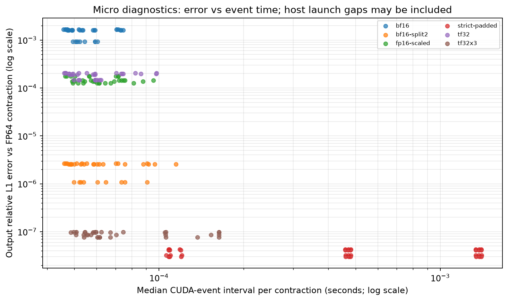
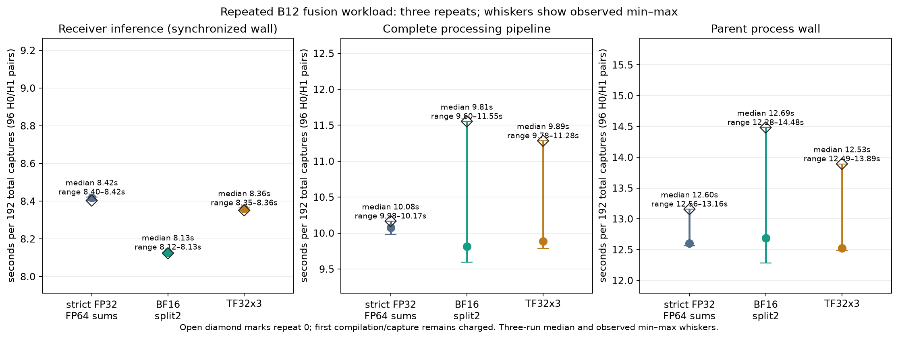
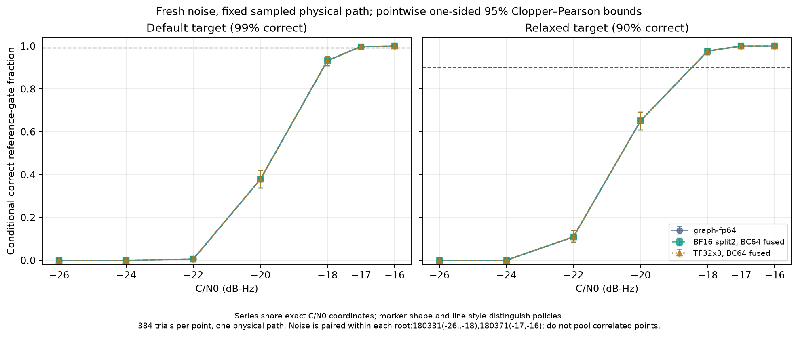
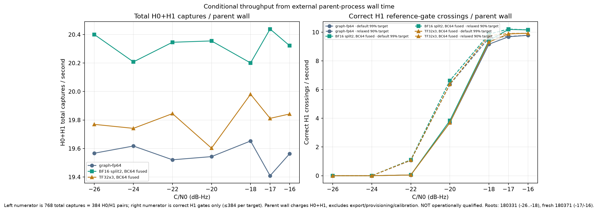
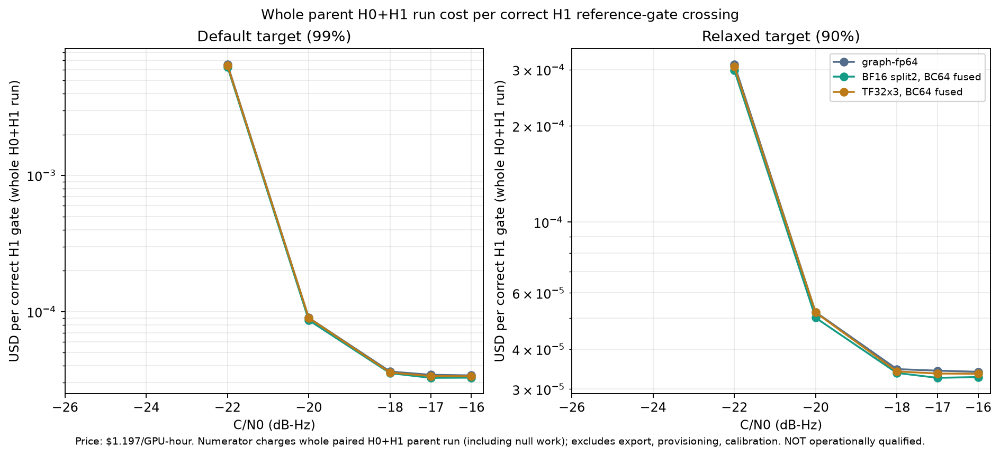

# Tensor processing follow-up, 1 November 2026

This isolated study adds explicit tensor implementations of the finite-state receiver's frequency transition, including optional fusion of the first phase shift. It preserves strict FP32 and FP64 reference paths and leaves receiver defaults unchanged. The ordinary Robust receiver and its regression campaign are outside scope.

The starting source is `ebfe649c1f9c0a5bace48594c982111f64c28f41`. See the [predeclared protocol and staged decisions](protocol.md), the [earlier GPU campaign](../2026-11-01-optimization/README.md), and the reproduction section below. This report concerns a fixed exhaustive candidate bank, not a complete blind acquisition system.

## Implemented arithmetic

`tools/triad_phase_tensor.py` adds six explicitly named product modes. State storage and outputs stay FP32; all frequency products accumulate in FP32. Tensor conversion, scaling and decomposition occur inside the timed kernel. The tiled kernel reads the existing `[trial,candidate,quadrature,frequency,phase]` layout directly, retaining every state. F43 is padded to register tiles, without padding the global input or pruning candidates.

| Mode | Product representation | Important difference |
| --- | --- | --- |
| `strict-padded` | Strict FP32 inputs and products | Organization control; severe compiler spilling in this implementation |
| `tf32` | Explicit nearest/even TF32 operands | Ten fraction bits; FP32 outputs do not recover input precision |
| `tf32x3` | Triton three-product TF32 | Higher-accuracy tensor approximation to the original FP32 operands |
| `bf16` | BF16 operands | Wider range than FP16, fewer fraction bits |
| `fp16-scaled` | FP16 transition and column-scaled FP16 posterior | Positive per-column scale across all frequencies; zero columns use one; no clipping |
| `bf16-split2` | Two BF16 components per operand, three products | High×high plus both cross terms; low×low omitted explicitly |

The optional `--tensor-fuse-advection` loads complete first-shift index maps and performs the original FP32 interpolation before conversion. Native tests compare fused and separate paths bit for bit, including fractional time steps, non-power-of-two phase counts, and multiple frequency tiles. Mode, tile width and fusion settings are immutable after construction, preventing stale captured graphs from silently retaining an earlier policy.

The implementation uses Triton 3.4.0 with PyTorch 2.8.0+cu128 on an RTX 5090. Saved native SASS verifies HMMA instructions for all five mixed modes; strict-padded emits no HMMA. This verifies executed code generation, not a percentage of tensor-core utilization. Triton's [dot precision controls](https://triton-lang.org/main/python-api/generated/triton.language.dot.html) and PyTorch's [float32 multiplication settings](https://docs.pytorch.org/docs/2.8/generated/torch.set_float32_matmul_precision.html) distinguish multiplication precision from output dtype. Global Torch TF32 remains disabled with `highest` precision outside the explicit tensor contraction.

FP8/FP4 and integer posterior arithmetic were not added in this follow-up. The measured frequency stage is a small fraction of total execution, and already-supported BF16/FP16 products failed the numerical screen. More aggressive formats would require a separate range, approximation and calibration study; advertised peaks do not justify them here. The earlier campaign retains bounded FP8/integer API probes.

## Development screen and timing

All 216 microcases completed: six modes × three trial batches × three tile widths × uniform, concentrated, logarithmic and subnormal posterior distributions. The dynamic range reaches the smallest positive FP32 subnormal. CPU FP64 sums of represented operands separate representation error from GPU accumulation; full-output FP64 contraction uses the identical stored FP32 inputs. Neither comparison substitutes for long recurrence or reception checks.

The worst relative output L1 errors against FP64 on the same FP32 operands are 2.06×10⁻⁴ for TF32, 1.67×10⁻³ for BF16, 1.76×10⁻⁴ for scaled FP16, 9.80×10⁻⁸ for TF32x3 and 2.64×10⁻⁶ for split BF16. Scaled FP16's largest discarded probability-mass fraction is 1.75×10⁻⁸ despite many tiny values rounding to zero. State representation L1 errors are normalized by original state mass; raw sums over hundreds of independent posterior columns would be misleading. Scaling avoids overflow but does not cure transition-rounding bias. BF16's fixed transition row-sum error reaches 0.00201, versus 0.000227 for TF32, before the receiver's existing global predictor normalization.

All 33 complete resident screen jobs and 18 repeated fusion jobs completed. Plain BF16, TF32 and scaled FP16 exceed the predeclared maximum likelihood-error/bias gate even though the small screen found no ranking or admission changes. Maximum absolute log-likelihood errors were 0.179, 0.0175 and 0.0174 respectively. TF32x3 and split BF16 passed that development gate; strict-padded was bit-identical in the saved score comparisons but much slower.

The repeated workload processes 192 total observations (96 paired H0/H1 trials), grouped as B12 × 8 independent noise batches, each with 929 updates. Medians below include first-use costs when incurred; bracketing baseline repetitions are retained. This is a single sampled physical design with independent conditional noise, not 192 independent channels.

| Policy | Inference seconds | Processing pipeline seconds | Parent complete-job seconds |
| --- | ---: | ---: | ---: |
| Current graph + FP64 reductions | 8.417 | 10.078 | 12.603 |
| Fused split BF16, 64 columns | 8.128 | 9.811 | 12.691 |
| Fused TF32x3, 64 columns | 8.360 | 9.888 | 12.528 |

Thus the resident inference gain is about 3.5% for split BF16 and 0.7% for TF32x3. Parent-job medians are near parity, with overlapping observed ranges. This does not demonstrate the 5× useful end-to-end objective. Wider tiles raise register pressure and spills; direct strict-FP32 tiled contraction was an unsuccessful organization.

Amortizing setup across 32 noise batches improves the complete-job result. Across the seven fresh SNR points, median parent times are 39.257/37.747/38.765 seconds: about 1.040× for split BF16 and 1.013× for TF32x3. These are seven sequential fixed-policy workloads with the same shape, not randomized timing confidence intervals. At −16 dB-Hz, the stage breakdown for 768 total observations (384 H0/H1 pairs) is:

| Measured stage, seconds | Strict graph + FP64 reductions | Split BF16 fused | TF32x3 fused |
| --- | ---: | ---: | ---: |
| CUDA context | 0.248 | 0.257 | 0.237 |
| Workspace validation and cached design preparation | 0.0367 | 0.0385 | 0.0289 |
| Persistent allocation and Gram transfer | 0.00983 | 0.00969 | 0.00799 |
| Receiver setup, warmup and capture | 1.148 | 1.075 | 0.930 |
| Paired statistics generation, including RNG | 1.185 | 1.184 | 1.215 |
| Observation H2D | 0.00641 | 0.00644 | 0.00639 |
| Receiver inference, synchronized wall | 33.562 | 32.421 | 33.292 |
| Explicit resets | 0.00633 | 0.00642 | 0.00655 |
| Scores D2H | 0.00846 | 0.00936 | 0.00919 |
| Verification and input hashes | 0.00224 | 0.00566 | 0.00845 |
| Complete processing | 36.212 | 35.013 | 35.741 |
| Parent complete job, including startup/output | 39.257 | 37.792 | 38.705 |

The cached generator separately records RNG, correlated-noise projection, normalization and allocation in each report; those nested times are components, not additional work to add again. Physical waveform generation precedes these statistics-based jobs. Full acquisition is outside this fixed-bank experiment and is not assigned zero cost. At this point complete-job throughput is 19.56/20.32/19.84 total scored observations/s; diagnostic cost is $0.0000340/$0.0000327/$0.0000335 per correct H1 gate crossing, charging the entire H0+H1 job but excluding physical export, provisioning and calibration.

The separate B1 latency stage processes **two** observations per job, one H0/H1 pair. Three-repeat parent medians are 4.201/4.198/4.149 seconds; ranges overlap. An actual sampled hour capture has measured first-use receiver-inference times 1.128/0.846/0.985 seconds. Adding separately measured preparation, transfer and verification gives reconstructed first-use processing budgets of 1.531/1.204/1.408 seconds; these are not independently timed cold parent jobs. Measured streamed transfer-plus-inference times are 0.1420/0.1328/0.1433 seconds. These single development measurements exclude original waveform export and physical recording; first-use compilation/cache state is not a controlled comparative latency qualification. Two-day streamed times are 6.3205/6.0198/6.3798 seconds for the same 43,220 blocks (6838/7180/6774 blocks/s). The raw reports retain both CUDA events and synchronized wall times, alongside reconstructed organization budgets and the full diagnostic job that executes several passes.

## Measured bottleneck and limits

The current-baseline B12 trace contains 64 updates and 35.478ms summed GPU kernel time. Frequency GEMM accounts for 3.548ms (10.0%); first-advection gather accounts for 2.109ms (5.95%). Removing the gather entirely gives a 1.063× ideal kernel-time ceiling; removing both entirely gives 1.190×. These are instrumented Amdahl bounds with no replacement cost, not measured speedups or complete-job ceilings. Other phase, emission, normalization and reduction work remains.

The trace separately identifies a 16.6% phase stencil, 7.8% FP64 partial reduction and substantial elementwise work. Host profiling, CUDA events, Torch traces, compiler register/spill/shared-memory metadata, PTX and native SASS are retained. Nsight Compute 2025.1.1 returned `ERR_NVGPUCTRPERM`; Nsight Systems was unavailable. SM/tensor utilization, occupancy, actual DRAM/cache traffic and achieved hardware arithmetic counters remain unmeasured. Low allocated VRAM is not evidence of low memory traffic.

The final paired 64-update traces sum to 35.146/33.907/34.821 ms over 2939/2876/2876 kernels. The baseline's frequency GEMM plus first gather costs 5.648 ms; the fused kernels cost 4.483 ms (split BF16) and 5.307 ms (TF32x3). Fusion removes 63 gather launches. Final native disassembly verifies dense `HMMA.16816.F32.BF16` and `HMMA.1688.F32.TF32`; neither is sparse. Compiler metadata reports 190 registers and zero spills for fused split BF16, versus 255 registers and 30 spills for fused TF32x3, with 33,792 bytes shared memory each. This is a concrete organization limitation; occupancy and spill traffic were not measured with hardware counters.

For B12, source-level useful frequency work is approximately 1.091GFLOP and a minimum 101.45MB of FP32 input/output traffic per contraction if each vector is read and written once: about 10.75 useful FLOP/byte. This excludes template rereads, scratch, conversions and padding. Three-product representations and padded tensor tiles execute more arithmetic than that useful count. It is not a measured bandwidth number.

## Precision allocation

| DSP stage | Retained / experimental precision | Placement and reason |
| --- | --- | --- |
| Sampled waveform, physical channel/oscillator and clock coordinates | Existing sampled reference implementation unchanged | CPU exporter; no new waveform or time-coordinate approximation |
| Design Grams, covariance factoring, rank-sensitive preparation | Existing FP64/complex128 | CPU cached preparation; numerical rank policy unchanged |
| Stored observations, state and emissions | Complex64 / FP32 in mixed experiment | GPU; observations themselves are not quantized by this change |
| Frequency transition construction | FP64 construction, stored FP32 | Cached preparation; mixed products may approximate the stored transition |
| First phase interpolation | FP32 before any tensor conversion | GPU, optionally fused with contraction |
| Frequency products | Explicit six modes above; FP32 accumulation | GPU; each mode is independently identified and validated |
| Predictor global normalization | FP32, unchanged | GPU; do not confuse it with the posterior normalizer |
| Posterior normalizer and accumulated log evidence | FP64 partial and final sums / FP64 | GPU existing reduction path; retained for long sums and small margins |
| Bit mixtures, thresholds, interval calculations | Existing FP64 | CPU verification; exact declared search-family accounting retained |

Quantizing the fixed transition changes its row sums, and state-dependent renormalization means an exact fixed stochastic-model likelihood guarantee cannot simply be inherited. No transition-row renormalization is hidden in the implementation. Tensor admission fields therefore describe reference score gates, with unsupported operational calibration explicitly marked. Nonlinear ADC/interference cases use the actual sampled observations through those operations, never newly drawn Gaussian projected noise.

## Fresh conditional noise and sensitivity

After freezing the two fused 64-column policies, the campaign scored 384 fresh paired noise realizations per C/N0 point on the same physical hour design. The first five points use root 180331; the stronger two-point extension uses a separate root, 180371. Noise is reused across SNR within each sweep, so points must not be pooled as independent trials. All three policies have exactly the same counts below, with no candidate-ranking, bit-ranking or admission changes and no observed wrong or null admissions.

| C/N0, dB-Hz | Correct at default reference gate / 384 | Correct at relaxed reference gate / 384 |
| ---: | ---: | ---: |
| −26 | 0 | 0 |
| −24 | 0 | 0 |
| −22 | 2 | 42 |
| −20 | 145 | 250 |
| −18 | 358 | 375 |
| −17 | 383 | 384 |
| −16 | 384 | 384 |

For the conditional fixed-design experiment, separate one-sided 95% binomial bounds on default correct reception are [0.9073, 0.9521] at −18, [0.9877, 0.99987] at −17, and [0.99223, 1] at −16. The last point's lower bound exceeds 99% conditional reception at this reference gate. These are pointwise bounds, not simultaneous or selection-adjusted qualification over SNRs/policies. They do not establish reception across changing physical realizations or calibrated operational admission. The maximum likelihood differences across the fresh noise points are 0.000570 nats for split BF16 and 0.0000223 for TF32x3.

Zero null admissions in 384 independent attempts gives a one-sided 95% upper bound of 0.007771 **per attempt**. The declared attempt schedule is one every 60 seconds, including overlapping captures: 1440 looks/day or 720/12 hours. The required any-admission probabilities per attempt are at most 6.94×10⁻⁸ and 1.39×10⁻⁵ respectively. Applying a union bound to the empirical upper bound is vacuous. This sample cannot qualify either operational false-admission target, and the tensor approximation does not inherit the exact-arithmetic likelihood guarantee.

The plots show measured conditional reception/throughput and diagnostic cost, with uncertainty and scope labels. The 0.1, 0.25, 0.5 and 1 dB allowable-loss budgets all remain **unresolved**. Identical decisions on this grid do not bound the crossing displacement at those resolutions. Cost per result meeting both operational requirements is unestablished; the diagnostic price parameter is $1.197/hour. No inference is made from advertised tensor peaks.

## Independent sampled paths and physical impairments

The fresh physical holdout has 128 different waveform/key, channel/oscillator and noise realizations, with balanced transmitted bits. It uses actual noisy sampled observations from continuous hour captures at −18 dB-Hz. All policies recover 120/128 at the default gate and 126/128 at the relaxed gate, with zero wrong admissions. Separate one-sided 95% Chernoff bounds, valid for independent possibly heterogeneous paths, are [0.87148, 0.97678] and [0.94125, 0.99858]. Thus this changing-path experiment misses the 99% reception target and supports the relaxed 90% ensemble-average reception component at this reference gate only. It does not supply a worst-channel or uniform per-bit guarantee. Its projected Gaussian null checks do not establish the operational tail.

Split BF16 and TF32x3 change neither actual-sample rankings nor gates. Maximum actual-sample likelihood errors are 0.000300 and 0.0000268 nats. Actual scoring wall totals for 128 paths are 10.071/9.622/9.658 seconds for baseline/split BF16/TF32x3. The corresponding parent totals, 73.707/70.680/71.969 seconds, also include projected H1/H0 scoring and must not be called single-capture latency. The physical-path prior uses phase diffusion 0.0153 rad/√s; the conditional benchmark uses 0.00872665. These are separate paired comparisons, not one pooled sensitivity curve.

Physical source generation is substantial: 128 exporters consumed 630.856 summed child seconds on four CPU workers, giving a 157.714-second lower bound on generation wall time. The generation parent wall was not measured, so no exact source-inclusive throughput is claimed. Reusing projected statistics amortizes physical generation; it does not make that work free.

The 30 sampled-frontend diagnostics cover eight hour cases and two continuous two-day cases: baseline, ideal ADC16, ENOB12/8, severe overload, an occupied-hop narrowband interferer with analog filtering and recovery, DAC-before-channel quantization plus ADC, and signal-absent interference. Quantization occurs in the physical exporter at the specified stages; nonlinear observations are scored as sampled, never replaced with projected Gaussian noise. These are paired development diagnostics, not an independent frontend sensitivity campaign.

The overloaded hour capture misses with every policy. More consequentially, the **signal-absent interference control** produces strict-reference bit scores [50.3802, 23.4717], crossing both reference gates; both tensor policies agree. Its archive uses the key `signal` because it follows the actual-observation route, but the physical manifest disables transmission. This is a false gate crossing under model mismatch, not a successful reception or a tensor-specific failure. An operational receiver needs an interference-valid admission model before using those gates.

The continuous two-day cases contain 11,064,065 samples at 64 samples/s and 43,220 blocks. Split BF16 accumulates up to 0.002225 nats error on the actual signal and 0.002363 on the separate projected null, exceeding the 0.001-nat hour-screen maximum if applied to this duration. TF32x3 reaches 0.000253 on actual signal and 0.000278 on projected null; its accumulated bias also exceeds the hour-screen bias budget in some day diagnostics. Strong-signal decisions remain identical, which does not demonstrate safe precision reduction near the day-length boundary. Every saved sampled-frontend streamed/resident score comparison reports zero difference; separate streamed score arrays were not archived for independent byte comparison.

Six additional two-day development jobs move the same linear physical design to −28 and −26 dB-Hz using identical Gaussian-projected noise. At −28 the strict bit log-LRs are [19.88319, −2.83833], placing the winning score 2.7073 nats above the default gate; at −26 they are [57.16339, −4.38234]. Bit-score difference is a ranking margin, **not** the admission statistic. All policies make the same decisions and preserve streamed/resident agreement. Across these two paired diagnostics, split BF16 reaches 0.001001 nats maximum signal-score error and TF32x3 0.000397. Both exceed the hour-screen mean-bias limit over the saved signal/null scores. One reused physical/noise pair per level gives no reception-rate or tail qualification.

## Qualification and next experiments

Both higher-accuracy tensor paths remain explicit experimental options. The strict defaults, FP64 preparation/normalization and full state/candidate search remain intact. There is a small amortized throughput benefit for split BF16 on this RTX 5090 workload; there is no demonstrated 5× improvement over the current implementation, no qualified sensitivity-loss budget and no operationally calibrated tensor result. The earlier hardware comparison remains the evidence for PRO 6000, MIG and multi-GPU behavior; these new tensor policies were measured only on RTX 5090.

| Target | Evidence and remaining gap |
| --- | --- |
| Default 99% reception | Fresh changing-path result at −18 is 93.75%, 5.25 percentage points short; its one-sided upper bound is 97.68%. The −16 fixed-path result is only pointwise conditional evidence. |
| Relaxed 90% reception | Fresh changing-path ensemble-average lower bound is 94.12% at −18. This reception component passes at the reference gate; the admission component remains unqualified. |
| Any false admission ≤10⁻⁴/day or ≤1%/12h | Empirical horizon upper bounds are 1; exact finite-precision/interference-valid tail control is missing. |
| 0.1 / 0.25 / 0.5 / 1 dB loss budgets | All unresolved; no measured confidence interval on crossing displacement at these resolutions. |
| 5× complete-job throughput | About 1.040× in the larger conditional workload, near parity in smaller jobs. Removing the two targeted stages entirely yields only a 1.190× kernel-time ceiling for the profiled baseline. |
| Cost per operationally validated result | Unestablished. Reported prices and curves count diagnostic correct gate crossings only. |

Ranked next experiments are:

1. Fuse or reorganize the measured phase/emission/normalization traffic while retaining the strict arithmetic path. Frequency contraction plus its first gather comprise only about 16% of baseline kernel time.
2. Establish a finite-precision admission bound or calibrated refinement policy over the complete acquisition family. Small score errors and zero-event samples cannot supply the missing extreme-tail guarantee.
3. Investigate precision × accumulation length near the two-day decision boundary, including a high-precision recomputation trigger based on an independently bounded score error.
4. Resolve the changing-path misses and interference-null crossings against the sampled reference before spending on finer 0.1 dB tensor sensitivity curves.
5. Compare the retained tensor policies on PRO/MIG only if a larger compute-bound shape or a measured register/cache bottleneck makes that hardware comparison informative.

See [reproduction commands](reproduce.md), `summary.json`, `validation-analysis.json` and the evidence archives for exact inputs, source hashes, seeds, commands, versions, stage timings and scope. Native CUDA validation passed 24 product comparisons, 16 fused/separate comparisons and six graph modes, in addition to ten CPU checks. Focused resident/state/path/optimization checks passed; no ordinary Robust regression or C++ behavior change is claimed.
