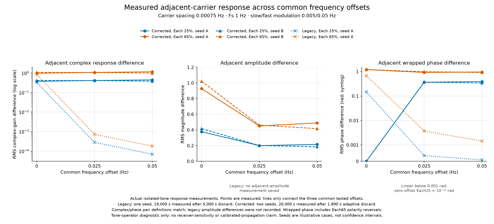

# Selective modulation model correction

## Status and decision

This record audits the additional frequency-selective modulation stage for the
isolated three-carrier v3 modem. The previous study used `legacy-allpass-v1`.
The isolated stream now defaults to `dispersive-dft-v1`, while the ordinary
Robust sampled and hardware paths remain on the legacy operator. Select
`--selective-model legacy-allpass` to reproduce the old v3 model; select
`--selective-model dispersive-dft` to use the corrected broadband operator.

**The legacy bank did collapse to nearly common modulation in the concrete
offset case.** A direct measurement of the operator found an adjacent complex
gain-difference RMS of 0.8501 for Each65 at 0.00075-Hz carrier spacing and zero
offset, but 0.0001798 after a +0.05-Hz offset. Per-tone amplitude modulation
remained strong. The error was the fixed narrow crossover bank's treatment of
displaced spectra; it did not disable the modulation stage.

**Large Doppler does not imply frequency selectivity across close carriers.** A
real 5-ms excess delay gives only `2π × 0.00075 × 0.005 = 2.36e-5` radians of
inter-carrier phase at this spacing. One radian requires about 212 seconds of
delay and a full phase cycle about 1,333 seconds. Therefore common response is
physically plausible for short-delay channels. A high differential response at
this spacing is an explicit synthetic stress assumption unless supported by a
measured dispersive path model.

Completed development and independent holdout reception screens, plus a paired
timing-oracle diagnostic, are summarized below. The sampled tone probe and
operator theory do not themselves establish receiver performance; broad
sensitivity boundaries and operational reliability remain unqualified.

The final local triad software group passed **14/14 in 18.94 seconds** after
the model and CLI changes. An eight-export paired smoke run checked the matched
capture calendars and observed maximum paired noise-array difference
4.5e-14. A later six-job remote RTX PRO 6000 Blackwell scoring benchmark
preserved all tested bit winners and admissions; the measured whole-scorer
gain was only about 1.01–1.08× because CPU simulation and covariance
preparation remained. Detailed timings and limits are recorded below. These
are implementation and selected-case diagnostics, not broad acquisition or
sensitivity qualification.
The bounded GPU Pod has been stopped and deleted; the RunPod console showed
no remaining GPU, CPU or storage resources and `$0/hour` spend.

## Model definitions

### Legacy all-pass bank

The legacy operator constructs low, middle and high complementary outputs from
two rotated first-order all-pass crossovers. Their centers are determined by
the nominal occupied bandwidth around zero baseband. Each branch receives
independent seeded slow and fast additive sinusoidal amplitude changes. The
operator is broadband as an LTV filter and preserves complex samples; the
failure is that its narrow transition regions do not cover the signal after
larger frequency shifts. When the three tones are all far from those
transitions, they see almost the same branch mixture and therefore almost the
same time-varying gain.

### Corrected broadband DFT-delay bank

For public selectivity scale `s`, the ideal branch operators are

`B_b(f) = (1/3) sum_{m=0..2} exp(j 2π b m/3) exp(-j 2π (f-center) m/(3s))`,

with `b=0,1,2`. Their ideal delays are `0`, `1/(3s)`, `2/(3s)`, their sum is
unity, and the ideal transfer repeats every `3s` Hz. Each branch is multiplied
by its own real-valued seeded gain

`g_b(t) = 1 + d_s sin(2π (0.1D)t + φ_bs) + d_f sin(2π D t + φ_bf)`,

where `D` is the effective selected ray-center separation and the two phase
sets are independently seeded. The implementation forms `y=x+Σ_b(g_b−1)B_bx`
so zero depth is exact identity. It applies to the summed complex signal and
does not identify carrier labels. The two-ray delay/Doppler stage precedes it;
thus this extra stage is an explicit post-sum dispersive stress, not a physical
per-ray propagation profile.

Each65 sets both amplitude excursion depths to 0.65, so an individual branch
gain can range from −0.30 to 2.30. Negative gain is retained as a phase reversal;
there is no clipping or per-realization energy normalization. The percentage
is neither a per-carrier RMS variation nor a specified power fluctuation.

The implementation uses four-point causal cubic Lagrange interpolation for
fractional delays, rotates coefficients at their actual integer sample lags
to preserve the declared frequency frame, retains state across reads, and
drains the largest nonzero FIR lag. For `s=0.00075 Hz`, ideal delays are
444.444 and 888.889 seconds. At `Fs=0.25 Hz`, the longest branch uses a 224-row
history (896 seconds including discrete interpolation support), under 5 KiB
complex-double history. General history is capped at 4,194,240 complex samples
(64 MiB), and `Fs` must exceed `3s`. The reported `3s` response period describes
the ideal delay law only: sampled interpolation perturbs periodicity and must
be checked through tone sweeps and sampling refinement.

With scale zero (the default), `s` resolves to the transmitted carrier
spacing. This intentionally preserves modulation contrast across adjacent
carriers while rate changes also change dispersive memory. A positive
`--selective-scale-hz` fixes `s` in physical Hz across rate changes. Neither
choice is calibrated channel measurement. The `--selective-center-hz` field
sets a public pre-RX-oscillator channel frame. TX oscillator offset and path
Doppler move spectra through that fixed response; the RX oscillator follows
this stage and therefore does not. There is no hidden-truth recentering. A
change of baseband coordinate convention must transform the channel-frame
definition consistently; translating only the signal or only the frame changes
the physical channel. When both are translated consistently, output should
agree apart from the corresponding phase convention.

The whole passband and all modulation sidebands are propagated. In the target
case, a 0.05-Hz ray separation equals 66.7 adjacent-carrier spacings, so
sidebands can overlap many carrier neighborhoods. An isolated-tone transfer
measurement is diagnostic; it does not make the simultaneous waveform a set of
independently recoverable scalar gains. Receiver work must use the full
complex output and any required joint channel likelihood.

All receiver captures in this correction campaign have FHSS off. The existing
stream applies nominal hop de-rotation before this selective stage, so enabling
its envelope-only FHSS simulation makes this a de-hopped baseband stress
operator. It does not model a fixed RF dispersive filter retaining echoes
through actual retuning; the exporter reports `physical_rf_retuning=false`.
That extension needs consistent phase/frame conversion through filter memory
and capture selection after RF propagation. These results do not validate it.

## Legacy operator response probe

The retained direct probe is at
`local-evidence/triad-selective-correction/legacy-probe/`. It directly calls
the legacy helper, sends isolated tones through the sampled operator, measures
complex and magnitude/phase variation and actual ±0.005/±0.05-Hz sidebands, and
checks simultaneous-tone superposition. It does not infer responses from the
nominal band-center metadata.

The probe used `Fs=1 Hz`, occupied bandwidth three times spacing, `D=0.05 Hz`,
Each25/Each65, and spacings 0.00075, 0.0075, 0.075 Hz. It ran for 24,000
seconds, omitted the first 5,000 seconds, and measured 19,000 seconds: 95 slow
and 950 fast cycles. All measurements used the same deterministic modulation
seed. The maximum relative error between separately filtered tones and their
simultaneous sum was 2.43e-15, confirming linear time-varying superposition.
This is a narrowband tone diagnostic, not a full transmitter/channel waveform
or decoder test.

Adjacent complex gain-difference RMS from the probe:

| Spacing | Depth | −0.05 Hz | −0.025 Hz | 0 Hz | +0.025 Hz | +0.05 Hz |
| ---: | --- | ---: | ---: | ---: | ---: | ---: |
| 0.00075 Hz | Each25 | 0.0000676 | 0.0002665 | 0.3269 | 0.0002790 | 0.0000690 |
| 0.00075 Hz | Each65 | 0.0001758 | 0.0006930 | 0.8501 | 0.0007254 | 0.0001798 |
| 0.0075 Hz | Each65 | 0.09537 | 0.14246 | 0.8501 | 0.14246 | 0.02218 |
| 0.075 Hz | Each65 | 0.6148 | 0.6874 | 0.8531 | 0.9067 | 0.9713 |

At 0.00075-Hz spacing and +0.05-Hz offset, Each65 isolated tones still had
about 0.61 RMS magnitude modulation. The relative phase difference fell to
0.00143 rad RMS. This is a loss of differential information across the
carriers, not a loss of modulation energy. The crossover location relative to
the shifted spectra changes with rate and spacing, explaining the broad
configuration dependence.

## Corrected sampled tone response probe, settled v2

The reproducible C++ probe and its complete result table are retained in
[response-v2](response-v2/README.md). This is a corrected-operator response
test, not a receiver campaign. It measures actual complex, magnitude and phase
response of isolated tones and compares summed-tone processing against the
sum of individually processed tones. This directly checks physical waveform
superposition through the implemented finite FIR rather than reading model
metadata. The maximum simultaneous-versus-isolated relative error was
2.11e-16.

At spacing 0.00075 Hz and Fs=1 Hz, the adjacent complex-response RMS for
Each65 at common offsets 0/0.025/0.05 Hz was 0.9816/1.0824/1.1621 for seed A
and 1.0848/1.0749/0.9933 for seed B. Each25 gave
0.3775/0.4163/0.4470 for seed A. For Each65 seed A, adjacent amplitude
difference RMS was 0.9270/0.4510/0.4886, while adjacent phase-difference RMS
was 1.2066/0.9147/0.9511 radians. Thus the corrected operator retains
differential response under these tested common offsets, with sizable seeded
phase variability; the RMS response is not a sensitivity guarantee.

The settled probe ran 100 slow and 1,000 fast modulation cycles per profile
after discarding the complete finite FIR support plus 1,000 seconds. It swept
Fs=0.25/0.5/1/2 Hz at target spacing with Each25 and Each65, two seeds, and
offsets 0/0.025/0.05 Hz; it also checked 0.000075/0.0075/0.075-Hz spacing
scales. At Fs=1 Hz, Each65 finite-versus-ideal complex-response RMS error for
the three target offsets was about 4.4e-12/6.7e-6/1.04e-4. Across Fs=0.25–2
Hz it ranged from 8.4e-10 to 0.017; the largest was Fs=0.25 Hz and offset
0.05 Hz. Each25's maximum across those Fs/offsets was about 0.0065. At the
more extreme 0.000075-Hz scale and Fs=1 Hz, the corrected v2 errors were
1.9e-13/6.5e-6/1.03e-4 for Each65 and 7.2e-14/2.5e-6/4.0e-5 for Each25.
The earlier transient-contaminated 0.1946/0.0749 error claim is withdrawn.

These tone tests establish response and sampled interpolation behavior only.
They do not establish how much of this information the existing receiver
retains, which receiver mismatches dominate, or a correct-admission rate.

## Development receiver screen

The source-bound [development analysis](reproduction/README.md) covers 120
sampled workspaces across six profiles, both corrected/legacy models, Each25
and Each65, and shared Off controls. It uses four sampled physical paths per
cell and 16 conditional Gaussian-noise draws per path: **64 clustered trials**
per cell/C/N₀. These conditional repeats are not 64 independent physical
paths. Do not use pooled binomial/Clopper–Pearson bounds or treat this screen
as an independent holdout, calibration of a rare false-admission tail, or
sensitivity qualification. No such inference is made here.

### Energy and free-block projection

The following are **ratios of sums across four paths**. `E L/C` is
legacy/corrected post-to-pre modulation energy. `Correct P/post L/C` is the
legacy/corrected correct-label free-complex-gain projection fraction of the
post-modulation energy; `P/pre L/C` uses pre-modulation energy as the
denominator. A free per-block complex gain is an optimistic diagnostic
projection, not a realizable full-span receiver decision.

| Profile (Gaussian B / ray and AM D, Hz) | Depth | E L/C | Correct P/post L/C | Correct P/pre L/C |
| --- | --- | ---: | ---: | ---: |
| g001 (0.001 / 0.001) | Each25 | 1.059 / 1.058 | 0.989 / 0.989 | 1.048 / 1.047 |
| g001 (0.001 / 0.001) | Each65 | 1.414 / 1.417 | 0.946 / 0.945 | 1.339 / 1.339 |
| g01 (0.01 / 0.005) | Each25 | 1.062 / 1.062 | 0.984 / 0.983 | 1.045 / 1.043 |
| g01 (0.01 / 0.005) | Each65 | 1.418 / 1.422 | 0.919 / 0.912 | 1.303 / 1.296 |
| g1 (0.1 / 0.1) | Each25 | 1.062 / 1.064 | 0.963 / 0.962 | 1.023 / 1.023 |
| g1 (0.1 / 0.1) | Each65 | 1.413 / 1.424 | 0.907 / 0.898 | 1.281 / 1.278 |
| g001-fastam (0.001 / 0.01) | Each25 | 1.060 / 1.061 | 0.983 / 0.984 | 1.042 / 1.044 |
| g001-fastam (0.001 / 0.01) | Each65 | 1.416 / 1.419 | 0.919 / 0.922 | 1.301 / 1.309 |
| high10 (10 / 10) | Each25 | 1.065 / 1.066 | 0.613 / 0.614 | 0.653 / 0.654 |
| high10 (10 / 10) | Each65 | 1.426 / 1.430 | 0.605 / 0.608 | 0.863 / 0.869 |
| high30 (30 / 30) | Each25 | 1.063 / 1.065 | 0.496 / 0.496 | 0.527 / 0.528 |
| high30 (30 / 30) | Each65 | 1.419 / 1.430 | 0.496 / 0.493 | 0.704 / 0.705 |

These ratios show stage-energy changes and receiver-basis projection loss
separately. They do not convert the channel-modulation energy differences into
equal-energy sensitivity.

### Representative corrected Gaussian-window outcomes

Each entry is `correct / wrong / missed` out of 64 conditional observations;
strict and relaxed gates are listed separately. The C/N₀ value is the
representative weaker point for the first four profiles and the stronger point
for high10/high30. Results are fixed-bank Gaussian-window scores, not blind
acquisition trials.

| Profile | Depth | C/N₀ dB-Hz | Strict correct / wrong / missed | Relaxed correct / wrong / missed |
| --- | --- | ---: | ---: | ---: |
| g001 | Each25 | −27 | 61 / 0 / 3 | 64 / 0 / 0 |
| g001 | Each65 | −27 | 64 / 0 / 0 | 64 / 0 / 0 |
| g01 | Each25 | −23 | 62 / 0 / 2 | 63 / 0 / 1 |
| g01 | Each65 | −23 | 63 / 0 / 1 | 64 / 0 / 0 |
| g1 | Each25 | −11 | 64 / 0 / 0 | 64 / 0 / 0 |
| g1 | Each65 | −11 | 64 / 0 / 0 | 64 / 0 / 0 |
| g001-fastam | Each25 | −27 | 51 / 0 / 13 | 58 / 0 / 6 |
| g001-fastam | Each65 | −27 | 58 / 0 / 6 | 62 / 0 / 2 |
| high10 | Each25 | +8 | 16 / 0 / 48 | 16 / 0 / 48 |
| high10 | Each65 | +8 | 16 / 0 / 48 | 16 / 0 / 48 |
| high30 | Each25 | +10 | 1 / 0 / 63 | 1 / 0 / 63 |
| high30 | Each65 | +10 | 3 / 0 / 61 | 3 / 1 / 60 |

All corresponding corrected noise-only controls had 0 admissions in 64 draws
per selected cell and gate; this small conditional count is not a rare-event
false-alarm estimate. In the corrected Each65 high30/+10 cell, the relaxed
gate accepted one wrong bit, while the strict gate did not. Preserve that
wrong-acceptance result when comparing approaches.

Static-FFT reception produced 0/64 correct admissions across the development
signal points. This correlates with using a static channel basis on profiles
with renewing Gaussian ray gains (`B>0`); it does not show that static FFT is
fundamentally inadequate for stable paths or prove the cause of each miss.
For high10/high30, many misses also co-occurred with large error under the
nominal timing/start bank. The diagnostic projection is not an acquisition
oracle, and this correlation is not a causal or fundamental limit. The
separate timing-oracle comparison is summarized below; it is a paired
diagnostic, not blind acquisition evidence.

## Independent corrected-model holdout

The source-bound independent holdout contains 1,024 scored workspaces and 30
cells. Each signal cell has 64 independently seeded physical paths for the
three lower-spread profiles and 32 for high10/high30; model and modulation
comparisons reuse the corresponding seed roots by design. These are actual
noisy sampled-C/N₀ observations, distinct from the development screen's
conditional-noise repeats. The full local report has SHA-256
`f8af85ae3817cd19d66eb9a1672bda90e9fa253c76523f33c8542b5adacb3323`.
The maintained [holdout summary](reproduction/holdout-summary.json) has
SHA-256 `6be1f6c5f526136ee60db57c8486ae7b3546c95b000eb5ede8b5840069774325`.
The report binds analyzer SHA-256
`45f4960da40c216c07be8a632182756679a315c5d6ad645506fe102b17b7477e`,
holdout plan SHA-256
`b24750e53ee32ebfeddd875efb1961866b9224db3ac28fc21b3ee596b347c0e4`,
and score-plan SHA-256
`89380ea029bf6e9ae43fd9727ac3567dbbd7103c6c7998f7a68252009514aa31`.
Generation/scoring provenance does not establish compiler or binary execution
identity beyond the external source/binary binding recorded in the artifact.

The following are the accepted corrected `gaussian-window-ucb` outcomes as
`correct / wrong / missed`; strict and relaxed gates both use the same sampled
trials. High-spread cells have 32 trials, the other profiles 64.

| Profile (C/N₀) | Depth | Strict C/W/M | Relaxed C/W/M | N |
| --- | --- | ---: | ---: | ---: |
| g001 (−27 dB-Hz) | Each25 | 55 / 0 / 9 | 61 / 0 / 3 | 64 |
| g001 (−27 dB-Hz) | Each65 | 61 / 0 / 3 | 62 / 0 / 2 | 64 |
| g01 (−23 dB-Hz) | Each25 | 58 / 0 / 6 | 63 / 0 / 1 | 64 |
| g01 (−23 dB-Hz) | Each65 | 63 / 0 / 1 | 64 / 0 / 0 | 64 |
| g1 (−11 dB-Hz) | Each25 | 64 / 0 / 0 | 64 / 0 / 0 | 64 |
| g1 (−11 dB-Hz) | Each65 | 64 / 0 / 0 | 64 / 0 / 0 | 64 |
| high10 (+8 dB-Hz) | Each25 | 1 / 0 / 31 | 1 / 0 / 31 | 32 |
| high10 (+8 dB-Hz) | Each65 | 2 / 0 / 30 | 2 / 0 / 30 | 32 |
| high30 (+10 dB-Hz) | Each25 | 1 / 0 / 31 | 1 / 0 / 31 | 32 |
| high30 (+10 dB-Hz) | Each65 | 1 / 0 / 31 | 1 / 0 / 31 | 32 |

The independently sampled results have one-sided pointwise 95% correct-
reception lower bounds above 90% only for g1 at both modulation depths and
gates, and g01 Each65 at the relaxed gate. They do not establish 99% reception
in any tested cell. Because these are selected pointwise cells and their
intervals do not cover selection across cells, methods or gates, they are not
a simultaneous reliability guarantee.

All null and wrong-key controls had zero admissions for both gates. At the
three lower-spread profiles, each control/depth cell has 32 independent paths;
at high10/high30 it has 16. The one-sided 95% pointwise binomial upper limits
after zero admissions are therefore 8.94% (`0/32`) and 17.08% (`0/16`). These
small controls do not establish the requested operational false-admission
probability, including across repeated acquisition attempts or continuous
operation.

## Timing-oracle diagnostic

The accepted timing audit compares nominal and oracle-start rescoring of the
same exported sampled arrays; it verified byte identity for received energy,
signal energy, intervals and valid-row arrays. CFO, sample clock, phase,
physical path, waveform, power, bit, epoch and all six random seed roots are
unchanged. Its audit SHA-256 is
`fd95fa5ddd4cc59d76ca367afd5001b194bbd1a1c48d6e7cf5a235924401a93f`,
plan SHA-256
`4495ba1b47de17bcaa6b0032bf1eccea74c78f7239ab5cb1a91204eb4900361b`,
auditor SHA-256
`249a8f3f3cfdacb4f99ff3754e5dbb43f3294160da778835cead21e9b2a5a5b9`,
and nominal analyzer SHA-256
`45f4960da40c216c07be8a632182756679a315c5d6ad645506fe102b17b7477e`.
The accepted full audit is preserved as
[oracle-timing-audit.json](reproduction/oracle-timing-audit.json) with the
same SHA-256. The machine-readable copy retains byte-identity checks and all
per-path paired records.

| Profile / model / C/N₀ | Gate | Nominal C/W/M | Oracle C/W/M | N |
| --- | --- | ---: | ---: | ---: |
| high10 / legacy and corrected / +6 dB-Hz | strict, relaxed | 1 / 0 / 3 | 4 / 0 / 0 | 4 |
| high30 / legacy / +8 dB-Hz | strict, relaxed | 0 / 0 / 4 | 2 / 0 / 2 | 4 |
| high30 / corrected / +8 dB-Hz | strict | 0 / 0 / 4 | 2 / 0 / 2 | 4 |
| high30 / corrected / +8 dB-Hz | relaxed | 0 / 0 / 4 | 4 / 0 / 0 | 4 |

For high10, the `1 / 0 / 3` nominal and `4 / 0 / 0` oracle results hold
separately for legacy and corrected models (`N=4` each); the table's combined
row is not a pooled eight-trial estimate. Static-FFT also had zero correct
admissions in all 20 holdout signal cells at either gate. This is consistent
with the model's renewing Gaussian ray gains, but does not establish a general
static-FFT failure outside these channel assumptions.

These paired results show that a better start-time hypothesis can change
admissions on these particular physical arrays. They do not measure a blind
acquisition probability or show that a practical acquisition method can find
the oracle start. The 109-entry recommended nominal timing sample grid omitted
the exact nominal timing in these cases; the audit therefore cannot assign
these gains solely to physical-model mismatch or claim a fundamental timing
floor. Zero misses among four oracle trials is diagnostic evidence only, not a
reliable sensitivity estimate. Static-FFT still had zero correct admissions
in the development screen, so the oracle result does not reverse that result
or prove static-channel reception adequate.

## Revised interpretation and remaining campaigns

The independent holdout supports corrected-model admissions at the listed
lower-spread operating points, but high10/high30 outcomes remain poor under
the existing candidate bank. The timing oracle demonstrates that start-time
choice can matter on matched samples, while its four-path comparison is too
small and too privileged to support a practical acquisition or fundamental
limit claim. Earlier statements that correlated nominal timing errors prove a
receiver sensitivity boundary must be read as unconfirmed diagnostics.

A separate 850-day, −60 dB-Hz stable-path sample test is now recorded below:
all four paths were correctly admitted at both strict and relaxed gates for
Each25 and Each65, on legacy and corrected models, and again on four fresh
corrected-model signal paths per depth. This establishes feasibility for those
finite seeded sampled-waveform cases with a bounded nominal search. Its
per-bit samples are only 2/2 and its equal-bit 95% lower bound is 47.3%, so it
does not establish 90% or 99% population reception probability, a minimum
duration, an operational false-admission rate, or general long-span channel
performance. The corrected Each65 energy gain is distinct from its lower
nominal-subspace projection fraction; observed decoder admissions do not
attribute performance to either factor alone.

The measured CUDA result is a modest whole-scorer improvement on the tested
shapes and methods, with larger gains confined to selected receiver-method
timers. It validates this batched scoring path, not broad receiver or waveform
GPU acceleration. Empirical 99% reliability, operational false-admission
calibration, blind acquisition validation and generalized duration boundaries
remain open.

## Conditional high-spread boundary screen

The accepted [conditional-boundary summary](reproduction/conditional-boundary-summary.json),
SHA-256 `2a18e1eaab192dbff66bc67a88793beef5fcca4ab69b2e59dc3fb5a9fc84da1b`,
reconciles 120 workspaces over 30 GPU cells. Each point uses four fixed
physical-path realizations with 64 conditional noise draws per path at each
tested C/N₀. These 256 scored draws are clustered repeats, not 256 independent
channel trials; the report is explicitly marked `scientific_qualification: false`
and supplies no pooled path-level confidence interval.

| Corrected model point | C/N₀ | Gate | Correct / wrong / missed from 256 conditional draws |
| --- | ---: | --- | ---: |
| high30 Each25 | +20 dB-Hz | strict and relaxed | 159 / 67 / 30 |
| high30 Each65 | +16 dB-Hz | strict and relaxed | 168 / 81 / 7 |
| high30 Each65 | +20 dB-Hz | strict and relaxed | 165 / 91 / 0 |
| high10 Each65 | +14 dB-Hz | strict and relaxed | 64 / 0 / 192 |

At the high30 points, wrong-bit admissions rise sharply with C/N₀, including
91 wrong admissions at Each65/+20. The high10 Each65 result is clustered by
path: only one of its four path strata supplied the 64 correct admissions at
+14 dB-Hz. These screens motivate model/acquisition work, but do not measure
independent-path error probability or establish a universal high-Doppler
sensitivity boundary. Timing, frequency and epoch hypotheses remain nominal
or unsearched, so misses cannot be assigned solely to channel-model mismatch.
This conditional matrix also has no wrong-key controls; zero null admissions
do not establish the continuous-operation false-alarm target.

## Long-observation feasibility point

The accepted [long summary](reproduction/long-summary.json), SHA-256
`d8cff6b148bda39b79d41f805bc850a1b343fdafc7a672fd89a51e2d759e21a9`,
reconciles a complete-tail 850-day replay and fresh corrected-model samples.
The replay used 0.25-Hz samples, 18,368,201 rows and 73,472,804 seconds of
capture calendar for 73,440,000 requested active seconds. The profile is the
stable two-ray −60 dB-Hz case: GUI rate 0.0036 Hz, carrier spacing 0.00075 Hz,
0.05-Hz ray separation, 5-ms excess delay, GPSDO-OCXO endpoint spectra, and a
bounded static-frequency bank at nominal timing and epoch. It includes
synthetic spacing-scaled selective modulation, not measured propagation.

| Sample set | Model / modulation | Strict correct / wrong / missed | Relaxed correct / wrong / missed | N |
| --- | --- | ---: | ---: | ---: |
| Paired complete-tail replay | Legacy Each25 | 4 / 0 / 0 | 4 / 0 / 0 | 4 |
| Paired complete-tail replay | Corrected Each25 | 4 / 0 / 0 | 4 / 0 / 0 | 4 |
| Paired complete-tail replay | Legacy Each65 | 4 / 0 / 0 | 4 / 0 / 0 | 4 |
| Paired complete-tail replay | Corrected Each65 | 4 / 0 / 0 | 4 / 0 / 0 | 4 |
| Fresh corrected paths | Corrected Each25 | 4 / 0 / 0 | 4 / 0 / 0 | 4 |
| Fresh corrected paths | Corrected Each65 | 4 / 0 / 0 | 4 / 0 / 0 | 4 |

These are separate samples, not one pooled denominator. Each 4/4 cell has two
observations per bit; its one-sided 95% equal-bit population lower bound is
47.3% (the individual 2/2 per-bit lower bounds are 22.4%). Fresh corrected
null and wrong-key controls each had 0/2 admissions per modulation depth and
gate; their corresponding one-sided 95% upper bound is 77.6%. This is not
evidence for the operational false-admission target. The test establishes a
finite seeded feasibility point, not 90%/99% population performance, a minimum
sufficient duration, or a calibrated 850-day prescription.

Energy and receiver-basis projection are reported separately as ratios of
sums over four paired replay paths. `post/pre` is measured selective-stage
signal energy; `correct/post` is the nominal correct-label free-channel
projection fraction of post-stage energy; `correct/pre` places that projected
energy over pre-stage energy. Projection is not a decoder outcome.

| Model / depth | Post/pre energy | Correct/post projection | Wrong/post projection | Correct/pre energy |
| --- | ---: | ---: | ---: | ---: |
| Legacy Each25 | 0.9950 | 0.9492 | 0.0540 | 0.9445 |
| Corrected Each25 | 0.9962 | 0.9432 | 0.0539 | 0.9396 |
| Legacy Each65 | 1.2452 | 0.7256 | 0.0425 | 0.9036 |
| Corrected Each65 | 1.2462 | 0.6931 | 0.0422 | 0.8638 |

The corrected Each65 operator raised realized signal energy by about 24.6%
across these paths, while its post-energy correct-subspace projection was
lower than the legacy projection. Nevertheless, the bounded receiver accepted
all four correct bits in both samples. These observations do not identify
energy gain or projection fraction as the cause of success; no failed
long-duration realization or minimum-duration transition was measured. Two
noiseless `Fs=0.25/0.5 Hz` refinements kept the six integer seed roots and
endpoint truths; the correct-projection fraction changed by about −0.0042 and
the post-stage signal-energy ratio was about 1.006. The continuous stochastic
paths/noise and host binaries were not coupled, so this is a descriptive
discretization check, not convergence validation.

## CUDA scoring benchmark

The maintained [benchmark review](reproduction/benchmark-review.json) has
SHA-256 `acb0a1f9abff8768ce1a13ed0543eb1adfbdef656168f992f89496bafa963f9a`;
its reproduction script is `reproduction/benchmark_review.py`. Six jobs ran
once, sequentially, on an NVIDIA RTX PRO 6000 Blackwell. CPU FP64 was compared
with CUDA FP64 and a `FP32-min` path on the same retained sampled workspaces
for g1 and high10, with common conditional noise addresses. All sampled
two-bit winners and strict/relaxed decisions matched. Each device comparison
included 2,048 trial vectors per method. Maximum scaled score difference was
`6.8e-14` for CUDA FP64 and `7.7e-6` for CUDA `FP32-min`; maximum absolute
score difference was `7.72e-5`.

| Profile | Backend | Scorer wall seconds | Gaussian method speedup | Static-FFT method speedup |
| --- | --- | ---: | ---: | ---: |
| g1 | CUDA FP64 | 99.33 (1.08×) | 1.06× | 4.07× |
| g1 | CUDA FP32-min | 99.54 (1.07×) | 1.21× | 3.91× |
| high10 | CUDA FP64 | 92.63 (1.01×) | 1.04× | 2.49× |
| high10 | CUDA FP32-min | 91.90 (1.02×) | 1.18× | 2.47× |

Ratios compare one CPU FP64 run with one target-backend run; scorer wall
includes conditional-noise sampling and UCB, and child elapsed includes
startup. CPU covariance preparation took about 2.15–2.33 seconds per job and
sampling/UCB took 83–93 seconds, so end-to-end gains are small. The `FP32-min`
path uses complex64 FFT/GEMM, but simulation, UCB, whitening, covariance
preparation and score reductions retain CPU/device FP64 as declared; TF32 was
disabled. Static-FFT method timers improve more than Gaussian method timers,
but these are selected shapes and single measurements. This does not establish
general GPU throughput or sensitivity improvement, and it does not accelerate
full waveform generation, blind acquisition or long-duration export.

The detailed source-bound findings digest is preserved as
[development-findings.json](reproduction/development-findings.json), SHA-256
`3b31a9d3650abd41c2671e122496766ed1baa4614cfb2c8594688109a1b7244a`. Its
input analysis report has SHA-256
`9dd23226dbbdd834e39cbd9d2bb690be742d3f756c4607503d6ab0c10ab496a9` and binds
to analyzer SHA-256
`45f4960da40c216c07be8a632182756679a315c5d6ad645506fe102b17b7477e`. The
accepted scope and reproducible analyzer are linked from the
[reproduction guide](reproduction/README.md).

## Physical interpretation and references

The standard time-varying multipath form is `y(t)=∫h(t,τ)x(t−τ)dτ`; its
frequency response at time `t` depends on the delay profile. Delay spread sets
frequency correlation, while Doppler spread describes time/frequency evolution.
A 0.05-Hz ray-center separation is not itself a delay spread. See the
[Berkeley channel-model report, §§3.2–3.3](https://www2.eecs.berkeley.edu/Pubs/TechRpts/2006/EECS-2006-109.pdf)
for the LTV impulse response and relation between delay profile and coherence
bandwidth, and [3GPP TR 38.901 §7.7.2](https://www.etsi.org/deliver/etsi_tr/138900_138999/138901/17.01.00_60/tr_138901v170100p.pdf)
for the separation of tap delays and Doppler spectra in a standardized tapped
delay-line model. These sources justify treating delay and Doppler as distinct
model dimensions; they do not calibrate this synthetic stress bank.

A physically justified frequency-selective propagation model may use a
frequency-dependent response for each physical path, then apply that path's
delay/Doppler and sum it with the others. Any such path filter, its correlation
bandwidth, memory, Doppler law, and output support must be explicit. Do not
filter by carrier label: labels have no physical meaning when the occupied
spectra and sidebands overlap. If a radio channel measurement is unavailable,
keep the DFT-delay operator identified as a deliberately spacing-scaled stress
law, separate from geometric ray delay and Doppler.

## Analytical checks and transfer limits

For ideal exact delays, the DFT branches obey `ΣB_b=I` and
`Σ|B_b(f)|²=1`. Across an ensemble with six independent uniform phases, let
`q=(d_s²+d_f²)/2`. The expected full-span signal-energy factor is exactly
`1+q`, for any fixed input spectrum: 1.0625 at Each25 and 1.4225 at Each65.
This ensemble expectation is not a normalization rule or a promised energy
change for one fixed seeded waveform; individual phase realizations vary. For two
tones separated by `δ`, the ideal branch-vector difference obeys

`Σ_b |B_b(f+δ)−B_b(f)|² = (2/3)[(1−cos x)+(1−cos 2x)]`,

where `x=2πδ/(3s)`. At `δ=s`, this equals 2 independently of common carrier
offset. Random-phase complex-envelope modulation contrast is therefore
`sqrt(2q)`: 0.3536 at Each25 and 0.9192 at Each65. This is an ensemble RMS
response statement, not bit-error probability, amplitude-only sensitivity, or
reception performance. Cubic fractional-delay interpolation, finite capture,
tail handling, colored received waveform, oscillator uncertainty and actual
receiver subspace alter the applicable matrix; test the implemented sampled
operators directly.

The corrected model now has a separate, accepted analytical exclusion study:
[`dispersive-dft-v1` information bounds](theory/README.md). It evaluates 36
−60 dB-Hz cases for full pre-selective spans of 850 days and ten Julian years,
with Each25/Each65 and Off, Gaussian ray widths `B=0.1, 1, 10 Hz`, and 5-µs or
7-ms delays. Under its stated zero-mean renewed-Gaussian path assumptions, all
36 KL upper bounds fall below the necessary information for both 99%/1e-4 and
90%/0.01 single-completion targets. For Each65, `B=0.1 Hz`, 7-ms delay and ten
years, the corrected upper bound is 1.34035 nats versus 3.82058 nats required
for the relaxed target; at 850 days it is 0.31192 nats. The previous legacy
upper bound for the ten-year Each65 case was 6.58331 nats and excluded only the
strict target. The stronger corrected bound follows from a checked contraction
identity for both sampled cubic DFT branch stacks and a corrected fourth-moment
factor. It does not report an observed decoder miss or an achievable duration.

**These exclusions do not apply to the stable 850-day experiment:** that case
has fixed rays and Gaussian width `B=0`, while the new bound assumes two
independent zero-mean renewed Gaussian ray gains and `B>0`. The deterministic
ray-center separation `D` and Gaussian width `B=2σ` are separate dimensions;
the `D=.05 Hz` modulation clock does not supply renewal at `B=0`. A coherent
path component, external channel observations, or another stochastic law also
changes the bound's premise. No universal −60 dB-Hz impossibility is claimed.

For low-C, long observations in that renewed, zero-mean channel model, the
necessary information follows `C²T/B`, not coherent `CT`; reducing waveform
rate alone cannot evade it while those assumptions hold. This scaling does not
apply automatically to the seeded finite-phase modulation operator or stable
two-ray path, which retain a coherent mean. Known-channel and unknown
synchronization/channel performance also remain distinct. Search complexity,
finite support, false-alarm correction over repeated attempts, and duration
alternatives add practical costs beyond the single-completion oracle bound.

## Prior findings requiring model-specific treatment

The results in the
[2026-11-02 selective study](../2026-11-02-selective/README.md) were generated
with the legacy all-pass bank. Their wrong-key overlap diagnosis remains a
finding for those legacy samples. Their correct/wrong admission counts,
receiver-projection retention, conditional sensitivity boundaries, duration
estimates and `850-day Each65` conclusion are not corrected-model evidence.
The corrected model has now been exercised on matched complete-tail replay
paths and fresh independent sampled paths at that 850-day point, as recorded in
the long-observation section. This is a new finite-sample result, not a
retroactive validation of the legacy study or a minimum-duration result.
The earlier selective exports did not consistently include the selected
legacy filter's full tail in the declared observation calendar. For the
retained 850-day path, `source_samples=18,366,718` and manifest
`sample_count=18,366,719`, while the natural full-tail calendar contains
18,368,197 rows. Thus 1,478 rows (5,912 seconds at 0.25 samples/s) were omitted.
The report's larger channel-output count did not prove those samples were
captured or scored. The omitted-tail energy and its effect on reception were
not measured. This makes the old performance result an incomplete-support
measurement; it does not by itself prove the recorded 16/16 admissions false.
Those admissions remain results on the captured legacy prefix and must not be
presented as tail-complete. Paired v3 exports can set a common minimum total
selective tail with `--selective-tail-floor-seconds`, which never clips a
longer filter. The current eight-export smoke checked equal row calendars and
indexed noise for that path; its maximum paired noise difference was 4.5e-14.
This smoke does not qualify the campaign's full export matrix. Reproduce the
historical result using the legacy model and old calendar. For a corrected
comparison, report the full common-calendar paired result; old and new samples
are not byte-identical merely because they share seed values.

The exact `Off` path and all recorded zero-depth/zero-Doppler bypass checks are
unchanged. Findings that concern the unmodulated (`Off`) channel rather than a
corrected modulation stage may still be reused if waveform, capture calendar,
and source revision match. GPU scoring and arithmetic comparisons can be
reused only when their input statistics and projection basis remain valid; new
filter responses require newly generated samples/projections or retained raw
I/Q.

## Campaign evidence status

- Corrected sampled response, sideband and sample-rate diagnostic: documented
  in the response probe section; sample-rate comparison is not a convergence
  proof.
- Paired legacy/corrected captures, energy, projection and actual admissions:
  documented for the selected 850-day stable-path case above.
- Independent corrected-model holdout: completed for the listed finite
  sampled cases; not an operational reliability qualification.
- CUDA scoring benchmark: completed for two profiles and selected receiver
  methods; not broad GPU throughput qualification.
- General sensitivity boundaries, minimum duration, population-level 90%/99%
  reliability beyond the selected pointwise 90% results, operational
  false-admission calibration, and blind acquisition: **pending**.

Do not interpret a small noise-only count as a calibrated rare-event guarantee.
Report correct accepted bits, wrong accepted bits, wrong-key admissions,
misses, null admissions, denominators and uncertainty separately. Keep repeated
conditional noise draws separate from independent physical paths and preserve
the complete calibrated acquisition/duration/model search family.
