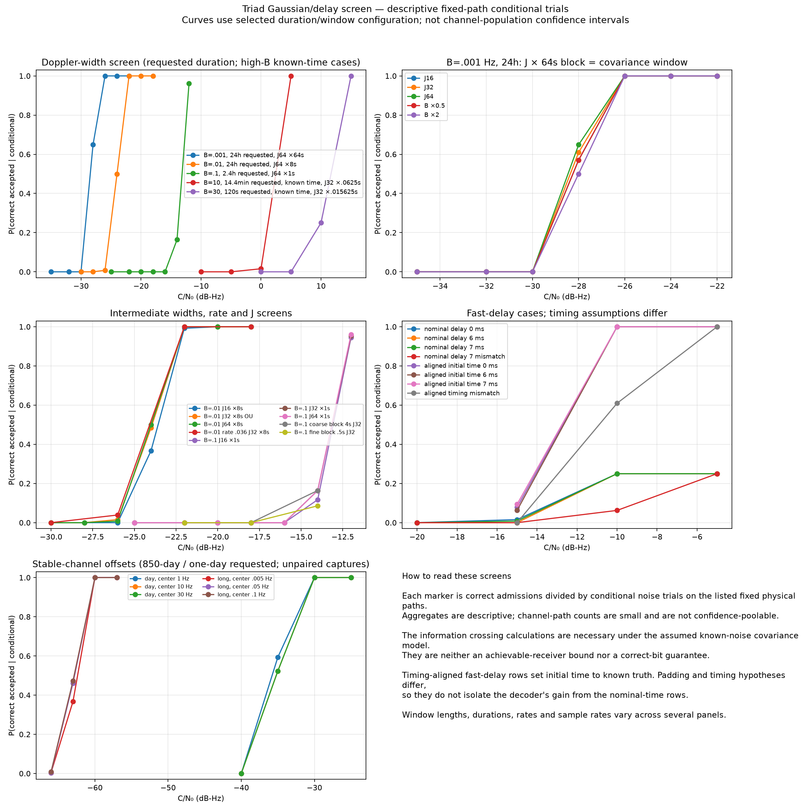

# Three-carrier Doppler/delay sensitivity study

This isolated v3 study distinguishes **stable ray-center separation** from
**stochastic Doppler spectral width**. Both can widen the received spectrum,
but only the latter necessarily introduces continually renewed random channel
uncertainty in the specified model. The experiments preserve the encrypted,
clock-addressed, shaped three-carrier waveform. They do not change or qualify
the ordinary Robust receiver.

The strongest new results are:

- With stable two-ray geometry, **−60 dB-Hz, 0.05 Hz ray separation and 5 ms
  excess delay** produced **300/300 correct accepted bits** over genuinely
  sampled observations of about **850 days**. This does not establish the same
  result for a 0.05 Hz stochastic linewidth.
- With Gaussian stochastic width **B = 2σ = 0.001 Hz**, the approximately
  one-day configuration produced **600/600 correct accepted bits at −25 dB-Hz**,
  including 300/300 for each source bit. At −27 dB-Hz it produced 279/300 under
  the strict gate and 290/300 under the relaxed gate.
- At **B = 0.01 Hz**, approximately one day and −22 dB-Hz produced **300/300**.
  At **B = 0.1 Hz**, approximately 2.4 hours and −10 dB-Hz produced **300/300**;
  a longer one-day diagnostic produced 32/32 at −16 dB-Hz, which is too small
  to establish 99% reception.
- The conditional Gaussian information bounds exclude −60 dB-Hz with
  0.001 Hz stochastic width within ten years under their stated power,
  waveform, channel and noise assumptions. They do not imply a universal
  propagation limit or a nonzero SNR floor at unlimited duration.

The primary table below contains **15 cohorts and 3,996 logical actual noisy
observations**. Their score arrays, exact planned seeds, source bindings and original/resumed
case identities passed an independent audit; archive status is stated under [Evidence and reproduction](#evidence-and-reproduction).
The smaller conditional screens reuse physical paths and are counted separately.
No wrong accepted bit was observed in these 3,996 primary observations; this is
an observation, not a bound on every operating condition.

## Implemented models and receiver scope

The new physical control `--ray-gaussian-width-hz B` adds independent stationary
proper-complex Gaussian-spectrum gains to the direct and delayed rays, retaining
the existing equal-power ray composition, delay and deterministic Doppler
centers. `B = 2σ` is separate from `--spread-doppler-hz`. The finite sampled
teacher uses an L2-normalized Gaussian FIR and initialized stationary history;
its actual kernel and RX physical timestep are exported. State advances through
silence, outages and chunk boundaries. Gaussian and OU evolution are alternative
controls; both default off. The capture check reserves six standard deviations
at each Gaussian spectral edge, with an explicit 8,193-tap capacity limit.
Neither the Gaussian tails nor that allowance are a strict bandlimit.
See the [channel contract](../../../channel-models.md#isolated-triad-long-span-path-evolution).

Physical delay/Doppler overrides now replace their own nominal preset dimension
before one margin multiplication. Receiver tap delay and Doppler remain
independent public hypotheses. This permits matched and deliberately mismatched
models without quietly deriving the receiver basis from simulator truth.

The added `gaussian-window-ucb` receiver retains complex joint three-carrier/tap
correlations. It integrates a Gaussian coefficient covariance over fixed,
nonoverlapping windows, using physical block-center timestamps. PSD square-root
and eigenvalue preparation handles rank-deficient Grams, and cached factors
support batched scoring and reuse across stationary noise upper bounds.
The existing static-FFT, Gaussian-OU and midpoint-CFO/OU receivers provide
comparisons. This is accumulation before nonlinear likelihood evaluation; it
does not multiply noisy fine-symbol carriers first.

The window receiver's coefficients are constant within each retained block and
independent across its window boundaries. The physical Gaussian FIR process has
neither restriction. Consequently this is a **reduced receiver model**, not an
exact likelihood for the physical teacher. Shorter blocks, longer windows and
assumed-width mismatch are sensitivity checks, even though the alternative's
likelihood is normalized. The Gaussian-window and Gaussian-OU methods have no
additional residual-CFO bank beyond the exported candidates; static FFT and
midpoint-CFO/OU have their separately declared CFO priors.

## Configuration and observation accounting

Unless explicitly marked known-initial-time below, the experiments use:

- RF center 8,270 Hz; independent base and shift `gpsdo-ocxo` presets; margin 1.
- Clock sync 10 ms, region width 1 ms, offset 0, audio error 70 ms. This gives
  an initial relative arrival interval of **±90.5 ms**. The exported timing
  bank contains only the nominal zero branch, clock branch zero and one keyed
  epoch. It is an approximate low-rate acquisition condition, not a proof of
  full blind acquisition over all recommended alternatives.
- Added Symbols multiplier 1, FHSS off, Symbol Burst off, additional
  frequency-selective perturbation off, diurnal evolution and outages off.
  Encryption, clock-derived keyed pattern addressing, whole-cell interleaving,
  shaping and source/channel tails remain enabled as applicable.
- Two public receiver taps matching each profile's delay and ray-center
  separation, except the explicit delay-mismatch controls. The window prior
  assigns power 0.5 to each tap.
- Total-triplet C/N₀ in dB-Hz. It is neither per-carrier C/N₀ nor in-band SNR.
  White proper-complex noise is generated at `variance = Fs / 10^(C/N₀/10)`.

The GUI-style inner rate is divided by six to obtain the fine rate per carrier
when Added Symbols is 1. Physical channel parameters and the waveform rate
therefore remain distinct. These presets are explicit simulation assumptions,
not measured sub-9-kHz or HF propagation/device models.

The requested active duration is rounded upward to complete private waveform
tiles. Capture duration additionally includes pulse support, arrival padding and
channel tails. All rows below process the entire modeled span; they do not
repeat a short capture or scale its energy to emulate a longer observation.

| Profile | Gaussian B (Hz) | Ray separation (Hz) / delay (ms) | GUI rate (Hz) | Requested active time (s) | Actual active time (s) | Complete capture (s) | Fs / block duration |
|---|---:|---:|---:|---:|---:|---:|---|
| G001 | 0.001 | 0.001 / 0.005 | 0.036 | 86,400 | 96,002.4 | 98,696 | 0.25 Hz / 64 s |
| G01 | 0.01 | 0.005 / 0.05 | 0.36 | 86,400 | 86,421.6 | 86,693.5 | 2 Hz / 8 s |
| G1-short | 0.1 | 0.1 / 0.5 | 3.6 | 8,640 | 8,661.6 | 8,690.875 | 16 Hz / 1 s |
| G1-day | 0.1 | 0.1 / 0.5 | 3.6 | 86,400 | 86,455.6 | 86,484.875 | 16 Hz / 1 s |
| Stable-long | 0 | 0.05 / 5 | 0.0036 | 73,440,000 (850 d) | 73,440,183.6 | 73,466,896 | 0.125 Hz / 8,192 s |

All Gaussian primary rows use 64 retained blocks per covariance window. The
stable row uses static FFT channel marginalization with a ±1 μHz common-CFO
prior; it does not use a 64-block independent-window model. C/N₀ is nominal
before the particular fading realization. To compare measured sample energy
with an energy allocation in seconds, divide `sum |x[n]|²` by **Fs**; do not
compare sample-energy sums directly with elapsed seconds.

## Primary actual-observation results

`Correct` means the receiver selected the transmitted bit and crossed the
specified admission gate. Every failure below was a miss, not a wrong accepted
bit. Relaxed results reclassify the same saved scores; they are not additional
transmissions. The listed lower bounds are pointwise one-sided 95% bounds on the mean
correct-reception probability of equally weighted bit strata. All-success cases
use the arithmetic–geometric mean bound; partial-success cases conservatively
combine per-bit Clopper–Pearson bounds with a Bonferroni allocation. They allow
the two bits to have different reception probabilities. Within each bit stratum,
independent identically distributed outcomes from the declared simulation
population are assumed. These are not simultaneous bounds over configurations.

| Cohort | Profile | C/N₀ (dB-Hz) | Actual trials | Strict correct / misses | Relaxed correct / misses | Strict balanced-mean 95% lower bound |
|---|---|---:|---:|---:|---:|---:|
| `g001-m28` | G001 | −28 | 300 | 172 / 128 | 246 / 54 | 49.02% |
| `g001-m27-refine` | G001 | −27 | 300 | 279 / 21 | 290 / 10 | 87.68% |
| `g001-m26` | G001 | −26 | 300 | 299 / 1 | 299 / 1 | 96.96% |
| `g001-m25-refine` | G001 | −25 | 600 | 600 / 0 | 600 / 0 | 99.50% |
| `g001-m24` | G001 | −24 | 300 | 300 / 0 | 300 / 0 | 99.01% |
| `g01-m24` | G01 | −24 | 300 | 154 / 146 | 239 / 61 | 43.06% |
| `g01-m22` | G01 | −22 | 300 | 300 / 0 | 300 / 0 | 99.01% |
| `g01-m20` | G01 | −20 | 300 | 300 / 0 | 300 / 0 | 99.01% |
| `g1-t8640-cn0m14` | G1-short | −14 | 300 | 55 / 245 | 138 / 162 | 12.50% |
| `g1-t8640-cn0m12` | G1-short | −12 | 300 | 295 / 5 | 300 / 0 | 94.83% |
| `g1-t8640-cn0m10` | G1-short | −10 | 300 | 300 / 0 | 300 / 0 | 99.01% |
| `g1-t86400-cn0m18` | G1-day | −18 | 32 | 26 / 6 | 29 / 3 | 54.64% |
| `g1-t86400-cn0m16` | G1-day | −16 | 32 | 32 / 0 | 32 / 0 | 91.06% |
| `g1-t86400-cn0m14` | G1-day | −14 | 32 | 32 / 0 | 32 / 0 | 91.06% |
| `stable-005-m60-complete` | Stable-long | −60 | 300 | 300 / 0 | 300 / 0 | 99.01% |

The −25 dB-Hz G001 cohort has 300/300 for **each** bit, giving a separate
pointwise lower bound of 99.006% per bit. A balanced 300/300 cohort has only
150 trials per bit, whose corresponding all-success lower bound is about
98.02%; its balanced-mean 99.01% figure does not establish a 99% bound separately for
each bit. At −27 dB-Hz the relaxed 290/300 balanced-mean lower bound is 92.41%, supporting
the relaxed 90% reception target for that declared population pointwise.
At −26 dB-Hz, 299/300 is encouraging but does not statistically establish 99%.
Neither 32/32 day-long result establishes 99% reception.

These are tested operating points and transition brackets, not exact boundaries.
For G001 the measured strict transition lies between the poorer −27/−26 points
and the demonstrated −25 point; G01 is bracketed by −24 and −22. G1-short
moves from 55/300 at −14 to 295/300 at −12 and 300/300 at −10. Extending G1 to
one day permits substantially weaker points, but the N=32 duration comparison
is a diagnostic and does not establish a strict duration law or 99% boundary.

The original stable-long export job exhausted its execution deadline after
**288/300** paths completed. Its original campaign and incomplete score report
are retained: they were not a 300/300 result. The 12 missing paths were resumed
with the **same planned seeds and configuration**, then all 300 logical paths
were scored in `stable-005-m60-complete`. The final table counts those cases
once; it does not count the resumed attempts as new independent observations or
erase the original timeout.

## Admission calibration

The strict target is 99% correct accepted reception with at most `10⁻⁴`
probability of any noise-only admission per 24 hours; the relaxed target is
90% correct with at most 0.01 per 12 hours. These are separate targets.
The scored family uses at most one completed attempt per 60 seconds, 16
receiver/model alternatives, eight duration alternatives and a maximum over
two bit mixtures. Half the false budget is allocated to scores and half to
residual-noise calibration. This yields strict score gate **22.7210633896** and
relaxed score gate **17.4227460230** in log-LR units.

Calibration policy is also part of the configuration. G001, G01 and Stable-long
use two allocated calibration alternatives, with strict per-segment failure
allowance `2.1701388889e−9`. G1-short and G1-day explicitly use one, giving
`4.3402777778e−9`. Identical score gates do not imply identical noise-calibration
policies. Selecting between those policies as additional online alternatives
would require the corresponding additional family allocation. Relaxed counts
here retain the original stricter calibrated scores and change only their gate.

The analytical allowance requires stationary white proper-complex Gaussian
noise and residual coordinates orthogonal to the **entire scored bank**.
One upper confidence bound is formed from actual noisy total energy and full-bank
projected energy per physical path. The receiver does not read simulator noise
variance, hidden means or noiseless signal energy. A fixed mismatched Gaussian
signal prior can lose sensitivity while preserving this null argument; colored,
impulsive or changing noise is not covered by it.

The conditional screens recorded no null admissions. Their 31,104 saved
method/condition decisions are correlated and reuse paths and noise draws; they
are **not 31,104 independent operational trials** and do not empirically verify
`10⁻⁴` per day. The operational statement remains a model-conditional family
bound, not a demonstrated continuous acquisition scheduler or an unrestricted
sequential stopping rule. Wrong-key signals are distinct from the noise-only
null and have no new broad qualification in this study.

## Receiver comparisons, delay and fast fading

The [screen summary](screen-summary.json), generated by
[`summarize_screen.py`](summarize_screen.py), records input hashes, receiver
configurations and 39 conditional curves. The figure uses **requested** active
durations; profiles differ in rate, sample rate and duration, so it is a
feasibility map rather than a controlled width-only sensitivity law.

For B=0.001 Hz at −28 dB-Hz, the same four sampled paths and 32 conditional
noise draws per path give 73/128, 79/128 and 83/128 strict admissions for
window lengths J=16, 32 and 64. OU gives 78/128 on the corresponding J=32
comparison. At −26 dB-Hz the J=64 screen gives 128/128. Assumed width 0.5× and
2× gives 73/128 and 64/128 at −28, against the matched-width J=32 result of 79/128.
These small conditional differences support window/width refinement; they do
not prove a universal ranking or quantify a robust mismatch margin.

Stable-ray screens cover separations 0.005, 0.05 and 0.1 Hz at 850 days, and
1, 10 and 30 Hz at approximately one day. The long screens give 256/256
conditional admissions at −60 dB-Hz for all three separations; the day screens
give 256/256 at −30. At −35 the day counts are 152/256, 134/256 and 134/256.
Sample rates and physical seeds differ across separations, so these are
configuration comparisons, not paired channel-realization differences. They
support the distinction between capture/search cost and stochastic coherence
loss; they do not establish multi-year stability of actual propagation.

The fast delay anchors use GUI rate 360 Hz and modeled delays 0, 6 and 7 ms.
At −10 dB-Hz, the original nominal-time configurations each yield 32/128
conditional admissions; using a mismatched 0.005 ms receiver delay on the
7 ms path yields 8/128. However, the physical arrival prior is ±90.5 ms while
the receiver searches only zero. That timing uncertainty is substantial at
this rate. Separate **known-initial-time** controls, with zero clock/region/
audio timing error, yield 64/64 for each matched delay. Their timing information,
capture padding and sample timeline change, so subtracting these results is
not a pure acquisition or delay-loss measurement. A fully searched high-rate
delay boundary remains unestablished.

Known-initial-time stochastic screens extend to B=10 and 30 Hz. At B=10,
GUI rate 36 Hz and about 864 seconds, conditional reception reaches 64/64 at
+5 dB-Hz. At B=30, GUI rate 360 Hz and about 120 seconds, it reaches 64/64 at
+15 dB-Hz. These four-path screens do not establish 99% path-population success.

A further compression comparison holds physical Fs/seeds and elapsed covariance
window duration fixed while grouping four fine blocks into one coarse block.
For B=10 at 0 dB-Hz, conditional counts change from 9/64 coarse to 13/64 fine;
for B=30 at +10 dB-Hz they change from 57/64 to 63/64. Actual sampled noisy
controls give 2/4 for both B=10 representations and 4/4 for both B=30
representations. The planned comparison and its limits are in
[`make_paired_compression.py`](reproduction/make_paired_compression.py).
The [paired compression audit](compression-audit.json) passed all eight pairs:
physical metadata and roots agree, capture intervals and row counts agree, and
fine-block Grams, means, actual noisy correlations and both energy sums aggregate
to their coarse counterparts (maximum absolute difference `1.46e−11`). This
verifies retained-statistic agreement; raw I/Q was not independently retained
for a bytewise raw-sample identity check. Even a confirmed comparison remains only four
physical paths. It does not establish that all high-width loss comes from
compression or that finer blocks always improve admission: residual calibration
rank and fixed-window duration also matter.

## Theoretical limits and remaining gaps

The [theory record](theory/README.md) distinguishes known deterministic-channel
presence references, Gaussian unknown-channel information necessities, and the
practical receivers. For unit white proper-complex noise and Gaussian signal
covariance K,

`D(P1 || P0) = tr K − log det(I + K)`.

Any detector with detection probability p and false probability α on that
specified observation model must satisfy `D >= d(p || α)`. This is necessary,
not sufficient; presence is easier than correct-bit identification. At small
covariance eigenvalues, `D ≈ tr(K²)/2`. For a fixed stochastic correlation
family this yields information scaling roughly as `(C/N₀)² T / B`, in contrast
to coherent known-channel energy scaling `(C/N₀) T`. Stable deterministic ray
separation is not B in this relation.

At −60 dB-Hz, Gaussian width 0.001 Hz and ten years, the constant-envelope
summed-ray KL upper bound is 0.0890 nats, below the strict one-completion
requirement 9.0622 nats and relaxed requirement 3.8206 nats. A separate bound
using the implemented pulse table's peak and continuous-energy bounds gives
0.8204–0.8207 nats across the studied low rates. Its strict/relaxed admission
upper bounds are about 13.14%/31.14%. These conclusions require the stated
continuous source/scatter/noise assumptions; they do not silently transfer to
point-sampled data. The separately qualified discrete FIR/interpolation bound
is weaker: 7.2671 nats and strict admission at most about 83.73% for its listed
integer-alignment/zero-clock-error cases. It does **not** exclude the relaxed
target. Numerical padding is not interval-arithmetic certification.

The [public-Gram information calculation](theory/actual_window_information.md)
connects actual sampled waveform designs to the **assumed independent-window,
block-center Gaussian prior**, with known noise and candidate synchronization.
For J=64, approximate necessary presence crossings and the lowest tested point
establishing a balanced-mean strict 99% lower bound are:

| Profile | Global one-completion necessary crossing | Current minute-family component-allocation crossing | Demonstrated strict point | Distance above global / allocated crossing |
|---|---:|---:|---:|---:|
| G001 | −31.03 dB-Hz | −28.83 dB-Hz | −25 dB-Hz | 6.03 / 3.83 dB |
| G01 | −26.66 dB-Hz | −24.59 dB-Hz | −22 dB-Hz | 4.66 / 2.59 dB |
| G1-short | −16.14 dB-Hz | −14.09 dB-Hz | −10 dB-Hz | 6.14 / 4.09 dB |

The global crossing uses the entire horizon false budget for one completion;
the allocated crossing imposes this study's specific minute/model/duration/bit
allocation. Neither is a promised achievable receiver threshold, nor an exact
physical-FIR correct-bit bound. The distances include bound looseness, noisy
calibration, acquisition assumptions and model/compression effects; they are
not all necessarily recoverable algorithmic loss. Thus this study does **not**
demonstrate universal optimality or a comprehensive near-bound receiver.

For the stable −60 dB-Hz case, the separate known-waveform presence reference
is 432.07 days under the imposed minute-family allocation, compared with the
850-day demonstrated point, about 2.94 dB of nominal duration/energy difference.
Unknown channel/synchronization and correct-bit reception are additional
requirements. It is not a proof that reducing transmission to 432 days is
achievable.

## Computation, precision and unfinished operating ranges

The physical exporter processes every sample through the selected shared channel
with continuous oscillator/path state. This avoids substituting a short repeated
path for a multiyear observation, but capture cost grows with Fs and duration.
Larger deterministic Doppler offsets therefore require wider sampled capture
even when coherent accumulation remains possible. Gaussian FIR cost also grows
with its explicit kernel length. The source, streaming channel and C++ receiver
retain their bounded state; exported receiver workspaces and cached window
factors grow with retained blocks and must pass memory preflight.

Gaussian-window preparation and sensitive reductions use FP64. The optional
FP32 path covers complex bulk products and disables TF32. Matched input checks
showed no bit or gate disagreement among CPU FP32, CPU FP64 and CUDA FP32 over
1,024 score rows per window comparison, with maximum absolute log-score
change `1.3569e−5`; the CFO CPU/CUDA comparison covered 128 rows with maximum
change `1.2345e−7`. These samples do not demonstrate parity arbitrarily close
to a decision boundary. The screen timings were collected under concurrent
load and are not isolated acceleration measurements.

The [isolated benchmark](reproduction/benchmark-summary.json) processed 1,024
conditional trials per control on each of two fixed G001 paths at −28 dB-Hz,
with CPU and GPU runs performed sequentially. All four jobs completed.

| Receiver | CPU / GPU complete process (s) | CPU / GPU receiver calls (s) | Complete-process ratio |
|---|---:|---:|---:|
| Midpoint CFO/OU, 128 frequency hypotheses | 105.572 / 12.110 | 98.431 / 6.096 | 8.72× |
| Gaussian-window J32 | 6.837 / 6.568 | 0.570 / 0.579 | 1.04× |

Input hashes, source/dependency hashes and noise schedules match. Across 4,096
score vectors per method, neither winners nor admission decisions changed.
Maximum log-score differences were `1.74e−7` and `1.44e−5`; the closest tested
scores were 0.00698 and 0.01469 from the gate, respectively. CFO and window
methods admitted 1,298/2,048 and 1,288/2,048 signal draws, with zero wrong
admissions and zero/2,048 null admissions each. These are conditional draws on
two physical paths, not new reliability or rare-false-tail qualification.

FP32 bulk work retains FP64 tap covariance, calibration, phase/frequency state
and likelihood reductions; TF32 was disabled. For window mode, sampling/UCB
cost 4.801/4.100 seconds and explicit plan preparation 0.070/0.068 seconds;
the GPU did not accelerate its receiver calls in this run. This is one paired
timing observation, not a universal hardware speedup. The larger CFO bank is a
throughput workload, not evidence that 128 frequency hypotheses are necessary
for this narrow GPSDO prior: CPU window scoring remained faster overall than
GPU CFO scoring. An initial benchmark-plan schema error launched no experiment;
the original plan and corrected plan are retained.

Useful next work is quantitatively bounded: carry Gaussian channel covariance
across window boundaries, test smoother state-space approximations against the
finite Gaussian teacher, add block-internal channel basis terms where compression
loss is measurable, and complete a timing/epoch/clock search at faster rates.
Delay mismatch and longer high-width observations require their own frozen
holdouts. These approaches must retain residual calibration degrees of freedom
and full family accounting. More flexible gains must not absorb the bit pattern.
No new generic result is established for free-running microwave acquisition,
impulsive/colored interference, real RF retuning, arbitrary outages, or all GUI
configurations. The new physical evolution models are not automatically inverted
by a validated duration planner; existing unsupported-planner status remains.

## Evidence and reproduction

Base source revision: `514b8961105d7ee69288c07a968f54b2b32b01c3`, with the
study's uncommitted implementation additions. Individual reports bind tool and
dependency hashes; campaign manifests retain commands, independent seed roots,
source fingerprints and binary hashes. The exact published or released modem
is not certified by this experiment.

The final local isolated check passed **14/14** using `./build.sh test triad`
with its compatible build profile and a writable `/tmp` compiler cache. The
first local attempt failed during compiler-cache setup on a read-only path;
the setup failure and corrected rerun are retained. The remote exact-C++ check
also passed 14/14. These are isolated triad checks; ordinary Robust integration
and its unrelated regression campaign were intentionally outside scope.

The maintained record includes:

- [Primary scoring plan](reproduction/primary-score-plan.json), original
  [holdout generation](reproduction/holdout-export-plan.json),
  [boundary follow-up](reproduction/boundary-export-plan.json),
  [G1 duration follow-up](reproduction/g1-export-plan.json), and
  [same-seed stable resume](reproduction/stable-resume-export-plan.json).
- [Development export plan](reproduction/screen-plan.json),
  [receiver screen plan](reproduction/score-plan.json),
  [known-time controls](reproduction/aligned-export-plan.json) and
  [compression controls](reproduction/compression-actual-export-plan.json).
- [Result analyzer](analyze.py), [analyzer checks](test_analyze.py),
  [screen summary](screen-summary.json), [theory](theory/README.md), and
  [compact evidence collector](reproduction/collect_evidence.py).

Plans contain exact argument arrays and per-job limits. The generation scripts
accept their documented root/output arguments; preserve the selected seeds,
physical settings and complete candidate family when relocating a run. Build
with `./build.sh test triad --cli`; the optional Python studies require NumPy,
SciPy and PyTorch. Run their focused tests with the same scientific environment.
The [independent primary audit](primary-audit.json) verifies all 3,996 planned
case indices, six separate seed roots, source and receiver/dependency identities,
exact generation commands and 23,976 primary input-hash receipts against the
full remote audit. All 516 recorded generation source files match this checkout.
The first 288 stable scores are bit-identical before and after administrative
resumption. This establishes recorded provenance; it is not a reproducible-build
proof of source-to-binary equivalence. See the [audit reproducer](reproduction/audit_primary.py).

The [archive verification receipt](archive-verification.json) binds the downloaded
139,317,355-byte archive by SHA-256:
`0993791313d687d2742495260266b330ef6f4b7177d4ffa31f687402c06906f0`.
It is stored in ignored `local-evidence/triad-spread-final/evidence.tar.gz`;
compact summaries and reproducible analysis tools are maintained here.
All 13,015 retained files were rehashed locally. The [final audit binding](primary-final-binding.json)
checks that adding the four benchmark reports changed none of the earlier 65
report records, input-hash checks or primary-plan bindings. The final full remote audit
checked 24,912 input-file receipts across 69 scoring reports; its primary plan
covers all 15 cohorts. Local inventory checks bind every one of those receipts
to the archived hash inventory.

The collector hashed 29,148 raw-array files (13,959,153,184 bytes), retaining
61,375,272 bytes in 11 selected workspaces and explicitly omitting 29,071 bulk
arrays. All score archives, manifests, commands, result logs and original failure
artifacts remain. Twelve partial validity masks from the timed-out export were
retained as explicit receipts after the collector correctly rejected their
unclassified `.tmp` suffix. Retained-workspace replay is possible; numerical
rechecking of omitted arrays requires regeneration. The hashes and remote checks
must not be presented as local re-execution of those omitted arrays.

The final full audit counts 78,592 conditional method/trial observations and
4,012 actual method/path observations: the latter comprise the 3,996 primary
cases plus 16 paired-compression scores. These totals include dependent receiver
comparisons; they are not independent physical-path or operational-admission
trial counts. Administrative failure auditing is separate, preserving the
original 288 completed cases and 12 missing exports without duplicating the
288 successful observations in the final campaign count.

The [local replay receipt](replay-receipt.json) records three bounded CPU FP64
replays from retained arrays: the G001 −26 dB-Hz miss, a G001 −25 dB-Hz success,
and the stable −60 dB-Hz success. All original settings, inputs and decisions
matched; maximum score differences were `1.28e−13`, `1.14e−13` and zero.
Each replay finished in under three seconds. The [replay script](reproduction/replay_retained.py)
retains exact commands; these replays add no independent physical trials.

The temporary GPU Pod and container storage were deleted after retrieval and
verification; the provider showed zero ongoing spend and no retained network
volumes. Provider account records and cleanup receipts remain outside the repository.
