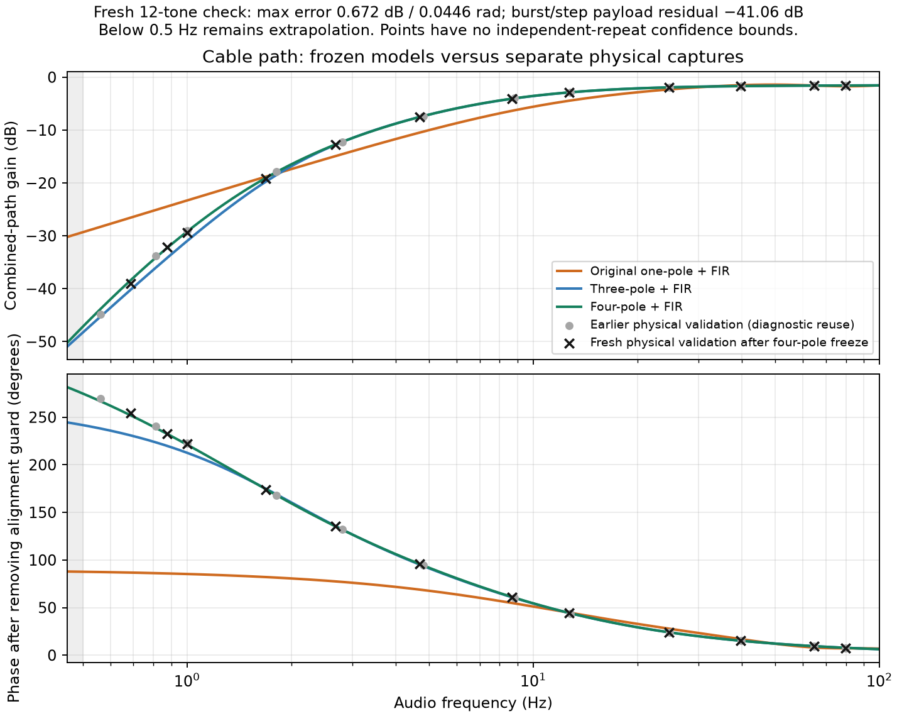

# Isolated three-carrier audio cable qualification, 2026-11-04

This record concerns the combined headphone-output → cable → microphone-input
path. It does not qualify a radio, independent RF oscillators, multi-day
physical reception, blind acquisition or operational false-admission rates.
Use the [maintained Live/Duplex guide](../../../triad-live-duplex.md) for the
hierarchy, commands and evidence grades. Ordinary Robust integration is outside
this study.

The original **24 physical captures are complete**, with one explicitly
unsupported audio geometry. An interruption after capture 18 was retained;
the continuation verified and reused those captures before completing the last
six. Additional concentrated low-frequency training and two separate validation
captures identified and corrected a substantial simulation-model error.

This qualifies the measured cable/model relationships below, not the whole
operational receiver. The maintained [evidence matrix](evidence-matrix.json)
separates complete waveforms, partial components, diagnostics and exclusions.
Raw PCM remains in ignored `local-evidence/`; the compact archive contains
receipts, identities, results and source snapshots, **not** every raw capture.

## Measurement boundary

- Realtek ALC257, Ryzen HD Audio Controller, physical `hw:1,0`.
- Headphone output and external microphone input were the active desktop ports;
  output-monitor sources are rejected by the runner.
- Raw ALSA stereo S16_LE, 48,000 frames/s, automatic conversions disabled.
  Both capture channels are retained; channel zero is fixed for analysis.
- The ALSA utilities' actual format logs, fatal discontinuity handling, PCM
  hashes, command arguments and process cleanup are part of each receipt.
- The suite does not change mixer settings. Source/server settings are retained
  before and after. Raw hardware access bypasses desktop resampling, not the
  physical analog filters or codec conversion.
- S16 is the software PCM contract, not an effective ADC-bit measurement.

The production audio API originally requested mono capture. This raw codec
configuration requires stereo, so the first native attempt stopped before
playback. That original unsupported result is preserved. The subsequent
[native stereo follow-up](native-stereo-followup.md) corrected the production
backend and independently exercised it on the same cable. The original campaign
below remains an ALSA-utils measurement, not a retroactively native observation.

## Diagnostic ladder and prior evidence

A low-level desktop cable pilot established a live physical return without
clipping. A 57.6-second raw stereo training probe then completed in 61.96 seconds,
with no discontinuities or near-fullscale samples. Its peak capture was about
0.25 full scale. Training estimated approximately 11.4 Hz high-pass behavior and
−1.50 dB main-band gain; those are combined-path estimates.

A separate three-capture smoke run took 61.42 seconds, plus approximately
1.75 seconds of planning/preparation. A frozen training model predicted an
independent probe with −43.14 dB waveform residual and the complete 3.6-kHz-rate
triad with −49.49 dB residual. Energy prediction errors were below 0.001 dB.
The known-alignment diagnostic selected bit one, the transmitted bit. These
whole-stimulus pilot figures include public measurement markers; payload-only
metrics are required for weak and near-DC cases.

The source bridge has an independent sampled-grid check: 2520-Hz native source
resampled to 48 kHz versus independently rendered native 48-kHz source differed
by 0.223% RMS after aligning the declared payload origins. Audio roundtrip error
was 0.0264% RMS. An initial comparison incorrectly aligned absolute coordinates
instead of payload halos; both that failure and the corrected reference remain
retained. No payload fitting was used to align the corrected source references.

## Measured coverage and results

The frozen plan contains 24 physical stimuli and one explicit unsupported
near-Nyquist coordinate. It requires 1511.636 seconds of stimulus time, with
39.195 seconds of input preparation and about 0.905 seconds of planning. The
complete-command limit is 2900 seconds, including prior planning/preparation.

The factorized census covers 180 coordinates: ten requested rates, three Added
Symbols factors, three center-frequency policies and FHSS off/on. It reports
96 native configurations and 84 native rejections. Among the census rows,
45 are eligible for full physical capture, 21 require component/prediction
coverage, and 30 have unsupported real-audio geometry. Eligibility is not a
measurement or a receiver-performance result.

The complete captures cover high rates through 24 kHz, raised/near-edge audio
centers, low-rate Added ×100/×1000 patterns, a 149.6-second source calendar with
realized Fake-FHSS/burst gaps, and shared-channel HF/Aurora replay with Each25 or
Each65 selective modulation. Actual-rate windows cover the rates whose full
patterns require hours or days. A 420-second multitone payload supplies direct
low-frequency evidence; it is not time-compressed modem reception.

At 48 kHz sampling the 24-kHz-rate, 16-kHz-center coordinate lacks the declared
image/filter-transition clearance. The plan preserves that exclusion and tests
a supported 15.5-kHz center. Nominal triplet bandwidth is not a strict support
bound for finite pulses or Doppler/modulation sidebands.

There are 13 complete native waveform captures, eight actual-rate source
windows, two held-out physical probes and one broad training capture. Three of
the complete waveforms replay simulated HF/Aurora propagation through the
cable. All 24 successful captures used the verified stereo 48-kHz PCM format;
there were no reported discontinuities or near-full-scale samples. The separate
device-busy attempt is preserved as an unsuccessful attempt, not erased from
the record.

Selected **payload-only** results using the original frozen broad-band model:

| Physical case | Energy prediction error | Residual power / actual power | Interpretation |
|---|---:|---:|---|
| Rates 3.6, 12, 18, 24 kHz at supported centers | Approximately 0.001 dB | Approximately −49 dB | Complete audio-band waveforms closely predicted |
| Rate 24 kHz, center 15.5 kHz | 0.048 dB | −28.72 dB | Supported near-upper-band boundary; larger finite-band error |
| Rate 1 Hz, Added ×1000 | 0.002 dB | −49.44 dB | Complete long source pattern, original time coordinate |
| Rate 10 Hz, Added ×100 | 0.002 dB | −48.62 dB | Complete spreading case |
| HF worst, margin 3, Each25 | 0.002 dB | −48.31 dB | Synthetic propagation plus physical cable |
| HF worst, margin 3, Each65 | 0.003 dB | −50.20 dB | Strong selective modulation preserved |
| Aurora worst, margin 3, Each65 | 0.002 dB | −41.15 dB | Strong spread/modulation case |
| Fake FHSS with realized Symbol Burst gaps | 0.003 dB | −42.53 dB | Waveform model succeeds; original timing bank fails, as described below |

These are fixed-model errors, not fitted residuals. The numerical results,
denominators, source identities and conditional classification curves are in
the matrix/archive. They must not be substituted for independent hardware
error-rate measurements.

The deliberate low-level case generated only PCM codes −4 through +4, with
53.95% zero samples. Playback quantization reduced payload energy by 2.64 dB
relative to floating-point playback. Actual full-band payload energy was
13.45 dB above the deterministic prediction because the physical noise floor
dominated; its residual was −0.20 dB. A coherent pattern projection still chose
the correct bit in this capture. This does **not** make quantization or ADC
noise negligible: marker-inclusive residuals and additional-noise curves alone
would conceal the issue. Use available headroom rather than treating four PCM
counts as a generally qualified operating level.

## Low-frequency model failure and independent correction

The original one-pole-plus-FIR model matched the principal audio band but
predicted the 1-Hz phase incorrectly and nearly doubled its measured amplitude.
A 420-second low-frequency probe exposed the mismatch. At 0.005 and 0.05 Hz
the components were below a useful residual floor; at 0.0005 Hz the observation
contained only 0.21 cycles. These remain unidentified steady-state responses.
Endpoint transients in short low-center source windows cannot supply their
missing steady-state gain.

A separate 140.6-second concentrated training stimulus was used to fit a small
stable causal extension. The initial three-pole extension passed 10 of 12
fresh resolved tones and failed the two below 1 Hz. Those failures are retained.
A single four-pole alternative was then fitted to the **same training data**:
two real high-pass poles plus a biquad, still implemented in two SOS sections
with four states. No fifth-order search was performed. The old validation was
used diagnostically, not presented as independent qualification of the new model.

The four-pole profile and a fresh 85.6-second validation stimulus were frozen
before a new physical capture. All 12 resolved tones from **0.6875 to
79.6875 Hz** met the recorded 2-dB / 0.2-radian engineering envelope:

- Maximum absolute gain/phase errors: **0.672 dB / 0.0446 rad**.
- At 1 Hz: **−0.152 dB / 0.0160 rad**.
- Complete independent payload, including burst/step behavior: **+0.00216 dB**
  energy error and **−41.06 dB** fixed-model residual.
- Frozen-profile analysis took **4.34 seconds** and did not refit the capture.

The envelope is not a simultaneous confidence interval. This is one physical
validation capture containing multiple tones, not 12 independent hardware
trials. Training begins at 0.5 Hz; below it the fitted curve is extrapolation.
The measured validation support begins at 0.6875 Hz. Near-DC full-bit reception,
long-term drift and independent oscillator behavior remain unqualified.

A retained-capture check with the final profile also preserved the near-upper-band
and Aurora/Each65 predictions: changes relative to the original model were
below 0.000001 dB in energy error and 0.00008 dB in residual ratio. This two-case
transfer check took 2.07 seconds; the full original campaign was not silently
relabeled as a fresh physical run of the final model.

## Acquisition-bank failure

The original Fake-FHSS fixture declared a public ±90-ms arrival uncertainty but
exported a zero-offset-only diagnostic bank. Public audio markers remove cable
transport delay; they do not remove the independently simulated source-arrival
offset. Consequently both the actual capture and its accurately predicted
waveform selected the wrong nominal candidate, retaining only approximately
1.41×10⁻⁵ of the observed energy. This is a serious diagnostic-bank omission,
not evidence of a cable-induced sensitivity loss. The nominal failure remains
in the results.

The follow-up froze the public ±90-ms range before scoring either bit, with
four fractional sample phases and exact endpoints: **693 timing alternatives**.
Linear FFT correlations use shifted-template energy on one fixed validity mask;
templates, gaps and tails are not circularly wrapped. Both capture and model
selected the correct bit at **−47.395833 ms**, with represented-energy fractions
**0.977963 / 0.978019**. The two searches took **0.393 / 0.392 seconds**;
reusing the retained capture still required 35.42 seconds of audio/model/DDC
preparation, explicitly included in the 36.23-second follow-up cost. Routine
analysis shares that preparation with its other diagnostics.

This is a post hoc method diagnostic using public search bounds. It does not
calibrate the increased noise maximum, solve the remaining approximately 2.2%
projection loss, or establish blind acquisition/admission performance. The
bounded helper explicitly rejects unsupported multi-column or oversized searches.
That remaining fraction corresponds to about 0.10 dB; this cable diagnostic
does not justify a substantially more expensive search to remove it.

## Interpretation rules

Public probe markers establish timing. They are measurement aids, not additions
to the modem wire format or evidence of blind synchronization performance.
The frozen audio filter applies to the full composite, and its state/tails
continue through gaps. Both bit hypotheses use public templates and the same
operator. Truth labels only score the result.

Conditional classification curves use paired proper complex white noise added
after capture/DDC. Their joint retained covariance preserves candidate
dependence. Pointwise Wilson intervals concern generated-noise trials conditional
on one physical capture. They are not independent hardware reliability, colored
ADC-noise validation, continuous false-admission bounds or authenticated
reception. Noise-floor comparisons are separately reported.

The engineering review envelope is 0.5 dB energy prediction error and residual
power below −20 dB for supported, complete, high-level waveform payloads.
These are interpretation thresholds, not a future statistical guarantee or
an operational receiver gate. They were recorded after the separate smoke run
and before inspecting the complete campaign's held-out results. Weak and
near-DC signals additionally require noise-floor and identifiability checks.

## Reproduction and cheap follow-up

Build the optional tools as described in the maintained guide. NumPy/SciPy are
required for the Python analysis; the local run used `/tmp/triad-weak-env/bin/python`
with `OPENBLAS_NUM_THREADS=2 OMP_NUM_THREADS=2`. Do not assume this temporary
interpreter path exists on another host.

The [compact evidence archive](compact-evidence.tar.gz) and
[artifact manifest](artifact-manifest.json) retain exact source snapshots,
plans, receipts, profiles, failures and diagnostic recipes. Small files reached
through continuation links are materialized; the archive has no external
symlink dependency. Raw PCM is deliberately omitted. Its hashes and retained
local paths are recorded, so full waveform reanalysis requires those local
captures or a new explicitly identified physical run. The
[packaging script](package_evidence.py) can verify retained PCM and regenerate
the compact record without replaying audio.

Retain and reuse raw captures for analysis-only changes. A model change fitted
using these holdouts needs new independent physical validation; reprocessing
an old capture does not create another hardware trial. Device, route, PCM mode,
rate or mixer changes invalidate the corresponding physical profile.

## Time and efficient routine use

| Work | Measured wall time |
|---|---:|
| Original planning and preparation | 40.06 s |
| Original capture/inline-analysis command, including device-busy stop | 1495.45 s |
| Continuation, verifying/reusing 18 captures and completing six | 311.69 s |
| Original campaign active total | **1847.20 s (30.79 min)** |
| Additional payload-only reanalysis during development | 131.61 s |
| Concentrated LF training capture | 145.24 s |
| Three-pole validation capture | 90.09 s |
| Fresh four-pole validation capture | 90.26 s |
| Four-pole validation analysis / main-band transfer check | 4.34 s / 2.07 s |
| Retained FHSS timing follow-up, including preparation | 36.23 s |

The original run also had an estimated 681.76-second human pause while device
ownership was resolved. These are active work measurements, not proof of an
uninterrupted session. Pilot runs, compilation, software development and the
small separate model-fitting/figure costs are not hidden in the routine total.

The new full plan explicitly freezes model order four and its separate
validation variant. It has **26 physical stimuli**, 1737.84 seconds of stimulus,
and a **2545.84-second (42.43-minute) planned envelope**, including 208 seconds
of capture overhead and 600 seconds for analysis/finalization. It has not been
replayed from scratch merely to obtain an uninterrupted green result. The
original campaign, focused refinement and retained-capture checks supply its
component evidence; the next routine run must still report its actual total.

For receiver-only changes, reuse captured PCM and DSP preparation. For model
changes, first replay retained captures; use new physical holdouts when model
selection has used the old holdouts. For a route/device/mixer change, repeat
training and independent verification. Near-DC identification and days-long
stability require longer or different fixtures; no abbreviated test converts
them into measured full-bit results. No cloud GPU was needed for this campaign:
real-time cable observation dominates, and the remaining computation is short.

## Software checks

The new source-window test passed, including source equivalence, bounded cache
memory and partial-file preservation. The isolated `triad` group initially
passed 14 of 15 checks. The remaining configuration fixture predated the
8193-tap Gaussian-history guard: its 0.001-Hz width at Fs=64 required 203,721
taps. The positive metadata fixture now uses supported 0.05 Hz and retains
0.001 Hz as an explicit negative guard check; its focused regression passed.
The final isolated `triad` group passed **15/15** checks in **36.11 seconds**.
The native capture guard tests passed **6/6**, without opening audio. Focused
Python model/bridge/ALSA/campaign checks passed **70/70** in **3.03 seconds**
including interpreter startup. Exact source identities and test logs are retained
with the evidence. No ordinary receiver regression campaign was run.

The production capture limitation was corrected in the
[native stereo follow-up](native-stereo-followup.md). Remaining exclusions are
substantive: real radios and RF retuning, independently clocked
oscillators, near-DC steady-state responses below measured support, multi-day
physical operation, calibrated operational admissions and hardware reliability
under repeated independent trials. They are not counted as passed coverage.
