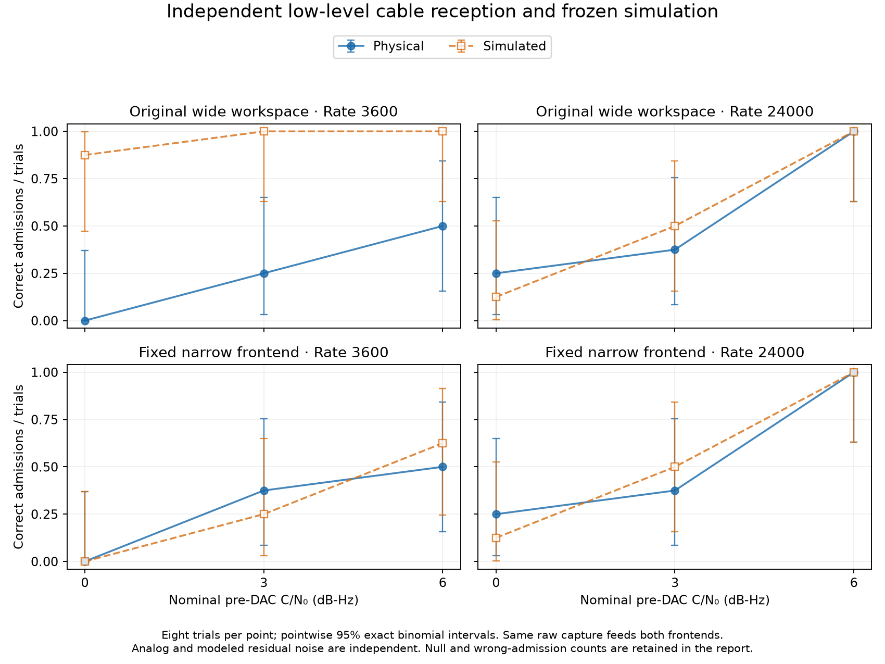

# Cable margin follow-up: physical noise and receiver bandwidth

This continues the [actual reception study](../2026-11-04-live-reception/README.md)
with repeated physical inputs, absolute-level variation and independent weak
reception trials. It uses the Realtek ALC257 headphone-to-microphone cable at
48 kHz, stereo S16, fixed capture channel zero. No mixer settings are changed.
This is the isolated receiver with public-marker timing and fixed keyed epoch;
ordinary Robust integration, blind acquisition and independent RF clocks remain
outside scope.

## A real discrepancy, and its location

The previous transmitted-noise-dominated comparisons hid a low-level problem.
Two new passes of 22 identical records cover pre-DAC noise RMS 0.1, 0.03, 0.001
and 0.0001, with complete baseline/edge patterns, noise-only and quiet records.
Both passes complete without clipping or discontinuity. Signal-to-noise ratio
within each case is fixed while absolute output level spans 60 dB.

The original baseline workspace has **4.2–5.3 dB more quiet power than its
model predicts**, although the three intended 750-Hz regions agree within about
−0.24 to +0.22 dB in these quiet probes. Spectral inspection locates the excess
near **1–2 Hz in audio**, translated to approximately −1725 Hz in baseband.
The old image-rejection filter has a broad transition extending through that
frequency. Its 5040-sample/s output retains more than the intended 2250-Hz
triplet. The receiver's whole-workspace energy estimate therefore includes
low-frequency hardware noise outside the signal band.

This is not a uniform 4-dB in-band noise penalty. The original quiet profile
has only 11.71875-Hz spectral resolution and does not identify this very-low-
frequency noise law. Increasing all simulated in-band noise by 4 dB would be
the wrong correction.

The optional [`triad_live_narrowband.py`](../../../../tools/triad_live_narrowband.py)
operator applies the same fixed causal low-pass to observations and every public
template column. Its pass edge is half the nominal triplet bandwidth, stop edge
0.6 times that bandwidth. Both tested geometries use **115 FP32 taps**; measured
passband error is at most 0.00102 dB and the dense-grid stopband maximum is
−79.80 dB. It retains streaming FIR state, excludes finite-window startup
support and checks complete template tails through the maximum searched lag.
It does not alter transmitted patterns or propagation.

Applied to the repeated diagnostic recordings, the narrower frontend gives:

| Diagnostic | Baseline | High-edge case |
|---|---:|---:|
| Quiet total power minus model, observed range | −0.079 to +0.042 dB | −0.015 to +0.049 dB |
| Quiet template-weighted PSD variance ratio, both bits | −0.052 to +0.109 dB | −0.003 to +0.051 dB |
| Total power minus model at noise RMS 0.0001 | −0.022 to +0.032 dB | +0.004 to +0.028 dB |

These are observed diagnostic ranges, not universal 95% bounds on future
receiver sensitivity. PSD weighting assumes stationary covariance within each
window. The same four quiet observations are reused for both candidate patterns;
they are not eight independent hardware samples. Repeat-difference spectra,
individual residual spectra, cross-spectra and early/late quiet powers are
retained, so shared interference is not silently removed by differencing.

## Distortion, phase and quantization

At higher levels, much of the edge waveform residual is explained by a stable
approximately **0.8-degree common phase difference**, with only about +0.004 dB
gain difference. The receiver already fits an unknown complex channel gain.
A residual expressed relative to a very small thermal-noise floor is therefore
not itself a sensitivity loss or evidence of severe nonlinear distortion.
Diagnostic transfer projections never normalize or modify receiver input.

The original no-added-noise floor levels could quantize to zero or almost zero
in S16. This follow-up explicitly quantizes the complete signal-plus-noise
composite once. At the lowest level, transmitted test noise dithers the S16
codes; signal-induced code changes are retained in the evidence even when the
isolated signal would vanish. This exposes physical ADC/path noise without
pretending that an all-zero transmitted signal measures analog sensitivity.
It is a measurement stimulus, not a recommendation to spend operational
transmit power on added noise. Pure analog attenuation and higher-resolution
production playback remain different experiments.

## Historical local gain comparison

The original 72 successful-capture signal observations were compared with five
exactly re-quantized forward predictions at signal-gain offsets −1, −0.5, 0,
+0.5 and +1 dB. Original physical scores, receiver and gates remain unchanged;
the original campaign source is loaded from its exact archived bytes. All
zero-offset PCM and both-bit likelihood checks match exactly.

| Case | Identifiable local inverses | Observed equivalent-gain range |
|---|---:|---:|
| Baseline | 23/24 | −0.0306 to +0.0163 dB |
| Edge | 17/24 | −0.0381 to +0.1873 dB |
| Added ×100 | 23/24 | −0.1671 to +0.0383 dB |

**Nine inversions remain unidentified**, and eight score margins lie outside
both declared gain envelopes. Flat/nonmonotonic or unbracketed curves are not
dropped from the denominator. A wrong/noise-driven candidate need not have a
useful local equivalent-SNR inverse. Classification-envelope agreement follows
already from the original zero-offset agreement and supplies no independent
narrow-bound proof. This 360-score replay took 198.98 seconds; it did not repeat
hardware recordings.

## Independent low-level receiver comparison

The frozen next stage uses a new clock-derived epoch/key fixture, noise RMS
0.0001, **39 shared physical calibration nulls**, and separately calibrated wide
and narrow frontends. Independent validation has eight trials per case at
nominal pre-DAC 0, 3 and 6 dB-Hz, balanced across both bits, plus 16 shared fresh
nulls. Baseline and edge cases share physical nulls, not independent null
denominators. The forward profile, including its original quiet PSD, is retained.

The algorithm and parameters are frozen before calibration PCM is inspected and
before validation capture. A per-record rank gate at alpha 0.05 remains an
experimental comparison, not a daily false-admission guarantee. Narrow filtering
colors the noise; the kernel's analytic Gaussian admission is still discarded.
The finite CFO bank modulates already-filtered templates, a retained small
approximation for ±0.06 Hz versus transitions of at least 225 Hz.

All held-out captures completed cleanly. Each SNR cell below is
**physical / simulated correct admissions out of eight**. Every remaining
signal trial is a miss: there were no wrong-bit admissions under either frontend.
The null column is **physical / simulated false admissions out of 16**.

| Case/frontend | 0 dB-Hz | 3 dB-Hz | 6 dB-Hz | Fresh nulls |
|---|---:|---:|---:|---:|
| Baseline, original wide | 0 / 7 | 2 / 8 | 4 / 8 | 0 / 12 |
| Baseline, narrow | 0 / 0 | 3 / 2 | 4 / 5 | 0 / 0 |
| Edge, original wide | 2 / 1 | 3 / 4 | 8 / 8 | 1 / 0 |
| Edge, narrow | 2 / 1 | 3 / 4 | 8 / 8 | 1 / 0 |



The main demonstrated improvement is **prediction fidelity**, not a proven
large physical sensitivity gain: baseline physical admissions increase only
6/24 to 7/24, while the simulation's optimistic 23/24 falls to 7/24. Edge totals
are 13/24 for both physical and simulated reception. Narrowed reception has six
individual signal-decision disagreements in 48 signal recordings and one null
disagreement. The independent analog/model noise realizations can change
marginal outcomes; exact per-record agreement is not required.

There are **48 unique physical signal transmissions**, not 96 independent
frontend trials. Eight successes out of eight have a two-sided 95% binomial
lower limit of only 63.1%; zero false admissions out of 16 have a two-sided
95% upper limit of 20.6%. This sample does not qualify 90–99% reception,
operational rare false admissions or a sub-dB shift in a full receiver BER
curve. Remaining misses also depend on the receiver's channel prior, search
and gate; they are not proved to be exclusively hardware limitations.

## How narrowly is the physical/model difference bounded?

The retained analysis estimates a matched-filter proxy
`loss_dB = 10 log10(V_physical/V_model) - 20 log10(|gain_physical/gain_model|)`.
Noise variance is PSD-weighted by fixed public templates. Gain uses the complex
cross-spectrum of known transmitted noise and physical output. Both are
evaluation-only; they never correct or normalize receiver observations.

The original two diagnostic passes alone give wide pass-cluster engineering
intervals: approximately **±3.13 dB baseline** and **−1.06 to +1.08 dB edge**.
That failed narrow-bound attempt is preserved. Reusing the 39 calibration and
16 independent validation nulls supplies two more physical captures without
additional hardware time. The resulting **nominal 95%, assumption-dependent
intervals for the mean matched-filter proxy** are:

| Case | Four-pass mean-loss engineering interval |
|---|---:|
| Baseline | −0.154 to +0.143 dB |
| Edge | −0.043 to +0.091 dB |

The calculation retains per-record and per-pass estimates and allocates error
probability across the noise/gain components and both bit templates within
each case. It does not count Welch bins as independent hardware populations.
The original public spectral weights remain fixed across passes, so this proxy
does not certify every new keyed acquisition bank.

These intervals rely on stationary covariance within windows and a Student
approximation for a small number of pass effects. Passes have unequal numbers
of records and share one codec/session. Exact 95% coverage is unproven; these
are **not individual future-pass prediction bounds, full-receiver BER shifts,
or distribution-free equivalence certificates**. The validation-only mean
proxy is about −0.012/−0.021 dB for baseline bits and +0.044/+0.053 dB for edge
bits. Removing a diagnostic common complex gain changes validation-null
residual power by less than 0.00055 dB baseline and 0.00183 dB edge, supporting
the interpretation that these residuals are dominated by noise rather than a
large deterministic transfer error.

Thus narrow within-session model agreement is supported for the tested bands
and levels. A rigorous future-session or sub-dB operational receiver guarantee
still requires more independent physical environments and reception trials.

## Transport and scope

The previous native playback requests 100-ms buffering. The existing raw-ALSA
test backend negotiates 24064 frames (501.33 ms), with 6016-frame periods, on
both endpoints. A short identical-PCM comparison passes on both backends.
The new experiments use the larger-buffer backend and retain exact format,
PCM, continuity and marker receipts. This isolates transport tolerance; it does
not identify the original scheduling/driver cause or fix production playback.
Both earlier failed floor captures remain excluded.

Fixed public chirps precede even quiet records. The resulting noise and settling
measurements are conditional on that schedule. The shared codec clock cannot
qualify independent oscillators, radios, AGC, RF retuning or multi-day behavior.
The new measurements do not qualify an entire millihertz-rate bit.

The optional frontend comparator explicitly accepts only the flat baseline and
edge cases qualified here. Doppler, oscillator uncertainty and modulation
sidebands require a larger justified capture/passband envelope. Do not insert
this nominal-width filter ahead of an unqualified wide-frequency acquisition or
apply it unchanged to the strong-spread case. The generic FIR accepts a public
bandwidth; selecting that bandwidth remains a physical modeling responsibility.

## Cost, evidence and cheap reproduction

Six capture commands completed with no xruns or clipping, totaling **1780.02
seconds (29.67 minutes)** and 151 records including repeats, calibration and
transport checks. Mixer settings are byte-identical before/after, the devices
are released, and no cloud instance was launched. This is summed capture-command
time, not total elapsed development time or complete broad-suite qualification.

Major software costs were 61.76 seconds for repeated-level analysis, 198.98
seconds for the full historical gain replay, 132.23 seconds for calibration,
149.50 seconds for independent receiver validation, and 122.84 seconds for the
staged noise-bound calculations. A one-time 132.06-second calibration replay
followed input-identity/passband guards being tightened; all **312 numerical
score pairs matched exactly**, and both source versions/results remain retained.
Routine execution does not duplicate that replay or repeat historical research.
The final **98 focused Python tests passed in 3.40 seconds**; eight strong-signal
functional checks also selected the correct bit in both frontends. These checks
support the implementation and do not replace physical evidence.

The [compact archive](compact-evidence.tar.gz) contains the protocols, source
snapshots, gates, per-record outcomes, raw diagnostic estimates and reproduction
scripts. The [manifest](artifact-manifest.json) binds every retained entry.
Large raw PCM/native arrays/workspaces remain in ignored
`local-evidence/triad-live-margin-bounds-001/`, with a streamed hash inventory.
Their historical physical noise cannot be regenerated from seeds. Native fixture
and model provenance also refers to the preceding reception study.

Fast hardware-free checks:

```sh
OPENBLAS_NUM_THREADS=2 OMP_NUM_THREADS=2 python3 -m unittest discover \
  -s tests -p 'test_triad_live_*.py'
```

Rescore the existing independent capture with the final frozen calibration,
using a fresh output directory and the matching numerical environment:

```sh
OPENBLAS_NUM_THREADS=2 OMP_NUM_THREADS=2 python3 tools/triad_live_frontend_compare.py \
  --prepared local-evidence/triad-live-margin-bounds-001/low-validation \
  --capture local-evidence/triad-live-margin-bounds-001/low-validation/capture.f32 \
  --metadata local-evidence/triad-live-margin-bounds-001/low-validation/capture.json \
  --calibration local-evidence/triad-live-margin-bounds-001/low-calibration-analysis-guards \
  --output local-evidence/triad-live-margin-bounds-rescore
```

The physical preparer is `tools/triad_live_level_probe.py`; repeated-waveform
diagnosis is `tools/triad_live_level_analysis.py`. New physical records require
explicit `triad_live_alsa.py --live --exclusive` raw endpoints and complete
continuity receipts. The frontend comparison also requires the receipt's exact
transmitted-input hash. Legacy native receipts lacking that binding are not
accepted by this new comparison path. Use the frozen plans and
[Live/Duplex guide](../../../triad-live-duplex.md) rather than rerunning old long
floor playlists. New channel, passband, mixer, arithmetic or preprocessing
conditions require new calibration/qualification; do not transplant these gates.
