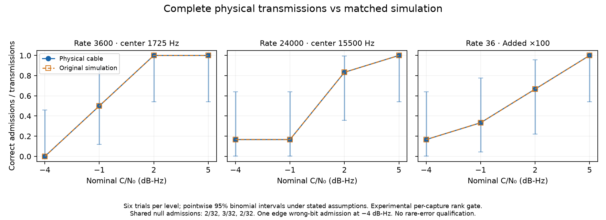

# Actual three-carrier reception through the audio cable

This experiment sends complete encrypted, clock-addressed v3 patterns through
the Realtek ALC257 headphone-to-external-microphone cable, then runs the maintained
isolated FFT acquisition/likelihood receiver on the captured PCM. It compares
those outcomes with a frozen audio simulation of the **same transmitted
signal-plus-noise samples**. It does not integrate the ordinary receiver.

The primary physical and original simulated classifications agree on all
**72 signal trials** and all **96 configuration-specific null decisions** from
32 shared physical null records. That includes an accepted wrong bit and
noise-only admissions; agreement does not mean every reception succeeded.

## Receiver and admission boundary

`tools/triad_live_receiver.py` reuses unchanged `FFTWorkspace` and
`score_workspace` computations, both public bit alternatives, unknown complex
channel gains and the complete declared timing/CFO bank. Public measurement
chirps condition audio transport offset and relative clock. The remaining
search is approximately ±5 ms with integer steps on the receiver grid and five
CFO values from −0.06 to +0.06 Hz. The keyed epoch and clock hypothesis are fixed.
This is **marker-conditioned offline decoding of physical transmissions**, not
blind acquisition, a new chirp-bearing modem format, or real-time scheduling
qualification.

Physical PCM is not relabeled as a Gaussian simulation. The working likelihood
retains its Gaussian residual normalizer, but its analytic admission guarantee
is discarded. Thirty-nine predeclared physical nulls calibrate each complete-bank
statistic with `p=(1+count(null_score >= test_score))/40`; admission requires
`p<=0.05`. Ties are conservative. The same frozen physical gate scores both
physical and simulated observations. This is a marginal per-capture rank test
**conditional on exchangeable null records**, not a conditional guarantee for
that frozen threshold, a suite-wide guarantee, authentication, or `1e-4/day`
qualification. Fresh nulls test the realized behavior.

No template, threshold, gain, timing prior or precision is adjusted in response
to the validation outcomes. The receiver uses FP32 bulk arithmetic and the
existing explicit higher-precision preparation/reductions. Native manifests'
Gaussian eligibility flags remain untouched. Unit tests check raw-kernel
parity, reuse, both bits and nonzero arrival, rejection guards and rank-gate math;
they do not substitute for these physical observations.

## Primary margin results

Independent pre-DAC noise has fixed RMS 0.03 in audio sample units. Signal gain
is `sqrt((2*0.03^2/48000)*10^(C/N0/10))`. The noise and signal pass through the
same DAC, cable and ADC. This is **transmitted test noise**, not independent RF
receiver-input AWGN or a measurement of radiated watts. No observed payload is
amplitude-normalized.

Each cell below gives **correct / wrong / missed admissions**, out of six
physical transmissions, with three trials of each bit. Original simulated
counts are identical in every cell.

| Configuration | Useful source time | −4 dB-Hz | −1 dB-Hz | +2 dB-Hz | +5 dB-Hz |
|---|---:|---:|---:|---:|---:|
| Rate 3600, Added ×1, center 1725 Hz | 8.8 s | 0 / 0 / 6 | 3 / 0 / 3 | 6 / 0 / 0 | 6 / 0 / 0 |
| Rate 24000, Added ×1, center 15500 Hz | 8.8 s | 1 / 1 / 4 | 1 / 0 / 5 | 5 / 0 / 1 | 6 / 0 / 0 |
| Rate 36, Added ×100, center 1725 Hz | 10.8 s | 1 / 0 / 5 | 2 / 0 / 4 | 4 / 0 / 2 | 6 / 0 / 0 |



Fresh noise-only admissions were respectively **2/32, 3/32 and 2/32**, with the
same original simulated decisions. These are shared captures processed by
three different banks, not 96 independent hardware nulls. Their pointwise
95% exact-binomial intervals are approximately **0.77–20.81%**, **1.98–25.02%**
and **0.77–20.81%**, under the stated Bernoulli assumptions. Repeated codec and
session state are not independent hardware populations.

Six successes in six trials have a two-sided 95% lower confidence limit of only
54.1%. The observations locate a transition on this three-dB grid; they do not
qualify 90% or 99% reception, a sub-dB sensitivity difference, or a universal
margin. Counts remain conditional on the chosen keyed pattern, geometry and
this physical setup.

The labels above are nominal unit-power pre-DAC C/N0. An evaluation-only
ADC-referred convention uses measured null PSD averaged over each nominal
occupied band and independently modeled useful signal energy. Its corrections
are about −0.020 dB, +0.042–0.044 dB and −0.018 dB respectively. Colored noise
has no unique scalar C/N0. These estimates do not alter receiver samples and do
not measure an absolute RF noise figure.

## Strong channel replay and an admitted wrong bit

A separate four-trial screen replays the maintained sampled channel through the
cable: HF worst, margin 3, hence 21-ms ray delay and 90-Hz separation, with
**Each 65%** frequency-selective modulation. Native sampling is explicitly
4800 Hz; the automatic narrower sampling geometry rejected this configuration.
The receiver uses only the public static two-ray basis, not the actual selective
modulation realization. This is synthetic propagation through real audio,
not measured RF multipath.

At nominal +2 dB-Hz, physical and original simulated reception each admitted one
correct and one wrong bit. At +14 dB-Hz both admitted both bits correctly. The
actual native energy exceeds the nominal unit allocation by 1.43–1.50 dB; it is
not silently normalized away.

Reusing the 32 independent validation null records with this fourth receiver
gave **0/32 physical and 0/32 simulated false admissions**, using the original
39-record stress gate. This additional scoring cost 54.53 seconds, without more
hardware time. The one-sided 95% upper bound is still 8.94% under independent
stationary-trial assumptions; this is not proof of a zero false-admission rate.

The retained wrong-bit diagnostic finds approximately **70.4%** clean-signal
representation in the nominal correct-bit static basis: about **1.52 dB loss**.
The chosen wrong acquisition alternative is favored by the noisy observation;
it is not aligned with the clean signal. A hidden-channel, evaluation-only
matched-shape projection prefers the true bit on both physical and simulated
observations. That projection neither whitens the colored noise nor supplies a
calibrated admission, and its hidden channel is unavailable to the practical
receiver. It demonstrates a gap worth retaining, not an achieved replacement
or a reason to claim catastrophic waveform indistinguishability. One selected
failure cannot establish its frequency. No threshold was changed to remove it.

## Explained high-frequency model discrepancy

The original LF4 profile's transfer training stops at 20999.75 Hz. Its deliberate
cosine taper from there to Nyquist underpredicts the cable's high-edge response.
Broadband physical calibration noise exposed approximately +0.110 dB excess
energy in the edge receiver and about −20 dB composite prediction residual.
This is an identified extrapolation limit, not evidence of an inherently
unmodelable hardware effect.

A forward-only correction uses records 0–19 of the null calibration playlist.
It retains the **same 1025-tap causal FIR**, LF4 SOS sections and noise surrogate,
blending the measured upper-edge response into the existing filter. The profile
is frozen before evaluation on records 20–38, which are excluded from fitting
but had previously been available to receiver calibration analysis.

On those 19 fitting holdouts, edge median energy error changes from
**+0.109866 to +0.002577 dB** and residual from **−20.0309 to −35.8025 dB**.
Baseline-band results remain effectively unchanged. Training and holdout
computation cost 7.49 and 36.97 seconds, with no additional hardware capture.
The original receiver/templates/gates are preserved; this correction changes
only the forward prediction. Near-Nyquist response includes this measurement's
fractional-marker interpolation, so independent capture transfer needs checking.

That transfer check now uses all 56 edge-configuration observations in the
separate validation capture (24 signal records and 32 shared nulls). Median
energy error improves from **+0.112509 to +0.004890 dB**; residual relative to
actual energy improves from **−19.9618 to −35.9019 dB**. Median absolute
likelihood-score difference from physical reception falls from **0.350862 to
0.031952**; maximum difference falls from 1.76102 to 0.17730. Both original and
corrected predictions retain exactly the physical admission classifications.
The baseline and spreading observations remain effectively unchanged.

This forward-only replay costs 231.62 seconds, including 32.31 seconds to
reconstruct physical aligned waveforms. It does not rescore physical reception.
An initial replay correctly stopped because its shortcut interpolated float32
PCM while the primary `align_capture` promotes to float64. The corrected replay
uses the same promotion and reproduces every original energy/residual metric
within the original `1e-7 dB` guard. The first failure and source are retained;
no tolerance, receiver, gate or trained profile was changed. The fitting script's
own float32 reconstruction remains frozen, and the separate float64-aligned
capture supplies the stronger transfer check.

## Audio continuity failure

The first no-added-noise floor playlist completed its wall-time run but reported
an **audio output underrun**. Its 686.32-second capture is marked incomplete and
is excluded from all reception counts. No thresholds or individual records are
salvaged from it. The adapter records the discontinuity and reason but not its
precise onset, so it cannot establish which subrecords remained unaffected.

One repeat of the unchanged, frozen playlist, with numerical workers stopped,
also reports an output underrun after 686.33 seconds. Both 59-record captures
are excluded in full, without receiver scoring. The repeated failure rules out
concurrent analysis as a sufficient explanation; the cause is not established.

Public-marker diagnostics find a **17.04-ms** interruption in the first attempt,
and **40.92-ms and 12.83-ms** interruptions in the repeat. Source inspection
confirms the reported error comes from ALSA `-EPIPE` during a nonempty PCM write,
not the separate EOF/drain path. Capture itself reports no discontinuity. The
wrapper continues after recovery but marks the complete capture invalid.
These are real transmitted timing gaps, not merely a terminal status warning.
Do not salvage individual records from this protocol or repeat the full floor
playlist until a concrete continuity diagnosis or fix warrants it. Event-time,
PCM-buffer and write/recovery telemetry would be the next focused diagnostic.

A linear audio transfer model does not predict OS/driver output underruns.
Real-time endpoint continuity is a separate requirement from offline sensitivity.
The measured transfer discrepancy was explainable and improved with the same
filter size. The remaining finite residual combines physical noise, timing and
model error; this study does not identify a fundamentally unmodelable waveform
effect. Exact analog noise realizations are stochastic, and the independently
drawn residual model is only a stationarity approximation.

## Cost, reproducibility and retained evidence

The seven hardware runs consumed **3404.44 seconds (56.74 minutes)** in total.
The five continuity-valid runs consumed **2031.79 seconds (33.86 minutes)**,
containing 158 records including the reference, pilot, calibration and validation.
The two invalid attempts contain 118 attempted records, with no admission
results. Thus this development experiment **did not meet the 50-minute target**.
Analysis and preparation are additional, sometimes overlapping costs; this is
not an end-to-end automation benchmark. Main calibration and validation analysis
took 151.86 and 203.08 seconds, respectively. The 84 Python Live/Duplex checks
passed in 2.30 seconds; no fresh native C++ regression campaign is claimed.
No cloud instance was needed or launched. Mixer settings are byte-identical
before and after the experiment; all audio processes have exited.

The [compact evidence archive](compact-evidence.tar.gz) retains the frozen
protocol, source snapshots, input/build hashes, raw per-record scores, gates,
failure receipts and reproduction scripts. Its
[artifact manifest](artifact-manifest.json) gives entry hashes and sizes.
The 2,768,688-byte archive has 497 entries, independently checked for hashes,
sizes and safe regular-file paths. The raw-input inventory covers 86 files
totaling 1,523,388,603 bytes without embedding them.
Large PCM and native arrays remain in ignored
`local-evidence/triad-live-reception-001/` and the pilot source directory; their
hash inventory is inside the archive. Historical physical PCM cannot be
regenerated from seeds. A new cable run is an independent physical repetition,
not an exact replay of that analog noise. The source baseline was
`3a943c245a00f5212dc52c059e58caacc0218eb5`; the archive snapshots and execution
freeze bind this task's additional Python tools to the measured runs.

The [corrected upper-edge profile](audio-profile-upper-edge.json) is specific to
this codec, routing, mixer and measurement frontend. It is a forward-model
correction, not a newly calibrated receiver profile. Preserve the original
profile when reproducing the frozen gates and primary analysis.

Minimal hardware-free checks, with NumPy, SciPy and CPU PyTorch installed:

```sh
OPENBLAS_NUM_THREADS=2 OMP_NUM_THREADS=2 python3 -m unittest discover \
  -s tests -p 'test_triad_live_*.py'
```

To rescore the retained successful physical validation without recording again,
use a fresh output directory (the tools intentionally refuse overwrite):

```sh
OPENBLAS_NUM_THREADS=2 OMP_NUM_THREADS=2 python3 tools/triad_live_margins.py analyze \
  --prepared local-evidence/triad-live-reception-001/validation \
  --capture local-evidence/triad-live-reception-001/validation/capture.f32 \
  --capture-metadata local-evidence/triad-live-reception-001/validation/capture.json \
  --calibration local-evidence/triad-live-reception-001/calibration-analysis \
  --output local-evidence/triad-live-reception-rescore
```

For a new physical comparison, follow the [Live/Duplex guide](../../../triad-live-duplex.md#actual-receiver-admissions-on-cable-captures).
The archived plans specify seeds 95102/95201/95301 for calibration/primary
validation/stress, fixed epoch 1793821728, exact fixtures, record order and gains.
Use explicit raw ALSA devices, stereo S16 at 48 kHz and fixed logical capture
channel 0. Inspect each continuity receipt before any receiver analysis. Start
with a short transport check; do not blindly rerun the long floor playlist or
the earlier research campaigns. Archived diagnostic scripts have local paths
that must be adapted when replayed elsewhere.

## Limits and evidence status

The **no-added-noise hardware floor remains unqualified** because both captures
failed playback continuity. The software explicitly refuses those captures.
Full real-time reception and the complete less-than-50-minute Live/Duplex
hierarchy are not qualified by the successful offline comparisons.

No independent-radio oscillator, GPSDO, antenna, RF retuning, AGC-equipped radio,
multi-day stability or complete millihertz-rate bit is qualified here. Fake
FHSS/burst physical captures from the earlier Live/Duplex study remain waveform
and bounded timing diagnostics; this study does not relabel them as calibrated
admission trials. The four selected regimes are representative measurements,
not exhaustive coverage of all combinations.
