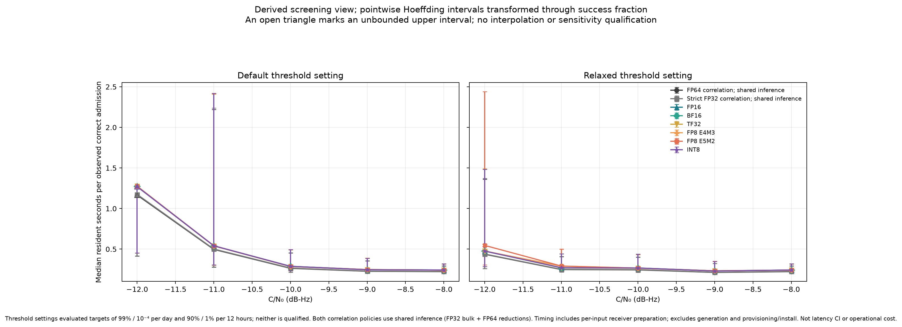
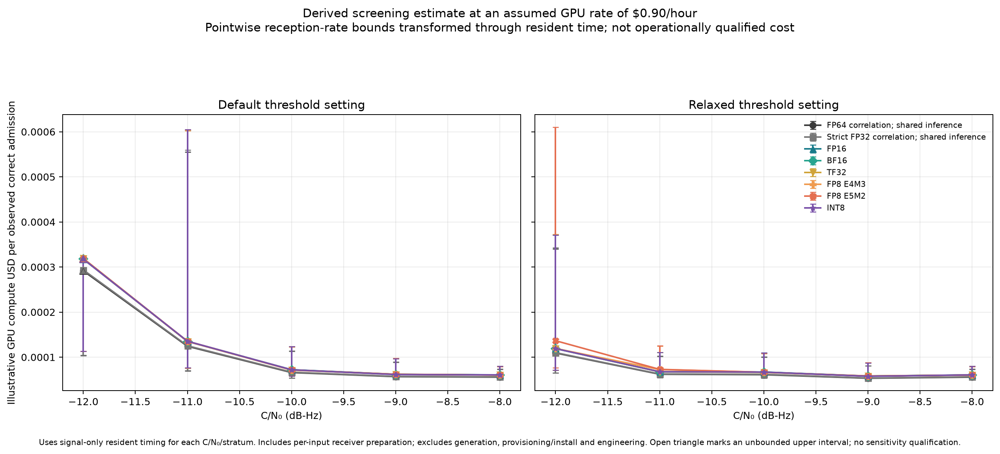

# Evidence for GPU precision and control decisions

Start with the [precision-control guide](../../../gpu-precision-controls.md)
for stage costs, precision risks and the distinction between the existing CPU
Search arithmetic dropdown and proposed GPU experiment controls. This page maps
its measured claims to retained results, including unsuccessful optimizations.
It does not qualify a receiver or promote a precision policy.

The repository contains six source/result/input archives totaling 103.9 MB
(decimal). [catalog.json](catalog.json) identifies **159 distinct archived
files in 21 evidence groups**, with exact member paths, byte counts and SHA-256
hashes. These are selected entry points, not a replacement for the full archive
contents and their original manifests. Eleven small logs are also copied here
for direct browsing; the validator checks them against the archived bytes.
No result below depends on an ignored `local-evidence/` directory.

## Archives and source binding

| Catalog archive ID | Repository archive and report | Contents and important limit |
| --- | --- | --- |
| `optimization` | [Evidence](../2026-11-01-optimization/evidence.tar.gz), [report](../2026-11-01-optimization/README.md), [stage table](../2026-11-01-optimization/precision-stages.md) | Paired FP32/FP64 hour inference, FP64 reduction organizations, preparation/reuse timing and checks. |
| `optimization-inputs` | [Fixed inputs](../2026-11-01-optimization/fixed-inputs.tar.gz) | Actual fixed hour payloads; does not include every later physical holdout. |
| `optimization-source` | [Source overlay](../2026-11-01-optimization/source-overlay.tar.gz) | Original implementation and tests, separate from current working-tree source. |
| `tensor` | [Evidence](../2026-11-01-tensor/evidence.tar.gz), [report](../2026-11-01-tensor/README.md) | Recurrence arithmetic, native instructions, long-duration/interference results, traces, final source and failures. |
| `fp4` | [Technical evidence](../2026-11-01-fp4/technical-evidence.tar.gz), [report](../2026-11-01-fp4/README.md) | Blackwell/MIG experiments, sampled frontend/quantization diagnostics, independent holdout, native dense FP4 instructions and source/exporter. |
| `consumer` | [Technical evidence](../2026-11-01-consumer-gpu/technical-evidence.tar.gz), [report](../2026-11-01-consumer-gpu/README.md), [protocol](../2026-11-01-consumer-gpu/PROTOCOL.md) | RTX 4090 measurements, source variants, independent holdout scores, CPU/CUDA traces, sustained replay, numerical defects and corrections. |

Source snapshots, exporter identity, seeds and per-case commands must travel
with the result. Test source alone is not evidence of execution. Current source
can evolve independently; use the archived source/hash for reproduction of an
old measurement. Ordinary receiver [tuning tests](../../../../tests/test_tuning.cpp)
and [GUI tests](../../../../tests/test_gui_controller.cpp) linked from the guide
are implementation references, not newly executed tests in this evidence audit.

## Result map

Member names below are **inside the named archive**. Braces abbreviate named
variants; the catalog contains every selected exact path and hash. For the
consumer rows, `C/` means
`triad-consumer-gpu-evidence/stage5/consumer-results/`. For tensor rows, `T/`
means `evidence/`. For FP4 rows, `F/` means `technical-evidence/`.

### Optimization and recurrence

| Group | Archive member entry points | What they establish / do not establish |
| --- | --- | --- |
| O1 | `optimization`: `gpu/results/5090-numeric-hour-graph-{fp32,fp64}-b1.json` and `.scores.npz` | Same fixed hour and nuisance model: 0.202/0.704 s inference. Not complete acquisition or sensitivity equivalence. |
| O2 | `optimization`: `gpu/results/5090-fp64-reduction{,-reversed}.json`, `5090-reduction-check.json`; `checks/python-tests.json` | About 1.15× surrounding inference gain from two **FP64** organizations, despite a slower isolated reduction. Cached covariance preparation and complete versus resident timing are recorded separately. No FP32-versus-FP64 reduction necessity claim. |
| O3–O4 | `optimization-inputs`: `inputs/hour/*`; `optimization-source`: `tools/triad_{phase_reduction,gaussian_prepared}.py` and corresponding tests | Fixed bytes and original source to reproduce those comparisons. |
| T1 | `tensor`: `T/screen/results/b1-{bf16,bf16-split2}-bc128.{json,npz}`, `T/micro.json` | Plain lower-precision recurrence failed development likelihood gates; multi-component modes improved accuracy but remain experimental. |
| T2 | `tensor`: `T/final/results/isa-fused/`, `T/final/results/validation-profile-v2/profile-baseline/`, `T/screen/results/ncu-counter-probe.stdout` | PTX/SASS and event traces; FP64 partial-reduction kernel share. Hardware utilization counters were denied. |
| T3 | `tensor`: `T/final/results/validation-physical-v2/actual-two-day-baseline-{baseline,bf16-split2,tf32x3}.json` and `actual-hour-null-interference-{baseline,bf16-split2,tf32x3}.json` | Actual sampled long-duration and interference failures, including a null-interference reference gate crossing. Not successful operational calibration. |
| T4 | `tensor`: `T/checks/{tensor-final-cpu-check,optimization-final-check,resident-final-check}.log`, `T/source-final/tools/triad_phase_tensor.py` | Historical CPU checks and source. CUDA checks explicitly unexecuted by CPU-only invocations. |

### Native FP4 and physical quantization

| Group | Archive member entry points | What they establish / do not establish |
| --- | --- | --- |
| F1 | `fp4`: `F/gpu-5090/results/probe-{nvfp4,mxfp4}-v2-isa/product.{ptx,sass,cubin}`, `F/static-kernel-analysis/summary.json`, `F/gpu-5090/results/ncu-good.log` | Dense native floating FP4 instruction evidence and static estimates. Counters remain unavailable; product speed is not receiver speed. |
| F2 | `fp4`: `F/gpu-5090/results/diagnostic-v2/index.json`, `frontend-adc-dac16-nominal-{strict,template-only,observation-only,both}-b1.{json,npz}` in that directory | Actual sampled observations distinguish fixed-template approximation, nonlinear observation quantization and joint loss. The full index includes further frontend/interference diagnostics. |
| F3 | `fp4`: `F/gpu-5090/results/holdout-v1/index.json`, `F/holdout-evidence/holdout-inputs/holdout-summary.json`, `F/gpu-{5090,pro}/results/whole-scan-{fp32,native}.json`, `F/gpu-mig/results/hardware-receiver/index.json` | 753 physical cases and paired policies, hardware/workspace measurements and failures including the day miss. Broad correlation-only and complete receiver workloads remain distinct. |
| F4 | `fp4`: `F/source-final/tools/triad_fp4_native.py`, `F/exporter-current/`, `F/holdout-evidence/{generate-holdout,run-campaign}.py` | Exact implementation/exporter and regeneration instructions. Raw holdout arrays are omitted, as detailed below. |

### Consumer tensor arithmetic and receiver costs

| Group | Archive member entry points | What they establish / do not establish |
| --- | --- | --- |
| C1 | `consumer`: `C/tensor-tests-final-signedzero.log`, `C/correlation-tests.log`, `C/workspace-tests.log`, earlier failure logs | Final RTX 4090 tests and defects fixed before final validation; direct copies below. |
| C2 | `consumer`: `C/scaling-diagnostic{,-extended}.json` | Subnormal restoration and FP8 conversion defects. A small FP64 epilogue repairs arithmetic; this is not evidence that bulk FP64 is required. |
| C3 | `consumer`: `C/partial-accumulation.json`, `C/partial-accumulation-artifacts/fp8-e4m3-constructed-large-plus-small-partial-32-outer-fp32.ptx` | K32 FP32 outer sums reduce represented-input arithmetic loss; FP64 outer sums are slower and give the same sampled answers here. |
| C4 | `consumer`: `C/holdout-{final,verified}/index.json`; root `holdout-policy-freeze.json`, `input-binding-check.json`, `holdout-inputs/index.json` | Initial 1,024 setup failures distinguished from corrected 1,024 paired policy evaluations on 128 physical captures. Scores and margins are retained. Zero of 32 null admissions does not qualify tiny operational tails. |
| C5 | `consumer`: `C/profile-{fp32,fp16}/{profile.json,torch-trace.json.gz}`, `C/{ncu.log,nsight-systems-availability.log,hardware.json}` | Correlation/packing's small kernel-time share, CPU traces and actual platform. Not measured SM/tensor utilization, occupancy or DRAM traffic. |
| C6 | `consumer`: `C/sustain-{fp32-b1,fp16-b1,fp16-b8}/{sustain.json,sustained-receiver.json}` | Complete fixed-capture replay: 63.15/61.71/47.20 captures/s. FP16 and larger copied batches did not improve receiver throughput. Not independent-trial or continuous-streaming qualification. |
| C7 | `consumer`: `C/probe-fp16{,-final}.json`, `C/tile-sweep-fixed/index.json`, `C/tile-sweep.log` | Packing-inclusive shape/tile costs, unsupported shapes and initial setup failure. Synthetic arithmetic checks do not qualify reception. |
| C8 | `consumer`: root `cpu-representation/representation-screen-final.{json,py}`, `C/representation/index.json` | Sampled development template-only/observation-only/joint representation tests. Independent holdout tests joint quantization; separate-operand holdout reception remains unmeasured. |
| C9 | `consumer`: root `MANIFEST.json`, `SHA256SUMS`, `source-final/`, `exporter/`, `study/{generate-inputs,run-campaign,analyze}.py` | Full source/input bindings, exporter and reproduction scripts. Original and failed source variants remain in the archive. |

The root for C4/C8/C9 members is `triad-consumer-gpu-evidence/`.

## Directly browsable execution logs

These are byte-for-byte copies of **historical executions**, not newly run DSP
tests. The catalog binds each copy to its archive member. Source snapshots and
software/device versions are in the corresponding archive/report.

| Log | Recorded outcome |
| --- | --- |
| [Consumer final tensor](test-results/consumer-tensor-final.log) | RTX 4090: 14 tests passed. |
| [Consumer exhaustive correlation](test-results/consumer-correlation.log) | RTX 4090: 15 tests passed. |
| [Consumer workspace](test-results/consumer-workspace.log) | RTX 4090: 8 tests passed. |
| [Consumer provenance](test-results/consumer-provenance-local.log) | Local CPU environment: 14 tests passed. |
| [Initial fused packing](test-results/consumer-fused-packing-failure.log) | 9 tests ran, 6 failures; retained failure evidence. |
| [Intermediate scaling correction](test-results/consumer-scalingfix-intermediate.log) | 10 tests ran, 2 failures; later conversion corrections were still needed. |
| [Initial tile sweep](test-results/consumer-tile-setup-failure.log) | Directory-creation setup failure, not a receiver miss. |
| [Counter probe](test-results/consumer-counter-denial.log) | `ERR_NVGPUCTRPERM`; counters were not obtained. |
| [Gaussian preparation](test-results/optimization-gaussian-preparation.log) | 5 CPU tests passed. |
| [FP64 reduction check](test-results/optimization-reduction.log) | CPU numerical diagnostic JSON; CUDA portion explicitly unexecuted. |
| [Tensor CPU diagnostic](test-results/tensor-cpu-final.log) | CPU representation checks; CUDA portion explicitly unexecuted. |

## Input retention and remaining limitations

The fixed optimization hour and consumer development IQ are retained as actual
payloads. Large later physical/holdout arrays, including the 128 consumer
holdout captures, are **not all stored in the repository**. Their archived
exporters, producer sources, commands, independent seed roots, manifests and
input hashes support regeneration. Follow each campaign's protocol and binary/
library requirements; verify regenerated hashes before claiming byte-identical
paired inputs. This audit did not regenerate those large inputs or rerun GPU
reception. A portable analysis of saved scores is different from a waveform
rerun and from an independently seeded new holdout.

The evidence preserves likelihood/ranking errors, wrong/null admission counts,
setup failures and unsuccessful speedups. It does not resolve the 99% and
10⁻⁴/day target, the relaxed 90% and 1%/12-hour target, or the
0.1/0.25/0.5/1 dB sensitivity-loss budgets. Unsupported tails and model mismatch
remain in the individual reports. No ordinary Robust integration/regression
campaign was performed for this documentation/evidence update.

## Verify and reproduce the retained analysis

From the repository root, this read-only validator checks complete archive
hashes, selected regular-file members, copied logs and Git ignore status. It
does not execute archived code or qualify a receiver:

```sh
python3 docs/validation-data/triad-v3/precision-controls/verify-evidence.py
```

The saved [integrity result](verification.json) records six archives, 159
selected files and eleven copies passing. It also records working-tree status
at audit time: the consumer evidence and new copies were untracked, **not
ignored**. New files must be included when committing this work; a successful
hash check does not imply a commit or publication. [SHA256SUMS](SHA256SUMS)
binds the new map, helpers and derived artifacts.

To inspect a record without extracting a directory:

```sh
tar -xOf docs/validation-data/triad-v3/2026-11-01-optimization/evidence.tar.gz \
  gpu/results/5090-fp64-reduction.json
```

The archived consumer analyzer was also run from a separate extracted directory,
without `local-evidence/`. All numerical summary values matched; the only 13
summary differences were relocated paths. Twelve analyzer-produced PNGs were
byte-identical. This verifies reproduction, not the correctness of every old
aggregation: the cost-plot issue described below is preserved in that replay.
The [portable comparison](portability-check.json) and
[comparison helper](verify-portable-analysis.py) record the exact bindings and
allowed path differences. To repeat with Python, NumPy and Matplotlib versions
from that record (3.13.5, 2.5.4 and 3.11.2 respectively), use an empty destination
directory. These are the analyzer rerun environment, not the earlier GPU image:

```sh
mkdir /tmp/triad-evidence-replay
tar -xzf docs/validation-data/triad-v3/2026-11-01-consumer-gpu/technical-evidence.tar.gz \
  -C /tmp/triad-evidence-replay
python3 /tmp/triad-evidence-replay/triad-consumer-gpu-evidence/study/analyze.py \
  --root /tmp/triad-evidence-replay/triad-consumer-gpu-evidence/stage5/consumer-results \
  --plot-dir /tmp/triad-evidence-replay/plots \
  > /tmp/triad-evidence-replay/report.txt
python3 docs/validation-data/triad-v3/precision-controls/verify-portable-analysis.py \
  --portable-root /tmp/triad-evidence-replay \
  --output local-evidence/triad-analysis-portability-recheck.json
```

One older PNG, `plots/resident-seconds-per-correct-capture.png`, lacked a retained
renderer. It remains in the original consumer directory with its original hash.
The new [standalone renderer](plot-resident-sensitivity.py) closes that gap for
a clearly labeled derived view of the archived summary; it does not claim to
recreate the unknown original plotting code. Its [80 derived points](resident-sensitivity-points.json)
include source hashes and transformed pointwise Hoeffding bounds. Eight upper
intervals are unbounded. The statistic is median resident time divided by
observed correct-admission fraction, with timing held fixed; it is neither a
latency confidence interval nor cost per operationally validated result.

The audit also found that the original cost analyzer grouped timings only by
policy and C/N0, pooling 32 null timings with 16 signal timings at −10 dB-Hz.
The new renderer separates signal strata, excludes null timings, and requires
timing counts to match both trials and distinct inputs. The point record
quantifies pooled versus corrected medians; reception counts and underlying
measurements are unchanged. Pooling overstated the −10 dB-Hz cost proxy by
1.47–3.33%, depending on policy. The corrected cost view uses the same declared
$0.90/hour assumption. Historical analyzer/plots remain unchanged for audit.
The portable comparison helper also independently recomputes all 80 derived
points from signal-stratum timings and saved outcomes, checking counts, medians,
fractions, transformed bounds and cost scaling without importing the renderer.

```sh
python3 docs/validation-data/triad-v3/precision-controls/plot-resident-sensitivity.py \
  --summary docs/validation-data/triad-v3/2026-11-01-consumer-gpu/analysis/summary.json \
  --output /tmp/triad-resident-sensitivity.png \
  --cost-output /tmp/triad-cost-sensitivity.png --hourly-rate-usd 0.90 \
  --points /tmp/triad-resident-sensitivity-points.json
```




